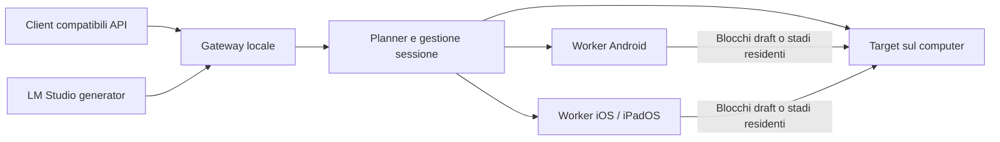

# ExpandMyHW — assessment prima dell'implementazione

31 ottobre 2026. Priorità dell'utente: **velocità superiore al solo computer**, con telefoni/tablet locali. Il caricamento di modelli più grandi è un secondo beneficio, da misurare separatamente. Questo documento conserva l'assessment iniziale. Aggiornamento successivo: nome **NodeLift**, inventario fornito e companion di qualificazione sviluppate; vedere [stato implementazione](docs/COMPANION_0_1.md). Nessun runtime LLM distribuito o accelerazione misurata.

## Raccomandazione

L'idea merita un esperimento, ma un plugin che «aggiunge RAM e CPU» non basta. Servono un runtime di inferenza distribuita, worker nativi mobile e adattatori per le applicazioni. La difficoltà principale è trovare lavoro delegabile che riduca il percorso critico invece di aggiungere attese.

L'host osservato è un Apple M3 Max con 64 GiB e 16 core CPU. Questo rende la baseline locale impegnativa; non abbiamo misurato velocità LLM, memoria effettivamente allocabile al backend o stato termico. Modelli dei telefoni/tablet, router, porte e cavi restano da identificare.

**Prima candidata:** un piccolo modello draft completo sul telefono produce proposte a blocchi, mentre il target sul computer le verifica. Va confrontata con speculation interamente locale, includendo overlap, contesa GPU/memoria, sincronizzazione del contesto e rollback. Potrebbe fallire sul M3 Max e riuscire su un host più debole: il risultato va dichiarato per configurazione, senza trasformarlo in una promessa universale.

**Seconda candidata:** mantenere sui nodi i layer che non entrano sull'host, evitando paging e ricaricamenti continui. Può espandere la capacità e, in certe condizioni, battere una baseline out-of-core; non dimostra che un modello residente diventi più veloce distribuendolo.

Il [dossier DistAI](research/distai/LESSONS_LEARNED.md) è il riferimento principale: codice, dati pubblicati e ricalcoli mostrano quali problemi sono già stati affrontati e quali confronti non dobbiamo ripetere.

## Soluzioni esistenti e cosa insegnano

Fonti consultate il 31 ottobre 2026. Solo DistAI è stato fissato a commit e analizzato in profondità in questa fase; la tabella non equivale a una replica o un audit completo degli altri progetti.

| Progetto | Rilevanza | Limite rispetto al nostro obiettivo |
|---|---|---|
| [DistAI](https://github.com/alex8819/DistAi) | Android+PC, llama.cpp RPC, selezione nodi, ottimizzazioni ARM, dati di esperimenti riusciti e falliti | La pipeline rallenta la singola chat; guadagni di coda non sono accelerazione individuale; nessuna implementazione iOS nel perimetro esaminato |
| [prima.cpp](https://github.com/OpenCPIL/prima.cpp), [paper v3](https://arxiv.org/abs/2504.08791v3) | Cluster domestici eterogenei, scheduling Halda e pipelined-ring parallelism, gestione di memoria limitata; README include Android/Termux | Numeri degli autori su cluster specifici; non prova uno speedup su M3 Max+telefoni né supporto iOS pronto |
| [exo](https://github.com/exo-explore/exo), [PLATFORMS](https://github.com/exo-explore/exo/blob/main/PLATFORMS.md) | Topologia, sharding, backend MLX e comunicazioni veloci fra Mac | Supporto attuale Tier 1 Apple Silicon macOS; Linux è nella parte Planned. Vecchi claim mobile non certificano iOS/Android attuali |
| [llama.cpp RPC](https://github.com/ggml-org/llama.cpp/tree/master/tools/rpc) | Punto di partenza concreto per backend remoti | README dichiara PoC fragile e insicuro; non costituisce prodotto pronto o runtime mobile tollerante ai guasti |
| [distributed-llama](https://github.com/b4rtaz/distributed-llama) | Tensor parallelism ARM/x86, comunicazione ottimizzata, Vulkan sperimentale | Vincoli su numero di nodi e KV heads; nessuna compatibilità mobile/iOS universale dimostrata |
| [LocalAI distributed](https://localai.io/docs/features/distribute/index.print.html) | API e orchestrazione; distingue federazione di richieste e worker per sharding | Il routing fra repliche non ripartisce una singola inferenza; la modalità worker ha vincoli sperimentali |
| [LinguaLinked](https://arxiv.org/abs/2312.00388), [Silica](https://github.com/ShintoChakkiath/Silica-Cluster-Decentralized-Mobile-AI) | Ricerca e prototipi di cluster mobile | Evidenze da verificare sulle nostre condizioni; Silica AGPL richiede valutazione di licenza prima del riuso |
| [Petals](https://github.com/bigscience-workshop/petals) | Serving di blocchi su nodi distribuiti, anche via Internet | Scenario diverso dal telefono come acceleratore della singola chat su Mac |
| [PipeInfer](https://arxiv.org/abs/2407.11798), [PipeSpec](https://aclanthology.org/2025.findings-acl.669/) | Speculation asincrona, pipeline e gestione di proposte scartate | Rendono non nuova l'idea generale; bisogna dimostrare il contributo specifico mobile/trasporto/scheduler |
| [ollama-cluster sperimentale](https://github.com/shadoq/ollama-cluster/blob/cluster/docs/cluster.md) | Fork con RPC e prova su due DGX Spark/RDMA | Non è una prova di compatibilità dell'Ollama standard con Android/iOS; hardware e rete molto diversi |

Il possibile contributo è una combinazione **misurata e riproducibile**: scelta automatica del lavoro utile, worker Android/iOS con gestione realistica del lifecycle, trasporto selezionato sulle latenze effettive e integrazione applicativa. Discovery, layer sharding, esclusione dei nodi lenti e speculation da soli non sono novità difendibili.

## Perché la rete può dominare

Occorre separare quattro traffici: caricamento iniziale dei pesi; attivazioni durante il calcolo; KV cache da trasferire o ricostruire; controllo/draft/risultati. Caricare una volta un peso sul telefono è diverso da rileggerlo via rete a ogni token.

Esempi **dimensionali ipotetici, non misure di dispositivi**:

- 1 Gbit/s equivale al massimo teorico di 125 MB/s prima degli overhead; 16 GB richiedono almeno 128 s di trasferimento.
- Un hidden state di 8192 elementi FP16 occupa 16 KiB: a 125 MB/s il solo payload richiede circa 0,131 ms. Una sincronizzazione da diversi ms può pesare molto più dei byte.
- Le attivazioni di 8192 token con lo stesso hidden size occupano 128 MiB per quel tensore: circa 1,074 s ideali allo stesso rate. Il protocollo può frammentare, duplicare o trasferire altri tensori.
- In una KV cache standard non compressa: `byte_KV ≈ 2 × layer × token_contesto × KV_heads × head_dim × byte_elemento`, con ulteriori fattori per batch/sessioni. GQA, sliding window, quantizzazione e architetture diverse cambiano il conto. Non si stima dalla sola dimensione del GGUF.

| Collegamento | Cosa verificare | Ruolo nell'esperimento |
|---|---|---|
| Wi-Fi 6/6E/7 | Goodput bidirezionale, airtime condiviso, p95/p99, risparmio radio, AP e bande reali | Comodità massima; possibile per blocchi sufficientemente grandi o poco frequenti |
| USB networking/tethering | Supporto OS, negoziazione reale, driver e direzioni, hub, calore di ricarica | Candidato per latenza stabile; disponibilità non uniforme Android/iOS |
| ADB forwarding Android | Overhead e modalità debug, non equivalenza a rete USB nativa | Utile in laboratorio; non assunto come esperienza finale del prodotto |
| Ethernet con adattatore | Compatibilità telefono/OS, banda porta/adattatore/switch, alimentazione | Baseline cablata ripetibile, se il dispositivo la supporta |

Wi-Fi non è automaticamente il più veloce, né va escluso a priori. Non fissiamo range numerici «tipici» come se fossero misure del sistema dell'utente. DistAI mostra quanto cambino i risultati cambiando stack e stato energetico; il [protocollo](BENCHMARK_PROTOCOL.md) prevede il confronto sullo stesso telefono.

## Architettura candidata, ancora da validare

Il planner sceglie per job: solo locale; draft remoto; capacità distribuita; eventualmente repliche per carichi concorrenti. Non abilita tutte le strategie insieme per nascondere quale produce il guadagno. Telemetria, timeout, cancellazione e versione del modello devono accompagnare ogni sessione.

### Compatibilità applicativa

**LM Studio:** i [generator plugin](https://lmstudio.ai/docs/typescript/plugins/generator) possono sostituire la sorgente dei token con un modello esterno; l'esempio `lmstudio/openai-compat-endpoint` è una strada concreta per integrare un runtime ExpandMyHW. Questo non rende distribuito il backend interno di LM Studio. [LM Link](https://lmstudio.ai/docs/lmlink) offre collegamento a istanze remote: remote serving non è aggregazione di RAM.

**Ollama:** la [compatibilità OpenAI](https://docs.ollama.com/api/openai-compatibility) riguarda l'API. Un gateway può fornire endpoint compatibili ai client, ma questo non è automaticamente un plugin nativo del processo Ollama. L'integrazione interna richiederebbe un contratto backend supportato o un fork da mantenere, da valutare separatamente. Non promettere che una normale chiamata chat esponga verifica speculativa o distribuzione dei layer.

**Altri client:** ogni client configurabile con URL di un endpoint OpenAI compatibile è un candidato, da qualificare su streaming, cancellazione, template, tool call, structured output e conteggio token. La dicitura API compatibile non garantisce tutte le funzioni. LocalAI e llama-server sono riferimenti tecnici utili, non integrazioni già completate.

### Android e iOS

Servono worker nativi con backend portabili e una matrice esplicita di operatori/quantizzazioni supportati. CPU ARM, Vulkan e Metal sono opzioni da profilare; NPU/ANE non sono automaticamente utilizzabili da qualsiasi GGUF. Conversione, operatori non supportati, fallback CPU e copie possono annullare il vantaggio.

Android richiede gestione del servizio in primo piano, memoria disponibile al processo e stato termico; le API [ADPF thermal](https://developer.android.com/games/optimize/adpf/thermal) possono informare il planner. Non va generalizzata la disponibilità del 50% della RAM da un vecchio telefono a ogni dispositivo.

Su iOS/iPadOS, [BGContinuedProcessingTask](https://developer.apple.com/videos/play/wwdc2025/227/) consente lavoro avviato dall'utente che prosegue in background, con GPU sui dispositivi e configurazioni supportati. Non è una garanzia di daemon permanente. Il worker deve dichiarare disponibilità, gestire scadenza/cancellazione e rifiutare nuove assegnazioni quando non può completarle. Limiti per processo, entitlement, pressione memoria e termica vanno osservati sul dispositivo; niente quota universale di RAM «donabile».

In entrambi gli OS: sessione visibile all'utente, consenso al ruolo di nodo, pairing autenticato, limiti di energia/temperatura/memoria e drain ordinato. Il modello, i prompt e le attivazioni sui nodi sono dati del job: il confine di fiducia comprende tutti i dispositivi coinvolti.

## Cosa recuperare da AudioEnhancer

Ispezionati il README e `app/services/cluster_manager.py`, `edge_worker.py` nel progetto locale `../AudioEnhancer/AudioEnhancer`. Il codice divide lavoro DSP in chunk indipendenti, scopre worker via UDP, delega via HTTP, filtra capacità e prevede fallback. La parte ML pesante resta locale nel perimetro letto.

Riutilizzabili come concetti: discovery, inventario capacità, health check, dispatch, fallback e rappresentazione dello stato. **Non emerge da quei file un backend già pronto per layer LLM, sincronizzazione KV o pooling coerente di RAM.** Un chunk audio indipendente può essere eseguito in parallelo; il token autoregressivo successivo dipende dal precedente. Nessuna modifica apportata ad AudioEnhancer. Il documento `docs/edge-computing.md` non è stato letto per timeout di accesso: non gli attribuiamo contenuti.

## Ordine di lavoro proposto

1. Identificare dispositivi e trasporti; fissare baseline host, modello e hash. Chiudere le revisioni esterne rimaste parziali/indisponibili.
2. Misurare comunicazione, memoria allocabile e inferenza locale sostenuta. Scartare configurazioni incapaci di raggiungere il break-even anche in condizioni favorevoli.
3. Testare draft autonomo a blocchi con target host, inizialmente greedy; confronto con il migliore speculative locale. Solo dopo, pipeline asincrona e sampling esatto.
4. Esperimento separato su target che eccede la capacità dell'host, confrontato con una baseline out-of-core realmente configurata. Un host che non avvia il modello produce un risultato di fattibilità, non uno speedup numerico infinito.
5. Procedere a runtime, worker iOS/Android e adapter solo se l'esperimento centrale passa i criteri. Tensor/expert parallelism e diffusion restano rami di ricerca separati, non prerequisiti del primo prodotto.

Le soglie e la metodologia sono in [BENCHMARK_PROTOCOL.md](BENCHMARK_PROTOCOL.md). Le [revisioni dei modelli](research/reviews/REVIEW_STATUS.md) sono **incomplete**: Gemini 4 High ha prodotto una risposta parziale prima del limite d'uso; GLM 5.3 Max non ha completato la revisione e ha segnalato capacità esaurita. Non vengono presentate come consenso o validazione ottenuta.
