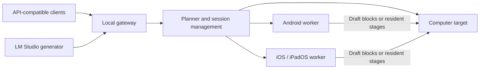

# ExpandMyHW: pre-implementation assessment

31 October 2026. The owner's priority is **higher speed than the computer alone**, using local phones/tablets. Running larger models is a second benefit to measure separately. This document preserves the initial assessment, before native inference was implemented. The project was subsequently named **NodeLift** and qualification companions were developed: see the [0.1 checkpoint](docs/COMPANION_0_1.md), [current engine guide](docs/ENGINE_0_2.md) and [measured results](research/measurements/ENGINE_RESULTS.md). Statements about missing implementation below refer to this initial checkpoint.

## Recommendation

The idea merits an experiment, but a plugin that “adds RAM and CPU” is insufficient. It requires a distributed inference runtime, native mobile workers and application adapters. The main difficulty is finding work that can reduce the critical path when delegated, instead of adding waits.

The observed host is an Apple M3 Max with 64 GiB and 16 CPU cores. This makes the local baseline demanding. At this checkpoint, LLM speed, backend-allocatable memory and thermal state had not been measured; phone/tablet models, router, ports and cables remained unidentified.

**First candidate:** a complete small draft model on the phone proposes blocks, while the computer's target verifies them. Compare with entirely local speculation, including overlap, GPU/memory contention, context synchronization and rollback. It might fail on the M3 Max and succeed on a weaker host: report results per configuration, without a universal promise.

**Second candidate:** keep layers that do not fit the host resident on nodes, avoiding paging and repeated reloads. This can expand capacity and sometimes beat an out-of-core baseline; it does not establish that distributing a resident model makes it faster.

The [DistAI dossier](research/distai/LESSONS_LEARNED.md) is the main reference: inspected code, published data and recalculations identify problems already addressed and comparisons we must not repeat.

## Existing work and lessons

Sources consulted on 31 October 2026. Only DistAI was pinned and examined in depth at this stage; this table is not a replication or a full audit of the other projects.

| Project | Relevance | Limit relative to our objective |
|---|---|---|
| [DistAI](https://github.com/alex8819/DistAi) | Android + PC, llama.cpp RPC, node selection, ARM optimizations, successful and failed experiments | Layer pipelining slows a single chat; queue throughput is not individual acceleration; no iOS implementation in the inspected scope |
| [prima.cpp](https://github.com/OpenCPIL/prima.cpp), [paper v3](https://arxiv.org/abs/2504.08791v3) | Heterogeneous home clusters, Halda scheduling, pipelined-ring parallelism and memory limits; README includes Android/Termux | Authors' results on specific clusters do not establish M3 Max + phone speedup or ready iOS support |
| [exo](https://github.com/exo-explore/exo), [PLATFORMS](https://github.com/exo-explore/exo/blob/main/PLATFORMS.md) | Topology, sharding, MLX backends and fast Mac communication | At review time, Tier 1 was Apple Silicon macOS and Linux was Planned; older mobile claims do not qualify current Android/iOS |
| [llama.cpp RPC](https://github.com/ggml-org/llama.cpp/tree/master/tools/rpc) | Concrete starting point for remote backends | README describes a fragile, insecure PoC; not a finished, fault-tolerant mobile runtime |
| [distributed-llama](https://github.com/b4rtaz/distributed-llama) | ARM/x86 tensor parallelism, optimized communication, experimental Vulkan | Node-count and KV-head constraints; no universal mobile/iOS compatibility established |
| [LocalAI distributed](https://localai.io/docs/features/distribute/index.print.html) | APIs and orchestration, distinguishing request federation from sharding workers | Replica routing does not split one inference; worker mode has experimental constraints |
| [LinguaLinked](https://arxiv.org/abs/2312.00388), [Silica](https://github.com/ShintoChakkiath/Silica-Cluster-Decentralized-Mobile-AI) | Mobile-cluster research and prototypes | Evidence must be checked under our conditions; Silica's AGPL terms require assessment before reuse |
| [Petals](https://github.com/bigscience-workshop/petals) | Distributed block serving, including over the Internet | Different from a phone accelerating one chat on a Mac |
| [PipeInfer](https://arxiv.org/abs/2407.11798), [PipeSpec](https://aclanthology.org/2025.findings-acl.669/) | Asynchronous speculation, pipelines and discarded proposals | The general idea is not new; demonstrate the specific mobile/transport/scheduler contribution |
| [Experimental ollama-cluster](https://github.com/shadoq/ollama-cluster/blob/cluster/docs/cluster.md) | RPC fork tested on two DGX Spark/RDMA systems | Not evidence of standard Ollama compatibility with Android/iOS; different hardware and network |

The potential contribution is a **measured, reproducible** combination: automatic selection of useful work, Android/iOS workers with realistic lifecycle handling, transport selected by actual latency, and application integration. Discovery, layer sharding, excluding slow nodes and speculation are not individually defensible novelty claims.

## Why networking can dominate

Separate four traffic classes: initial weight loading; compute activations; KV cache transfer/reconstruction; control, drafts and results. Loading weights once onto a phone differs from rereading them over the network every token.

**Hypothetical dimensional examples, not device measurements:**

- 1 Gbit/s is at most 125 MB/s before overhead; transferring 16 GB takes at least 128 seconds.
- An 8192-element FP16 hidden state occupies 16 KiB: payload alone takes about 0.131 ms at 125 MB/s. A synchronization delay of several milliseconds can dominate the bytes.
- Activations for 8192 tokens at that hidden size occupy 128 MiB for that tensor: about 1.074 seconds ideally at the same rate. The protocol may fragment, duplicate or transfer other tensors.
- For an uncompressed standard KV cache: `KV_bytes ≈ 2 × layers × context_tokens × KV_heads × head_dim × element_bytes`, with additional batch/session factors. GQA, sliding windows, quantization and different architectures change the calculation. GGUF size alone is insufficient.

| Link | What to verify | Experimental role |
|---|---|---|
| Wi-Fi 6/6E/7 | Bidirectional goodput, shared airtime, p95/p99, radio saving, actual AP and bands | Convenient; potentially suitable for sufficiently large or infrequent blocks |
| USB networking/tethering | OS support, actual negotiation, drivers/directions, hubs, charging heat | Candidate for stable latency; availability differs across Android/iOS |
| Android ADB forwarding | Overhead and debugging mode; not equivalent to native USB networking | Laboratory tool, not assumed final product experience |
| Ethernet adapter | Phone/OS compatibility, port/adapter/switch bandwidth, power | Repeatable wired baseline where supported |

Wi-Fi is not automatically fastest and should not be excluded in advance. Do not treat “typical” numerical ranges as measurements of the owner's system. DistAI shows how stack and power state change results; the [protocol](BENCHMARK_PROTOCOL.md) calls for same-phone comparisons.

## Candidate architecture, still to validate

The planner chooses per job: local only, remote draft, distributed capacity, or potentially replicas for concurrent workloads. It must not activate every strategy together and obscure the source of a gain. Telemetry, timeout, cancellation and model identity accompany every session.

### Application compatibility

**LM Studio:** [generator plugins](https://lmstudio.ai/docs/typescript/plugins/generator) can replace the token source with an external model. The `lmstudio/openai-compat-endpoint` example is a concrete route to an ExpandMyHW runtime; it does not distribute LM Studio's internal backend. [LM Link](https://lmstudio.ai/docs/lmlink) connects remote instances: remote serving is not pooled RAM.

**Ollama:** [OpenAI compatibility](https://docs.ollama.com/api/openai-compatibility) describes an API. A gateway can expose compatible endpoints to clients; this is not automatically a native Ollama plugin. Internal integration requires a supported backend contract or a maintained fork, assessed separately. Do not promise that an ordinary chat call exposes speculative verification or layer distribution.

**Other clients:** clients accepting a custom OpenAI-style endpoint are candidates, subject to streaming, cancellation, templates, tool calls, structured output and token-accounting qualification. API compatibility does not guarantee every feature. LocalAI and llama-server are technical references, not integrations already completed at this checkpoint.

### Android and iOS

Native workers need portable backends and an explicit operator/quantization support matrix. Profile ARM CPU, Vulkan and Metal. NPU/ANE are not automatically usable for arbitrary GGUFs; conversion, unsupported operators, CPU fallback and copies may erase the benefit.

Android requires foreground-service handling, process-available memory and thermal awareness; [ADPF thermal APIs](https://developer.android.com/games/optimize/adpf/thermal) can inform planning. Do not generalize “50% of RAM available” from an older phone to all devices.

On iOS/iPadOS, [BGContinuedProcessingTask](https://developer.apple.com/videos/play/wwdc2025/227/) permits user-initiated work to continue in the background, including GPU use on supported devices/configurations. It does not guarantee a permanent daemon. Workers must declare availability, handle expiration/cancellation and refuse assignments they cannot finish. Observe process limits, entitlements, memory pressure and thermals on the device; there is no universal “donatable RAM” quota.

Both OSes require a visible session, consent to the node role, authenticated pairing, energy/temperature/memory limits and orderly draining. Models, prompts and activations on nodes are job data: the trust boundary includes every participating device.

## Lessons from AudioEnhancer

The README and `app/services/cluster_manager.py`, `edge_worker.py` in local project `../AudioEnhancer/AudioEnhancer` were inspected. They split DSP work into independent chunks, discover workers through UDP, delegate over HTTP, filter capabilities and provide fallback. Heavy ML remains local in the inspected scope.

Reusable concepts include discovery, capability inventory, health checks, dispatch, fallback and state presentation. **Those files do not reveal a ready backend for LLM layers, KV synchronization or coherent memory pooling.** Independent audio chunks can run concurrently; the next autoregressive token depends on the previous one. AudioEnhancer was not modified. `docs/edge-computing.md` could not be read because of an access timeout; no content is attributed to it.

## Proposed sequence

1. Identify devices/transports; fix host baseline, model and hashes. Complete external reviews that remained partial/unavailable.
2. Measure communication, allocatable memory and sustained local inference. Reject configurations that cannot reach break-even even under favorable assumptions.
3. Test autonomous block drafting with a host target, initially greedy, against the strongest local speculative baseline. Only then investigate asynchronous pipelines and exact sampling.
4. Separately test a target exceeding host capacity against an actually configured out-of-core baseline. A host unable to start the model establishes feasibility, not an infinite speedup.
5. Expand runtime, workers and adapters if the central experiment passes. Tensor/expert parallelism and diffusion remain separate research branches, not first-product prerequisites.

Thresholds and methods are in [BENCHMARK_PROTOCOL.md](BENCHMARK_PROTOCOL.md). At this initial checkpoint, [external reviews](research/reviews/REVIEW_STATUS.md) were **incomplete**: Gemini 4 High returned a partial answer before its usage limit; GLM 5.3 Max did not complete the review and reported capacity exhaustion. They are not presented as consensus or validation. Later review outcomes are explicitly recorded in the linked history.
