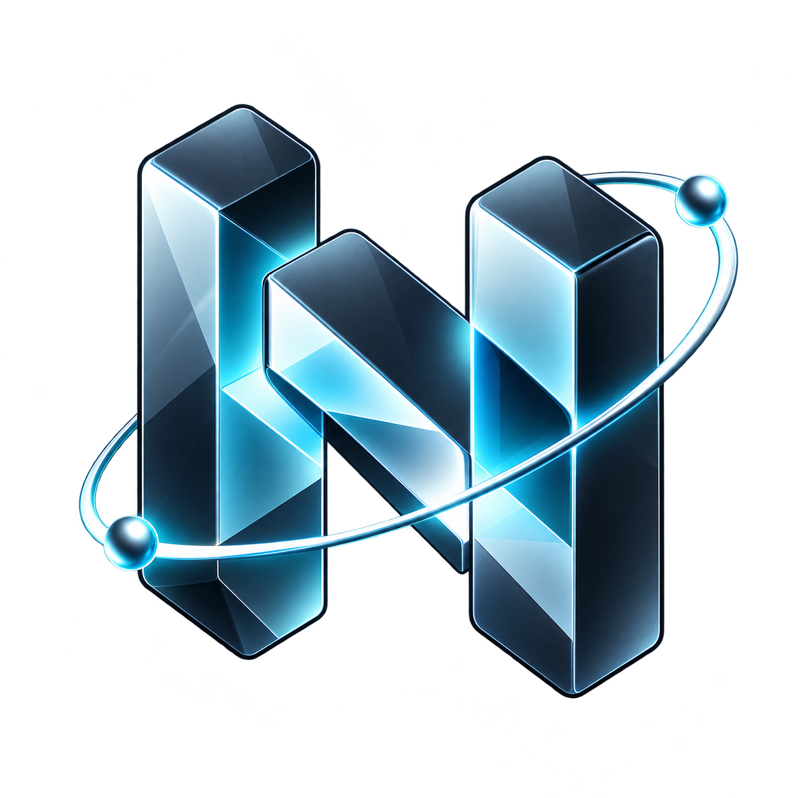
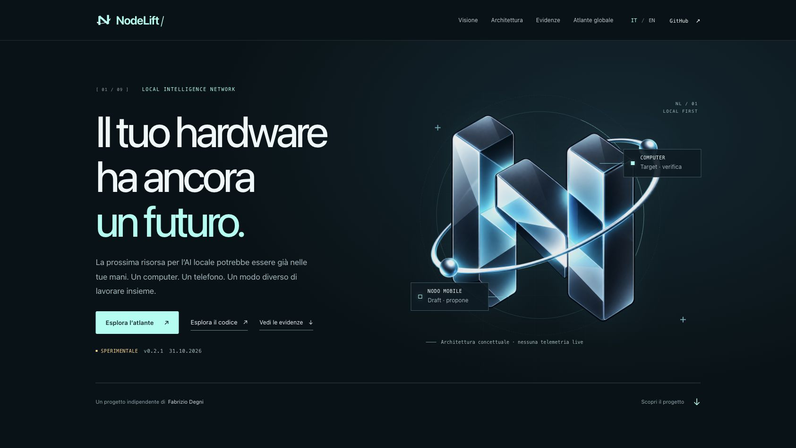

# NodeLift

**Give the hardware you already own another useful role in local AI.**

[](LICENSE)
[](https://www.fabriziodegni.com/NodeLift/)
[](https://github.com/sev7enITA/NodeLift/releases/tag/v0.2.7)
[](docs/INTEGRATIONS.md)

[](https://github.com/sev7enITA/NodeLift/actions/workflows/checks.yml)
[](https://github.com/sev7enITA/NodeLift/actions/workflows/documentation.yml)
[](https://github.com/sev7enITA/NodeLift/actions/workflows/native-build.yml)
[](https://github.com/sev7enITA/NodeLift/actions/workflows/release-verification.yml)

[](docs/wiki/Quickstart.md)
[](native/CMakeLists.txt)
[](native/llama.lock)
[](docs/LOCALIZATION.md)

Source and documentation badges follow `main`; native build and release verification show the latest manual run.

Repository documentation is in English. The app and [showcase](https://www.fabriziodegni.com/NodeLift/) support English (default), Simplified Chinese and Italian.

[Quickstart](docs/wiki/Quickstart.md) · [Wiki](https://github.com/sev7enITA/NodeLift/wiki) · [How-to guides](docs/README.md) · [Changelog](CHANGELOG.md) · [Gallery](docs/GALLERY.md) · [Troubleshooting](docs/wiki/Troubleshooting.md)

**NodeLift's objective is to make RAM and compute from existing local devices available to the AI interfaces you already use.** Its shared execution service is the core; the desktop control room manages resources, and adapters connect everyday clients. [Product direction and engineering roadmap](docs/ROADMAP.md).

The current experimental implementation supports phone-assisted drafting: a small model on a phone proposes tokens and the computer's target verifies them. This is one compute path. Distributing model partitions to expand executable memory capacity remains a core development workstream, alongside measuring when delegation is faster than the best local baseline.

**[Live project showcase and interactive atlas](https://www.fabriziodegni.com/NodeLift/)** · [55-entry detailed matrix](site/NodeLift/data/comparison.md) · [Assessment and engineering lessons](research/comparison-2026-10-31/ASSESSMENT.md) · [Publication verification](docs/SHOWCASE_DEPLOYMENT.md). The dated atlas distinguishes applications, runtimes, serving systems and research; it is not an exhaustive inventory or a universal performance ranking.

**[0.2.7 experimental prerelease](https://github.com/sev7enITA/NodeLift/releases/tag/v0.2.7), 1 November 2026.** Native inference, authenticated mobile work leases, an OpenAI-style text gateway, Android/iOS companion sources and an LM Studio generator adapter are implemented. **Phone inference speedup, pooled RAM, large hybrid-model speculation and sustained mobile operation are not yet qualified.** The first real-weight control experiments found local drafting slower than target-only inference on the small test pair. Negative results are published.

**Host 0.3.0 integration preview:** public Hugging Face GGUF search/download with SHA-256 verification, direct file/path import, opt-in OpenRouter, and a loopback text bridge for oMLX/LM Studio. English (default), Simplified Chinese and Italian UI. [Setup](docs/INTEGRATIONS.md#model-sources-and-external-engines-host-030-preview) · [Source review and qualification](research/integrations-2026-11-01/ASSESSMENT.md). Companion binaries are 0.2.7/build 9.

**Engine controls:** measured adaptive draft control, context lookup without a second model, and greedy argmax caching are available in source and the dashboard. [Optimization study and measured limits](research/optimization-2026-10-31/REPORT.md). The 0.2.7 companions support English (default), Simplified Chinese and Italian, with a saved in-app language choice. [Localization and validation](docs/LOCALIZATION.md).



*Public showcase capture, not a companion-app screenshot or live telemetry. [More images and provenance](docs/GALLERY.md).*

## Implementation and evidence

| Component | Implemented | Observed evidence / limit |
|---|---|---|
| Native core | Locked llama.cpp, greedy block verification, correction/bonus, EOS, KV resynchronization | Real-weight M3 Max/Metal tests; no universal bitwise-equivalence claim |
| Remote work | Pinned TLS, lease, epoch, prefix/vocabulary/model identities | Real-weight loopback tests including wrong proposals and lost replies; emulated node |
| Android | ARM64 CPU draft worker, checked LAN model transfer, battery/thermal controls | APK built; physical Xiaomi measurements used the earlier 0.1 qualification app |
| iOS | Native Metal/CPU worker, GGUF import, foreground lifecycle, user limits | Unsigned device build compiled; physical iPhone inference remains open |
| HarmonyOS NEXT | Separate ArkTS qualification candidate | No HAP or native inference worker |
| Desktop | [Device graph](docs/DEVICE-GRAPH.md), hardware inspector, run contribution, pairing, diagnostics, model settings | Browser functional checks and accounting tests; contribution is accepted token attribution, not compute share |
| Integration | Authenticated text chat gateway and LM Studio generator | Real-weight HTTP/adapter-handler tests; LM Studio GUI qualification open |

This is **not an Ollama backend patch**. Clients with a custom OpenAI-style endpoint can call NodeLift within its text/greedy subset. The LM Studio adapter selects NodeLift as a generator; it does not split LM Studio's own loaded model across phones.

**About & References:** author attribution, installed component version, official project links, technical references and manual release checking are available inside the desktop and companion apps. [How to find them](docs/ABOUT_AND_UPDATES.md).

[Download Android 0.2.7](https://github.com/sev7enITA/NodeLift/releases/download/v0.2.7/NodeLift-0.2.7-android-debug.apk) · [Source checks](https://github.com/sev7enITA/NodeLift/actions)

## Start on the host

Requirements: Python 3.12+, C++17 compiler, CMake 3.22+, Git and locally licensed GGUF weights. The verified native host build is Apple Silicon macOS/Metal. Other host platforms/backends are not qualified.

```sh
git clone https://github.com/sev7enITA/NodeLift.git
cd NodeLift
python3 scripts/doctor.py
./scripts/build-native.sh
python3 scripts/fetch-control-models.py
PYTHONPATH=host python3 -m nodelift.host --address YOUR_PRIVATE_LAN_IPV4
```

The optional control-model download is approximately 1.61 GB, with fixed [revisions and hashes](profiles/control-models.json). Open the **private dashboard link printed by the host**, select target/draft, apply the configuration and begin with Host only. Keep invitations and client keys private.

- [QR pairing guide](docs/QR_PAIRING.md)
- [Engine and companion guide](docs/ENGINE_0_2.md)
- [API and LM Studio integration](docs/INTEGRATIONS.md)
- [Build and verification status](artifacts/README.md)
- [Measured results](research/measurements/ENGINE_RESULTS.md)
- [Architecture and remaining work](docs/ARCHITECTURE.md)

## Evidence before acceleration claims

The speed workstream targets lower single-chat latency than the best applicable local baseline at the same target, sampling rules and actual output length. The capacity workstream targets model/context workloads that exceed the declared host memory budget. Both support the shared local execution service; capacity, speed and multi-user throughput require separate experiments. Reported physical RAM is not memory already shared with the host.

- [DistAI source study and lessons](research/distai/LESSONS_LEARNED.md)
- [October 2026 research update](research/RESEARCH_2026_10_31.md)
- [Gemini 4 High / GLM 5.3 Max reviews, adjudicated](research/reviews/ENGINE_REVIEW.md)
- [Physical Xiaomi hotspot measurements](research/measurements/2026-10-31-xiaomi-hotspot/REPORT.md)
- [Benchmark protocol](BENCHMARK_PROTOCOL.md), [initial assessment](ASSESSMENT.md), [device inventory](profiles/devices.json)

## Reproduce checks

```sh
PYTHONPATH=host python3 -m unittest discover -s host/tests -v
python3 scripts/check-native.py
python3 scripts/check-remote-loopback.py
python3 scripts/benchmark-engine.py
cd adapters/lmstudio && npm ci --ignore-scripts && npm test
```

Native tests require the built library and weights. Network/CPU qualification tests are not LLM benchmarks. The upstream comparison script additionally requires llama-server built from the pinned checkout. Weights, pairing databases, private prompts and signing secrets do not belong in Git.

Contributions are welcome: reproducible device measurements, backend bring-up, failure tests and improvements against an appropriate local comparator. See [CONTRIBUTING](CONTRIBUTING.md), [license](LICENSE), [third-party notices](THIRD_PARTY_NOTICES.md) and [brand provenance](docs/BRAND.md).

## Authorship and contribution

Conceived and developed by **Fabrizio Degni**. [Website](https://www.fabriziodegni.com/) · [LinkedIn](https://www.linkedin.com/in/fdegni/) · [About and credits](docs/wiki/About-and-credits.md).

Start with a [reproducible bug or device benchmark](https://github.com/sev7enITA/NodeLift/issues/new/choose). The [REA engineering study](research/rea-2026-11-01/ASSESSMENT.md) records lessons adopted for onboarding and verification, and potential engine work that still needs testing.

## Credits and thanks

NodeLift is created by Fabrizio Degni and informed by an open community of researchers and maintainers. We thank DistAI, llama.cpp/GGML, oMLX, REA, LM Studio, Jev/TypeSafe, the prompt lookup decoding authors, and the wider distributed-inference and mobile ecosystem for sharing their work. [Acknowledgements and project links](docs/ACKNOWLEDGEMENTS.md) distinguish actual dependencies, studied prior art and integrations. [Third-party notices](THIRD_PARTY_NOTICES.md) preserve the applicable licenses and authorship.

The full-color [NodeLift emblem and asset guide](assets/brand/README.md) is shared with the showcase and companions. [Locally Uncensored source lessons](research/locally-uncensored-2026-11-01/ASSESSMENT.md) credit its memory-planning, cancellation and diagnostics work.
