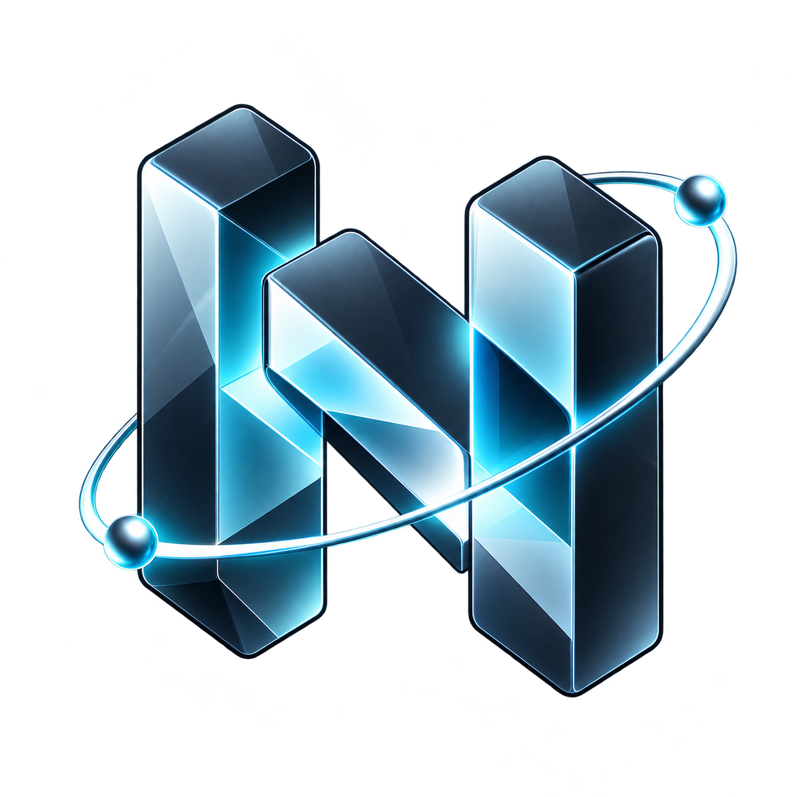

# NodeLift visual identity

The approved primary identity is the blue three-dimensional orbital emblem in [nodelift-emblem.png](nodelift-emblem.png). It appears on the public showcase, GitHub README and native companion headers and launcher icons.

Use [nodelift-mark.svg](nodelift-mark.svg), the simplified orbital N, for small or monochrome system surfaces such as Android notifications and themed icons. Do not substitute it for the primary full-color identity.

Run `swift scripts/render-app-icon.swift` from the repository root to generate the Android, iOS and HarmonyOS raster assets from the canonical PNG. The script preserves the original artwork, reserves Android adaptive-icon space and flattens iOS launcher artwork on an opaque dark background. Do not round iOS icon corners in the artwork; the operating system applies its mask.

Created for NodeLift, the project conceived and directed by Fabrizio Degni. See the repository license and acknowledgement register for attribution. HarmonyOS/NEXT artwork in source does not mean a native package has been compiled.
