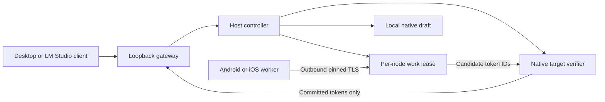

# Engine architecture

The C++ core links a fixed llama.cpp revision through a JSON C ABI shared by Python, JNI and Swift. It resynchronizes token-prefix/KV state after corrections and evaluates the committed anchor plus proposed block in one causal batch. Acceptance stops at the first mismatch/EOG; correction/bonus obeys the remaining output budget. Floating-point backend differences can change argmax: token equality is scoped to tested configurations.

A result must match node, request ID, epoch, full-prefix digest, model hash and token-ID fingerprint. Replays/stale identities/out-of-range IDs are rejected. One active run and one lease per node bound work. Expiry or worker error causes a counted fallback to the target. A drafter is not an authority over final text.

Worker-owned run records are published as locked snapshots. Prompts/results remain in private host state. Streaming withholds incomplete UTF-8 tails and cancels its matching run on client disconnect. The native handle registry retains an engine during calls so concurrent teardown cannot free it underneath an active call/cancel.

The full prefix is sent each round: explicit recovery is simple, but serialization/retransmission grow with context. A future delta protocol needs acknowledged cursors, epoch recovery and measured benefit.

## Remaining research gates

1. Physical native Xiaomi inference, screen-off/thermal/battery/failure tests, hotspot-role and wired comparisons.
2. Large compatible target/draft pair. Existing Qwen35 hybrids need checkpoint restoration with measured cost and correctness.
3. Strongest applicable local baseline: target-only, local draft, n-gram, MTP/EAGLE/DFlash and async where supported.
4. Evidence-based node/block choice using committed tokens and total round time, retaining host-only when delegation loses. Current modes are manual.
5. Asynchronous drafting with wasted-work accounting, then multi-user batching. Neither automatically proves single-chat acceleration.
6. Capacity sharding as a separate path; phone memory is not coherent host RAM.

The sought contribution is usable heterogeneous-device orchestration with reproducible evidence and lifecycle control. Remote speculation, adaptive blocks and pipelining are prior art. No unique algorithm, patentability or universal superiority is established.
