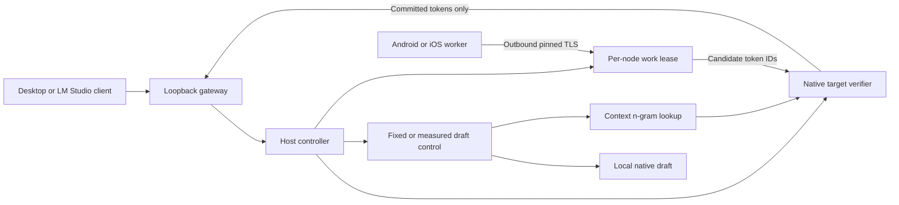

# Engine architecture

NodeLift's target architecture is a shared local execution service that brings device RAM and compute to existing AI interfaces. The desktop application manages that service. Memory-capacity execution and compute acceleration are core workstreams; the diagram below describes the current implemented drafting path. See the [product roadmap](ROADMAP.md) for the intended architecture, interface routes and capacity milestones.

The C++ core links a fixed llama.cpp revision through a JSON C ABI shared by Python, JNI and Swift. It resynchronizes token-prefix/KV state after corrections and evaluates the committed anchor plus proposed block in one causal batch. Acceptance stops at the first mismatch/EOG; correction/bonus obeys the remaining output budget. Floating-point backend differences can change argmax: token equality is scoped to tested configurations.

A result must match node, request ID, epoch, full-prefix digest, model hash and token-ID fingerprint. Replays/stale identities/out-of-range IDs are rejected. One active run and one lease per node bound work. Expiry or worker error causes a counted fallback to the target. A drafter is not an authority over final text.

Worker-owned run records are published as locked snapshots. Prompts/results remain in private host state. Streaming withholds incomplete UTF-8 tails and cancels its matching run on client disconnect. The native handle registry retains an engine during calls so concurrent teardown cannot free it underneath an active call/cancel.

The full prefix is sent each round: explicit recovery is simple, but serialization/retransmission grow with context. A future delta protocol needs acknowledged cursors, epoch recovery and measured benefit.

## Measured control and context reuse (unreleased source update)

The greedy core caches one finite-checked argmax token instead of copying a full vocabulary logit vector. This does not change the verifier or establish numerical equivalence across batch shapes.

`fixed` retains the chosen strategy. `adaptive` emits four useful host tokens, then measures up to two initial proposal rounds (one if very costly). It compares total round time per committed token against the recent median host cost with a 10% margin, continues measuring successful delegation and sticks to host after a loss/failure. The first local probe includes deferred draft loading/prefill. Request-local history avoids transferring decisions across models/nodes/prompts. These are heuristic thresholds, not calibrated confidence or a no-regression guarantee; cold probes and stale host cost remain limitations.

`lookup` incrementally indexes committed 3–8 token sequences and proposes continuations of the longest matching suffix, up to the selected block size. It needs no draft model. Misses use ordinary target decoding; hits use the existing verifier. All modes retain target authority, cancellation checks and lease identity validation. This implements known prompt-lookup prior art, not a novel algorithm.

See the [optimization assessment](../research/optimization-2026-10-31/REPORT.md) for Jev/System One lessons, local-project provenance, same-output comparisons and the pre-existing 96-token drift counterexample.

## Remaining research gates

1. Physical native Xiaomi inference, screen-off/thermal/battery/failure tests, hotspot-role and wired comparisons.
2. Large compatible target/draft pair. Existing Qwen35 hybrids need checkpoint restoration with measured cost and correctness.
3. Strongest applicable local baseline: target-only, local draft, n-gram, MTP/EAGLE/DFlash and async where supported.
4. Validate the opt-in measured host/draft gate on physical devices and held-out workloads; node selection and block size remain manual.
5. Asynchronous drafting with wasted-work accounting, then multi-user batching. Neither automatically proves single-chat acceleration.
6. Implement and qualify capacity sharding as a core execution path in parallel with the compute work; phone memory is not coherent host RAM. This requires resident partition/state accounting and a recovery plan for targets that cannot fit on the host alone.

The sought contribution is usable heterogeneous-device orchestration with reproducible evidence and lifecycle control. Remote speculation, adaptive blocks and pipelining are prior art. No unique algorithm, patentability or universal superiority is established.
