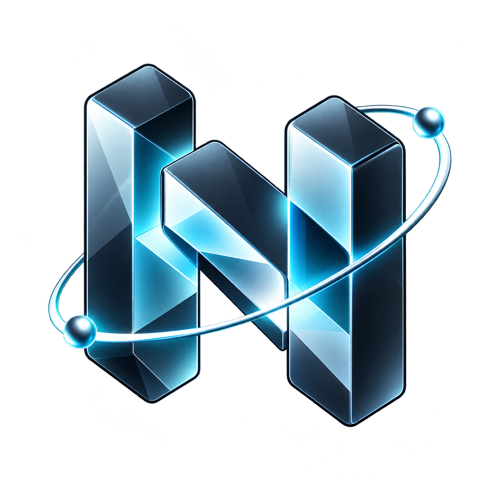
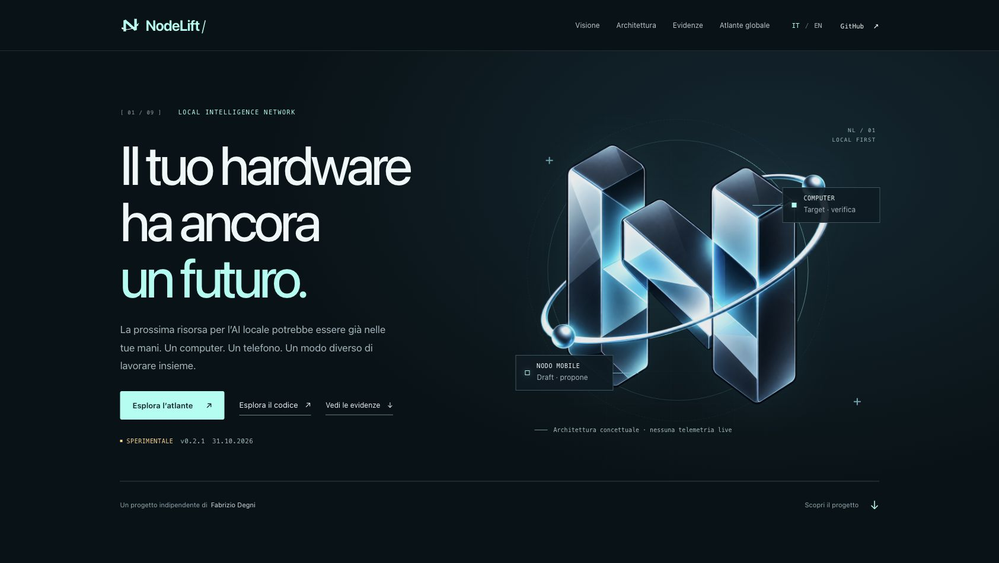
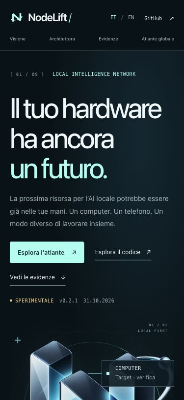

# NodeLift gallery

## Original identity

Original project artwork, not measured network activity. [Authorship and creation process](BRAND.md).

## Public showcase

These are actual captures of the **public showcase**, dated 31 October 2026, before the later credits section. The mobile image is a browser layout, not the Android/iOS companion. [Publication evidence](SHOWCASE_QA.md) · [Live site](https://www.fabriziodegni.com/NodeLift/).

## Execution flow

The [architecture guide](wiki/Architecture.md) includes a Mermaid diagram of native target verification, phone proposals and the separate external-provider routes. It is a schematic, not a benchmark.

Fresh companion screenshots and a reproducible physical-phone demo should be added after device qualification. Never use generated UI artwork as evidence that a feature ran.

## About & References · companion 0.2.4

The desktop control room includes authorship, runtime host version, manual release discovery and technical references. These are live browser captures, not native-phone screenshots.

[390px Italian browser view](evidence/about-2026-11-01/mobile-about-it.png) · [UI verification scope](evidence/about-2026-11-01/desktop-qa.json) · [Build verification](evidence/about-2026-11-01/build-verification.json)
