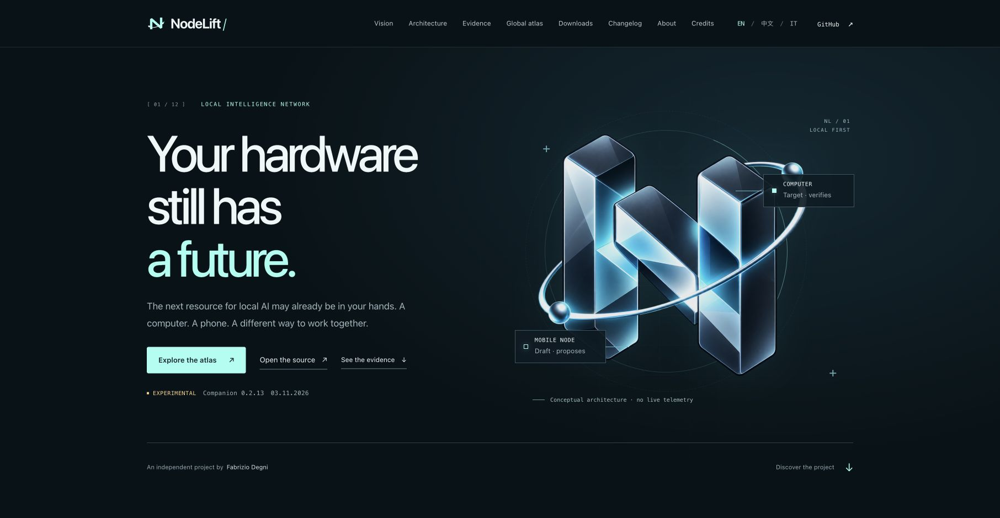
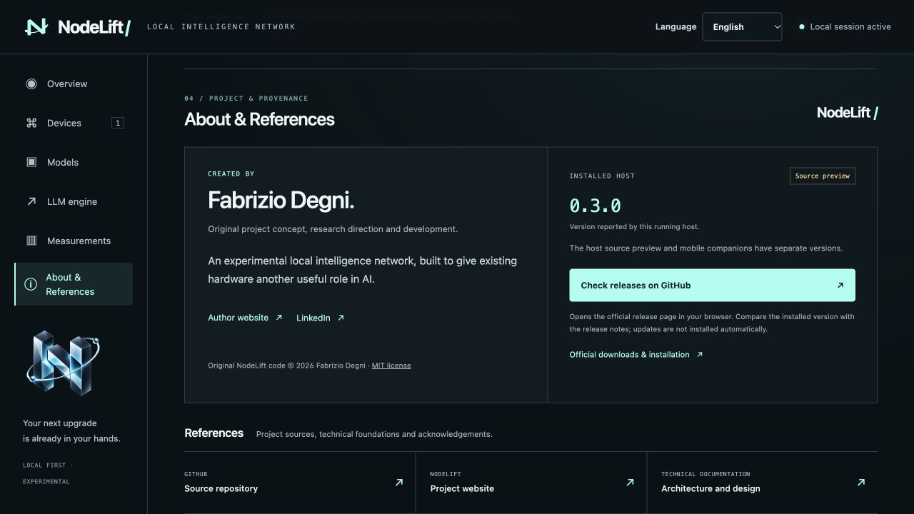

# NodeLift gallery

## Original identity

Original project artwork, not measured network activity. [Authorship and creation process](BRAND.md).

## Public showcase

This is an actual English-language browser capture of the public showcase, not the Android/iOS companion. Earlier Italian captures remain dated historical publication evidence and are no longer the repository's presentation images. [Publication evidence](SHOWCASE_QA.md) · [Live English site](https://www.fabriziodegni.com/NodeLift/?lang=en).

## Execution flow

The [architecture guide](wiki/Architecture.md) includes a Mermaid diagram of native target verification, phone proposals and the separate external-provider routes. It is a schematic, not a benchmark.

Fresh companion screenshots and a reproducible physical-phone demo should be added after device qualification. Never use generated UI artwork as evidence that a feature ran.

## About & References · companion 0.2.4

The desktop control room includes authorship, runtime host version, manual release discovery and technical references. These are live browser captures, not native-phone screenshots.

[UI verification scope](evidence/about-2026-11-01/desktop-qa.json) · [Build verification](evidence/about-2026-11-01/build-verification.json)
