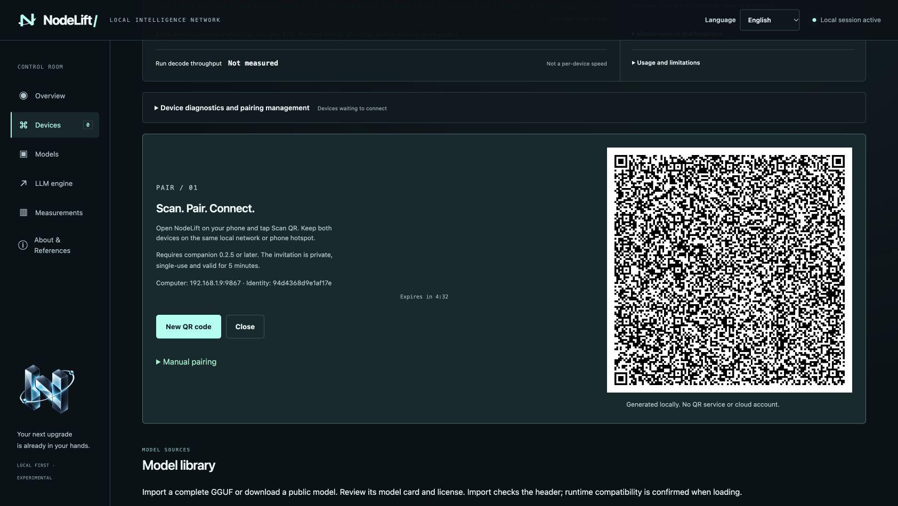

# Pair a phone by scanning the desktop QR

Companion **0.2.5 / build 7** introduces an offline QR flow for Android and iOS. Update the host source as well as the companion: older host processes do not serve the QR assets and invitation-status endpoints.

1. Connect the computer and phone to the same local network. A phone hotspot is supported: the phone can provide the hotspot to the Mac.
2. Open the authenticated NodeLift desktop control room and choose **Add device**.
3. In the phone companion, open **Pair your computer / Computer pairing → Scan QR**. Allow camera access and point it at the desktop code. Scanning from the system Camera can also open NodeLift where the OS camera recognizes custom app links; the in-app scanner is the supported fallback.
4. Check the computer address and identity fingerprint, then choose **Pair and activate node**. The desktop device graph shows the connected node.
5. Close the invitation panel. LLM proposals remain subject to the existing **Allow LLM proposals** setting and a loaded draft model.

Existing sessions survive the APK update. You do not need to forget a working computer pairing simply to update the app. Pause an active node before pairing another computer. iOS packages still require personal signing and provisioning; no signed distribution or HarmonyOS NEXT build is introduced by this release.

## Controls and recovery

- **New QR code** revokes the displayed invitation before creating its replacement.
- **Close** removes the QR and invitation text immediately and requests server-side revocation. If the server cannot confirm revocation, the dashboard reports that; the five-minute server deadline still applies.
- If enrollment wins a simultaneous race with Close, the completed session remains paired: use **Revoke pairing** on its device card to disconnect it. Close cancels unused invitations, not established sessions.
- The QR disappears when its invitation is used, closed or expires. The device graph provides the actual connection status. Closing a browser tab makes a best-effort revocation request; browser termination cannot guarantee delivery.
- **Manual pairing** retains the original JSON invitation path. Use this if the camera is unavailable or permission is denied.
- If scanning fails, increase screen brightness, keep the entire white square visible, move the camera slightly farther away, and generate a fresh QR if it expired. Confirm companion version 0.2.5 or later.
- A successful scan cannot repair a network with client isolation, a stale host IP or a blocked listening port. The invitation uses the host address chosen at startup. The host refuses to reuse a certificate after its configured IP changes. After changing networks, start with the current LAN address and a new private `--state` directory, then pair devices again; do not delete the old state as a workaround.

## Protocol and privacy

Prefer the in-app scanner. Custom URL schemes are not exclusive to one app; another installed app could register the same scheme. Confirm only an invitation you requested on your own computer and compare the displayed address and fingerprint.

The compact transport is `nodelift://pair/v1/<IPv4:port>/<expiry>/<invite>/<base64url-DER-certificate>`. Parsers reconstruct the original protocol-1 JSON invitation and derive its certificate SHA-256. The QR carries the pinned certificate itself, so it does not need an unauthenticated HTTP bootstrap or trust-on-first-network-response. Hostname verification, the private IPv4 restriction, bounded input, expiry validation and refusal of redirects remain in force.

The host stores only the invitation digest and its expiry. Pairing consumes it atomically once. Status and revocation endpoints require the desktop admin token and loopback origin. Native session credentials continue to use Android Keystore / iOS Keychain storage. QR rendering and camera decoding run locally; frames are not uploaded or stored. Anyone who can see a still-valid invitation can attempt enrollment, so do not share screenshots of live invitations.

The desktop uses Project Nayuki's MIT QR generator; Android uses Apache-2.0 ZXing; iOS uses AVFoundation. See [third-party notices](../THIRD_PARTY_NOTICES.md).

## Verification scope

Both Android ARM64 APK and unsigned iOS device app compile. Tests cover invitation authentication/revocation/replay, expiration, stale desktop responses, Swift QR decoding and actual loopback TLS rejection of a wrong certificate. ZXing independently decoded the QR from a real dashboard screenshot and recovered the exact payload. EN, Simplified Chinese and Italian desktop states were checked.

These checks do **not** establish physical-camera scan success on Xiaomi/iPhone, signed iOS installation, or inference performance. The screenshot below uses an isolated disposable invitation and a test certificate, with no production pairing credentials.

