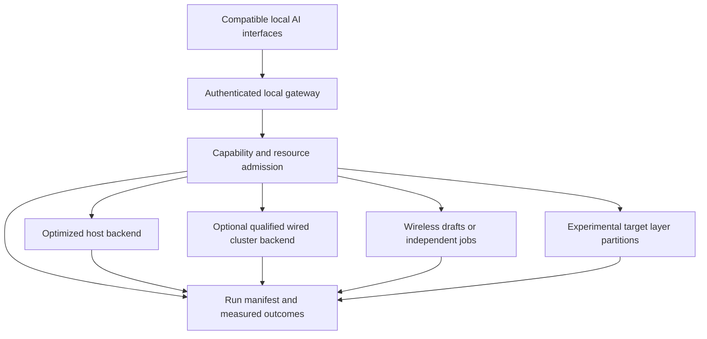

# Distributed execution: next architecture and qualification contract

Status: **proposed architecture, not implemented or performance-qualified**. 1 November 2026.

The objective is useful local inference on hardware people already own. NodeLift must support two distinct outcomes: faster execution when the target already fits, and additional model capacity when it does not. Neither follows from adding physical RAM figures. The current implementation remains the [greedy proposal/verifier path](ARCHITECTURE.md); the [Apple comparison](../research/apple-mlx-2026-11-01/ASSESSMENT.md) records the evidence boundary.

## Architectural decision

Keep a common local gateway and let qualified backends execute the work they handle well. MLX is a possible backend and comparator, not something to replace simply to claim independence. A compatible OpenAI-style API does not guarantee support for every client's tools, streaming, sampling, vision or structured output.

All lanes except the existing host/draft path require new implementation or qualification. Backend selection must never silently send a local request to a cloud provider. User-selected cloud routing remains a separate operation.

### Execution lanes

| Lane | Useful outcome | Admission and limits |
| --- | --- | --- |
| Optimized host | Reliable baseline and ordinary execution | Qualified model, sampling and output contract; retain as default |
| Fast wired cluster | Capacity and potentially acceleration | Discover actual hardware, backend, topology and version; qualify MLX/JACCL, TCP ring or another supported backend separately |
| Wireless assistance | Faster verified drafts or more independent jobs completed | Count communication, verification, rejected work, thermal effects and fallback; no admission from nominal RAM or TOPS |
| Capacity partitions | A target that cannot fit the host can complete locally | Model-specific partitions and state restoration; required-node loss can require restart or explicit failure |

The present M3 Max has Thunderbolt 4, so it is not a substitute for the Thunderbolt 5 RDMA setup in Apple's article. A USB-C connector, a phone's advertised radio generation or an Ethernet adapter does not prove usable transport bandwidth. Compare the Xiaomi hotspot with an available dedicated access point, supported USB network path and adapter-based Ethernet by measurement. Do not purchase hardware on the assumption that every phone supports the same path.

## Three implementation boundaries

### Control: permissions, capabilities and budgets

Keep authentication and user permission outside the performance optimizer. Define an immutable per-run decision record: backend/model/runtime hashes, node identities, approved operations, context/output bounds, deadline, allocatable memory budget and battery/thermal limits. Revalidate after reconnect, model change or background transition. An optimizer can reduce work or stop; it cannot broaden permissions.

Node capabilities must describe what was successfully loaded and executed, including supported model architecture, tokenizer, quantization, context and backend. Do not advertise NPU/GPU participation from a chipset specification alone. RAM admission is per device:

`resident weights + KV/state + peak scratch + runtime reserve <= measured admissible process budget`

The OS may still reclaim or terminate the process. Repeated allocation and sustained-load qualification are required; system-available memory is not a promise of an app allocation. Profiles expire after a runtime/model/OS change or material temperature/network drift.

### Data: bounded sessions, context and recovery

For the next wireless protocol, replace full-prefix retransmission only after a small independent state machine passes fault injection:

- `OPEN` identifies protocol, model and tokenizer hashes, run epoch, full-prefix digest and sequence cursor.
- `APPEND` includes expected cursor, committed token delta, operation identity, bounds and resulting digest. An acknowledgment refers to applied state, not merely receipt.
- Duplicate delivery returns the recorded result; gaps, wrong digests and stale epochs trigger bounded resynchronization. A retry cannot append twice.
- Proposals carry their exact base state and lease identity. The host alone commits accepted output. Correction invalidates speculative suffixes before the next proposal.
- `CANCEL` has acknowledgment and a measured response deadline. Expired or cancelled results cannot commit even when the worker finishes late. Unacknowledged compute is reported as unknown, never zero wasted work.
- Reconnect begins a new epoch and proves the committed cursor. No reuse of stale KV state on a new model or session.

Persistent TLS sessions may reduce overhead, but a new transport is an experiment. Benchmark it against the existing HTTP path before adopting it. Protect all prompt-bearing traffic; token IDs and intermediate activations can disclose input content.

For capacity mode, begin with contiguous layer partitions and local ownership of each partition's KV/state. Prefill may use bounded chunks to overlap stages. Single-request autoregressive decode still has stage dependencies. Define partition ABI, dtype, positional state, attention/mask semantics and backend numerical contract explicitly. Recurrent/hybrid models need their own checkpoint/rollback implementation.

A phone loss during drafting can return to a resident target. Losing a required capacity shard is different: use a qualified spare/checkpoint reconstruction if the topology permits it, or return an explicit interrupted-run result. Replaying the committed prefix can rebuild state but costs time and memory. Do not promise host-only recovery when the host cannot hold the target. CPU/NPU speed or theoretical capacity does not solve this constraint.

### Evidence: correctness, cost and per-device contribution

Record clock boundaries, actual output tokens, accepted prefix lengths, request completion, failures, cancellations and partial work. Per-node accepted-token attribution is not compute share, RAM pooling or causal acceleration. A node's marginal benefit requires a matched trial with and without that node; node benefits need not add linearly.

Keep bounded private operational diagnostics separate from explicitly published benchmark artifacts. Public trials use public prompts. Export only the data the user chooses. Store the qualification profile and its applicability next to the scheduler decision so a visible claim can be traced to the supporting run.

## Correctness gate

NodeLift already has a 96-token counterexample to universal batch/single greedy equivalence. Diagnose it with identical committed-prefix states, logits/margins, batch shape, KV position and backend configuration. Do not assume floating-point reduction is the proven root cause, and do not treat an arbitrary tolerance as exactness.

Define separate contracts: exact token sequence for a pinned deterministic reference; distributional equivalence for a supported stochastic algorithm; or a declared approximate-quality contract. The current greedy implementation does not establish the latter two. A strict recomputation path may be useful for qualification, but its cost must be included and it may eliminate the benefit of speculation. A near-tie detector alone cannot certify all other tokens.

## Cost model and scheduler

Use observed end-to-end wall time as the primary cost, rather than summing overlapping timers:

`cost per committed token = total request wall time / committed output tokens`

`paired speedup = baseline completion time / delegated completion time`

For a synchronous draft round with `a` accepted proposals and `b` correction/bonus tokens actually committed, the screening condition is `T_round < T_reference_for_(a+b)`. EOS and output limits can make `b` zero. Estimate reference cost at comparable context and thermal state, not from a constant token time. Round timing includes dispatch, queueing, draft computation, communication, verification and recovery. Do not add TLS or serialization again when they are already inside a measured request interval.

For an illustrative sensitivity check only, assume a reference costs 10 ms per token and a round commits five tokens: total round time must stay below 50 ms to improve throughput. A fixed 8 ms communication contribution leaves under 42 ms for everything else; an 80 ms contribution already exceeds the budget. These are hypothetical inputs, not a mapping from measured HTTPS percentiles to inference rounds or a NodeLift prediction.

The current short-probe adaptive heuristic is not a calibrated no-regression guarantee. The proposed controller starts from qualified profiles, uses bounded exploration, has hysteresis, and returns to the host when costs or resource conditions deteriorate. Test profile drift and the cost of probing separately. Asynchronous work requires a new critical-path analysis and counts discarded/overlapping computation; it is not automatically faster.

## Benchmark contract

Freeze prompts, model files, tokenizer/template, runtime/source/build identity, context, output contract, cache policy, topology and release thresholds before the qualification sample. Use randomized paired blocks across prompt groups and independent sessions. Separate tuning/pilot data from held-out qualification. Size the study from observed pilot variance and desired uncertainty, rather than declaring a few successful trials sufficient.

Report the strongest applicable optimized host baseline, including local speculation, prompt lookup or supported native multi-token methods. Compare identical model/precision where possible. If precision, template or architecture differs, report a quality/capacity comparison separately rather than an equivalent-output speedup. Apples-to-apples software comparisons use the same hardware. Apple's published multi-Mac numbers remain vendor measurements until replicated.

Required outcomes: prefill, TTFT, inter-token latency, actual committed tokens/s, full completion time, cold start, memory/swap, useful/discarded work, failure/cancellation rates, recovery time and thermal state. Add energy/battery only with a declared measurement boundary, including the phone, host and network where feasible. Do not convert peak watts into joules per completed request.

Prespecify an initial product target of at least **10% lower completion time** on the intended workload, with a paired grouped confidence interval supporting that claim, and a separately agreed TTFT/reliability budget. A 10% time reduction corresponds to speedup at least `1 / 0.90`, not `1.10`. This is a proposed acceptance target, not achieved performance. Group uncertainty by prompt and session; repeated tokens are not independent observations. Report all failures and output divergences, not only same-output successes. Do not publish stable p99 from small samples.

Capacity qualification reports successful completion, feasible model/context, latency, memory and recovery. When the host cannot run that target, host-only speedup is undefined; an out-of-memory baseline is not infinite acceleration. Energy benefit and extension of device life need separate evidence.

## Priority experiments and stop conditions

| Order | Experiment | Decision gate |
| --- | --- | --- |
| 1 | Reproduce and isolate the batch/single divergence on fixed builds | No exactness claim or promotion while unexplained mismatches remain under the selected contract |
| 2 | Xiaomi native drafting: real prefill/decode, full rounds and repeated sustained sessions | Keep host-only if the complete delegated path fails the chosen improvement/reliability budget |
| 3 | Delta protocol, cancellation and reconnect fault injection | No stale commit, duplicate append, silent state reuse or unbounded recovery; otherwise retain the full-prefix path |
| 4 | Two-device target-partition prototype, first with a small fully comparable model | Correct partition/state contract and explicit required-shard-loss behavior before testing a target exceeding host capacity |
| 5 | Best available wired/local backend and independent-job comparison | Publish workload-specific Pareto tradeoffs; remove routes that add overhead without capacity or useful throughput |

Capacity work is a core parallel workstream, not a label applied to speculative decoding. The order above expresses dependency gates; it does not require waiting for wireless speculation to succeed before implementing the capacity prototype.

## Governance acceptance

The governance claim is limited to demonstrable controls. Existing pairing, pinned TLS, replay checks, resource limits and explicit log export are useful implementation evidence. They do not constitute an independent audit or superiority to Apple's organization. The cited Apple article is a runtime study, not a complete description of Apple's governance.

Before stronger claims, qualify revocation during a job, cancellation convergence, malicious/stale worker replies, parser bounds, background/thermal termination, retention/clear behavior and the authenticated desktop recovery path. Pin dependency/model provenance and retain licenses. Distinguish release hashes from cryptographic update authorization: the current update feature discovers versions and does not implement an automatically trusted signed installer. Mobile store signing, a formal vulnerability response process and independent security testing remain separate work.

Success means a reproducible, constrained result that another owner can obtain on a documented topology. It does not mean a universal benchmark record or a novel algorithm established by model-review agreement.

## Sources

- [Current NodeLift implementation](ARCHITECTURE.md), [measured results](../research/measurements/ENGINE_RESULTS.md), [hotspot conditions](../research/measurements/2026-10-31-xiaomi-hotspot/REPORT.md).
- [Apple distributed inference article](https://machinelearning.apple.com/research/mlx-distributed-inference).
- [MLX communication documentation](https://ml-explore.github.io/mlx/build/html/usage/distributed.html), including backend/topology selection and fast-synchronization warning.
- [M3 Max MacBook Pro specifications](https://support.apple.com/en-us/117737).
- [Security reporting](../SECURITY.md), [mobile diagnostics](MOBILE_DIAGNOSTICS.md), [updates](ABOUT_AND_UPDATES.md).

## Desktop and server expansion

The [desktop/server deployment contract](RFC_DESKTOP_SERVER_DEPLOYMENT.md) adds Windows/Linux workstations, GPU servers, approved office pools and site-local operation to the target architecture. It separates coordinator from executor, stable required partitions from opportunistic assistance, and whole-request routing from combined inference. The first proposed comparator is the Lenovo P16; its hardware and runtime are not yet qualified. This is design scope, not a shipped platform-support claim.
