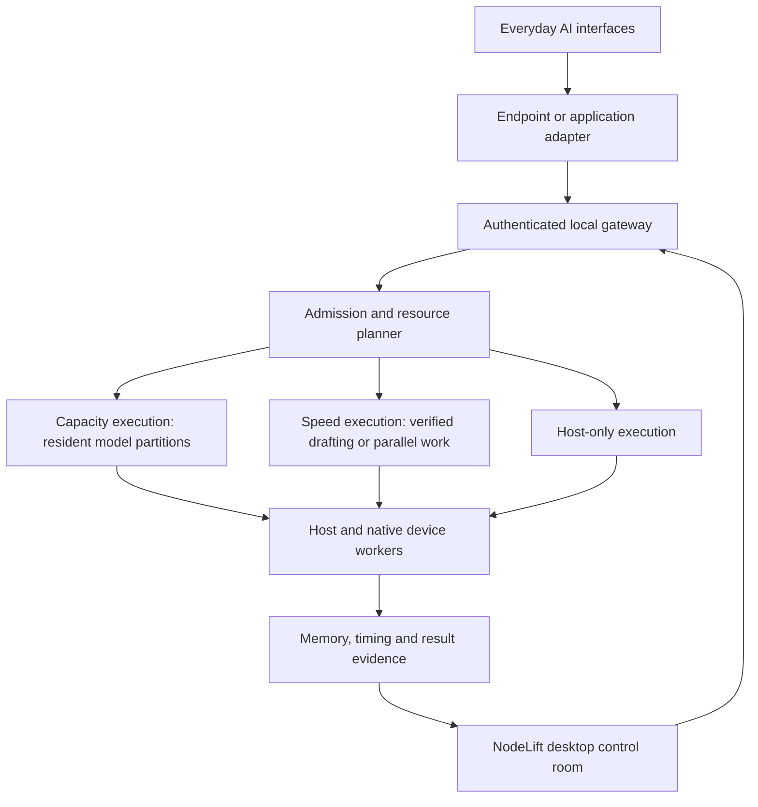

# Shared local RAM and compute for everyday AI interfaces

Product direction, 1 November 2026. This is a development roadmap, not a declaration of implemented compatibility or measured gains.

**NodeLift's objective is to make memory and computation from the user's existing local devices available to the AI interfaces they already use.** The shared execution service is the core product. The desktop application is its control room; mobile companions provide execution resources; adapters connect client interfaces to the service. A new chat interface, cloud-provider forwarding or a successful device pairing alone does not meet this objective.

The user's preference for faster single-chat execution remains a performance requirement. Expanding executable model/context capacity is also a core workstream. Each needs its own evidence; a larger model that runs slowly and a faster small model are different outcomes.

## Target architecture

The diagram describes the intended system. Capacity execution, general workload scheduling and the broader adapter set remain development work.

The same execution service should serve several qualified frontends. An adapter should translate a frontend's supported protocol and cancellation semantics; it should not reimplement the distribution engine. Current host execution admits one active run. Fair queuing, concurrent clients and resource isolation must be implemented before claiming simultaneous multi-application execution.

## Two resource outcomes

| Workstream | Required behavior | Evidence needed | Current state |
|---|---|---|---|
| Memory capacity | Keep appropriate model partitions and their working state resident on other devices, allowing a fixed model/context that exceeds the declared host budget | Per-node allocation/residency, weights/KV/activation budgets, loading cost, bytes transferred, sustained successful generation and comparison with host/out-of-core limits | Not implemented in NodeLift |
| Compute and latency | Assign useful work to eligible nodes and retain delegation only when it helps the selected workload | Same-model/output-policy baseline, complete request latency, TTFT, decode rate, failures, thermal behavior and total device cost where measured | Native drafting and an adaptive gate implemented; physical-phone speedup unqualified |

Usable memory is bounded by each OS, application, native backend, model structure and user's resource policy. The implementation must place computation near resident weights/state and account for network transfers. Adding physical RAM figures does not create coherent host RAM, and a generic browser extension cannot change an arbitrary application's allocator.

Model partitions, layer-owned KV state and activation transfers must be designed together. Remote-memory caching with frequent host transfers is a separate experiment and must demonstrate a benefit. Independent preprocessing, embeddings or other parallel work can contribute compute only after their task contracts, backends and quality checks exist; they are not implemented by the current text gateway.

## Interface coverage

The objective is broad coverage of everyday interfaces. Each entry progresses through **documented extension point → adapter implemented → end-to-end client test → measured local-resource benefit**. A connection that returns a model list or text is only an integration check.

| Interface family | Planned connection | Current evidence and missing work |
|---|---|---|
| LM Studio GUI | Generator selects NodeLift as the execution source | Adapter and SDK/gateway tests exist. Full GUI qualification and capacity-backed generation remain open. |
| Open WebUI | Configurable OpenAI-style connection | Documented provider mechanism; NodeLift end-to-end qualification remains open. Container networking requires an explicitly supported authenticated bridge. |
| Continue / IDE interfaces | Configurable provider endpoint or a dedicated adapter | Continue documents `apiBase`. Chat, editing, autocomplete and agent/tool modes require separate qualification; NodeLift's current gateway is a restricted text-chat subset. |
| AnythingLLM and comparable local frontends | Generic provider endpoint where the request/response contract matches | AnythingLLM documents a Generic OpenAI LLM provider. NodeLift chat/RAG/tool behavior has not been qualified. |
| Ollama-based applications | A supported client endpoint or a deliberately implemented runtime adapter | Ollama's own model runner is separate. No transparent model splitting or replacement inside the Ollama GUI is currently implemented. |
| Z.ai, Xiaomi MiMo and other hosted web GUIs | Assess supported extensions/tools; otherwise evaluate an explicit local browser companion route | No local-backend insertion has been demonstrated. A cloud API call still uses the provider's backend. A local extension could expose NodeLift-powered work only where the integration and permissions allow it; it would not increase a remote proprietary model's RAM. |
| NodeLift control room | Configure, observe and compare the shared service | Implemented local browser UI; native desktop packaging remains open. |

A candidate browser companion must visibly distinguish local work from cloud work, require deliberate request routing, and use bounded client authority. It must not silently capture conversations or forward them to another provider. Cloud bridges remain optional interoperability features and do not count as local memory/compute expansion.

Official integration sources reviewed for this direction: [LM Studio generators](https://lmstudio.ai/docs/typescript/plugins/generator), [Open WebUI compatible providers](https://docs.openwebui.com/getting-started/quick-start/connect-a-provider/starting-with-openai-compatible/), [Continue configurable API base](https://docs.continue.dev/customize/model-providers/top-level/openai), [AnythingLLM Generic OpenAI LLM](https://docs.anythingllm.com/setup/llm-configuration/cloud/openai-generic). These establish extension points, not NodeLift compatibility certification.

## Engineering milestones

1. **Implement and instrument a capacity path.** Define partition identity, bounded allocation, residency, execution and cancellation contracts for native workers. Compare compatible upstream approaches, beginning with the existing DistAI assessment and a bounded evaluation of [llama.cpp RPC](https://github.com/ggml-org/llama.cpp/blob/master/tools/rpc/README.md). Upstream currently describes distributed weights/KV and computation but labels RPC a fragile, insecure proof of concept. It is a candidate for study, not a deployed NodeLift backend or a verified feature of NodeLift's pinned revision. Any reuse needs mobile-backend qualification and the NodeLift authenticated transport/lifecycle boundary.
2. **Prove partition execution on the host and one physical phone.** Start with a small controlled model and explicit memory budgets. This proves protocol/placement behavior, not expansion beyond the Mac's physical RAM. Then use an honestly capacity-limited workload to demonstrate additional executable capacity. Keep weights resident across decode steps and record transfers rather than assuming Wi-Fi is fast enough.
3. **Qualify physical compute gains.** In parallel with the capacity work, evaluate the existing native draft path against the best applicable local baseline on the actual phone. Include network topology, battery/thermal limits, cancellations and sustained runs. Preserve negative results and disclose unknown measurements.
4. **Deliver the shared engine through real interfaces.** Complete LM Studio GUI qualification and one configurable frontend/IDE path with the same engine and model configuration. Add versioned request fixtures for defaults, streaming, cancellation and unsupported features. Extend API capabilities only with tests and backend support; generic endpoint compatibility alone does not qualify agent/tool workflows.
5. **Add multi-node planning and dependable lifecycle management.** Reserve per-device budgets, choose a viable subset, handle concurrent-client admission, and re-plan when a node leaves. A capacity run cannot promise a host-only fallback if the target does not fit there; it needs a qualified replacement/checkpoint path or a clear failure. Android, iOS and HarmonyOS NEXT require their own native execution and lifecycle validation.
6. **Package and broaden coverage.** Deliver a desktop service installer and reusable adapters, followed by a browser companion where feasible. Keep one shared engine and publish a tested interface/version/feature matrix. GUI polish supports this path; it does not substitute for the capacity and compute milestones.

## Acceptance evidence

- **Capacity:** additional model/context workload completed under disclosed memory limits, measured resident allocations and transfer volume, same weights/quantization where comparing host and cluster. A host that cannot start the model supplies a feasibility comparison, not an infinite speedup.
- **Speed:** paired end-to-end measurements against a capable host-only configuration, including cold/warm behavior, tail latency, thermal effects, failures and workload quality. The existing [benchmark protocol](../BENCHMARK_PROTOCOL.md) retains its distinct speed and capacity experiments; its proposed thresholds are not new performance claims.
- **Interface usefulness:** the user's ordinary client completes supported requests, streams output, cancels correctly and identifies the chosen execution route. Resource gains are measured at that client, not inferred from a badge or an accepted-token percentage.

Current implementation and measured limits remain in [architecture](ARCHITECTURE.md), [integrations](INTEGRATIONS.md) and [engine results](../research/measurements/ENGINE_RESULTS.md). This roadmap changes product priorities and documentation; it does not itself add memory sharding or new working integrations.
