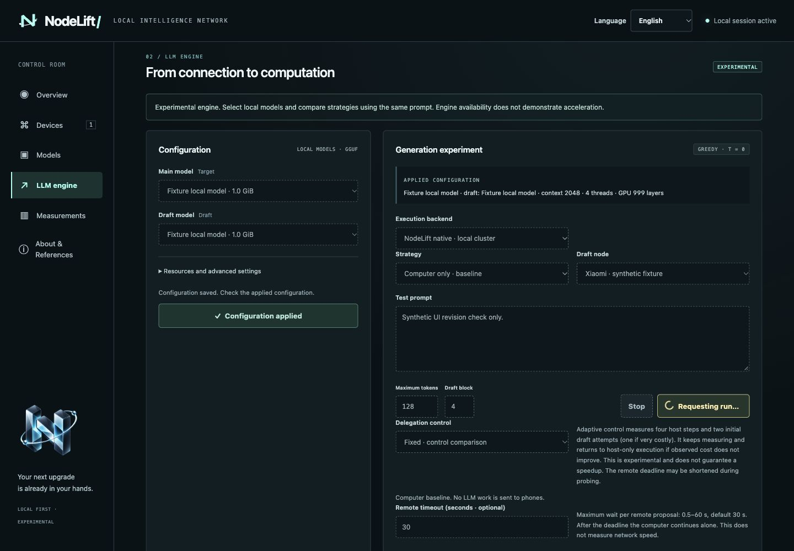
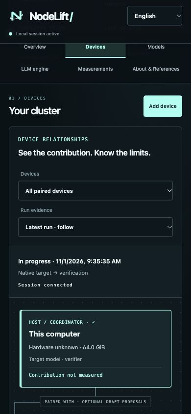
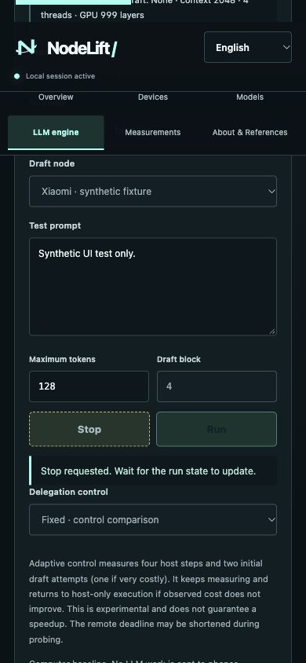

# Companion 0.2.6: scanner, support logs and update checks

The owner reported an immediate QR-scanner crash in 0.2.5 on a Xiaomi 17 Ultra. No physical ADB device or crash log was available; the owner can test a replacement APK. The exact exception is therefore **unconfirmed**, and this release is a candidate repair requiring an on-device trial.

## Changes

Android replaces ZXing Android Embedded/CaptureActivity with CameraX 1.6.2 and a local ZXing core 3.5.3 decoder. The camera follows the activity lifecycle, closes every analysis frame, limits image allocation to 4 MP, and keeps only the latest frame. Initialization and resumed preview have a 12-second foreground watchdog. Transient camera ownership errors can recover; retry and cancel remain visible on failure. Only this activity's use cases are unbound. No preview frames are retained or uploaded.

Android controls now use separate available, pressed, selected and disabled styles, action feedback and explicit connection/model progress. The saved LLM permission switch is synchronized after worker-side loading success or failure. Permission, live connection and actual draft readiness are separate states. Removing saved pairing requires a paused node and confirmation. iOS receives distinct button styles and connection state. Desktop pending actions retain their labels across polling and prevent duplicate requests, while backend status determines actual running/completed state.

## Validation

- Android application and instrumentation APK compilation passed; the instrumentation APK was **not executed**.
- Six JVM decoder tests passed: padded rows/current buffer position, pixel stride, a dense QR at four rotations, blank frames, truncated frames and allocation bounds.
- Android lint completed with no errors and 18 warnings (existing configuration/platform advisories plus dynamic UI localization warnings).
- Four additional JVM support-policy tests passed: numeric version/build ordering, weekly/offline timing, privacy/persistence, rotation/expiry/clear. Equivalent standalone Swift journal/update checks passed.
- Unsigned iOS device compilation passed for ARM64, iOS 17+. App identity is 0.2.6/build 8.
- Android package signing identity matches 0.2.5. Android native LLM library and iOS embedded native framework match the prior package byte for byte. No model weights are bundled.
- Desktop synthetic fixture checks covered busy Run/Stop, queued/running state, errors/retry, duplicate submissions, lost sessions, language label restoration, key visibility, and Add device/QR layout at desktop and 390-pixel widths. The narrow viewport had no horizontal overflow.
- Nineteen host protocol tests passed, including invitation replay/expiry, authentication and TLS rejection cases.
- English, Simplified Chinese and Italian catalogs and generated files were checked.

The cached Android emulator failed before boot with `qemu_mprotect__osdep: mprotect failed: Permission denied` and remained offline. No host security settings were weakened. There was no physical Android/iOS camera, native interaction or new LLM performance test. A successful build or model review does not confirm the Xiaomi crash is fixed.

## Independent review

Gemini 4 High reviewed the supplied scanner source. Its transient-error, resolution fallback, foreground-timeout and use-case ownership findings were accepted and fixed. Its claim that the lifecycle method could not compile was rejected: Gradle resolved lifecycle-common 2.3.1, and actual compilation confirmed the Java-interface override. A suggested legacy battery-receiver explanation was not accepted as the cause without a crash log. The follow-up returned “No blocking source findings.” Its minor recommendation to set the retry state before unbinding was also applied. This is a source review, not a physical-device result.

GLM 5.3 Max and Gemini 4 High evaluated the desktop source and synthetic screenshots. Their initial visual review requested revisions; grounded control-state and navigation findings were corrected before release. Hypothetical findings were checked against the complete source rather than accepted automatically. Gemini revision 2 returned PASS with no remaining blocking source/visual findings. GLM revision 2 began a fresh four-image inspection but did not return a final verdict; only its completed first review is claimed.

The mobile support source review returned PASS through Gemini. Argon High was selected at submission, but reopening the chat showed a quota-induced Flash-Lite selection, so the exact model used for that response is not independently established. Its iOS export-error logging and Android feedback polish were applied; its sheet-dismiss refresh suggestion was already implemented. A subsequent actual Argon High request was separately used for the architecture assessment. No mobile screenshot or physical test was part of the support review.

## Reproducible checks

```sh
python3 scripts/generate-localization.py --check
node scripts/check-localization.cjs
node scripts/check-control-states.cjs
node scripts/check-pairing.cjs
# With an installed Android SDK and JDK 21:
cd apps/android
./gradlew :app:testDebugUnitTest :app:assembleDebug :app:assembleDebugAndroidTest :app:lintDebug
```

The release build reused the prior native binaries in an isolated checkout outside iCloud; native engine files were compared byte for byte. A full source build still follows the normal pinned native build scripts.

## Owner trial

Install the 0.2.6 APK over the existing app without uninstalling. Confirm version/build in About, pause the node, choose Scan QR, grant camera permission if requested, and scan a fresh desktop Add device invitation. Confirm the shown computer identity. Also try Cancel, reopening the scanner, rotation and a brief background/foreground cycle. Check that buttons visibly respond, unavailable actions are muted, and engine ON/OFF remains separate from Draft ready. If an error persists, reopen the app and use About & References → Diagnostics → Export diagnostics. Save the JSON and report the step that triggers it. No USB is required. Check the About update state and cancel one share sheet to confirm it makes no transmission claim.

## Screenshots

These images use synthetic fixture data, not a live node or live invitation.







## Primary references

- [CameraX releases](https://developer.android.com/jetpack/androidx/releases/camera)
- [Camera state and recoverable errors](https://developer.android.com/reference/androidx/camera/core/CameraState)
- [Resolution fallback strategy](https://developer.android.com/reference/androidx/camera/core/resolutionselector/ResolutionStrategy)
- [Lifecycle provider and scoped unbinding](https://developer.android.com/reference/androidx/camera/lifecycle/ProcessCameraProvider)
- [ZXing 3.5.3](https://github.com/zxing/zxing/tree/zxing-3.5.3)

## Added support behavior

[Diagnostics](../../MOBILE_DIAGNOSTICS.md) are private, bounded and explicitly exported. [Automatic update checks](../../ABOUT_AND_UPDATES.md) run at process launch and weekly while running, retry after failure, and defer during OS suspension. Native headers and launcher assets use the current orbital mark. [iOS distribution](../../IOS_DISTRIBUTION.md) remains unsigned for this release; TestFlight and App Store are planned.

The dedicated showcase Credits section passed an actual Gemini 4 Argon High visual review of the final desktop CUA screenshot and a narrow Chinese Chromium capture. Its documented capture overlays were not represented as physical/native UI evidence.
