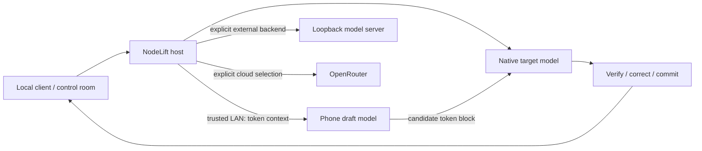

# Execution paths

The current mobile path proposes candidate tokens; the target remains on the computer. Target verification, correction and KV resynchronization precede committed output. A bounded lease carries epoch, prefix and model/tokenizer identities. Expired/unavailable work can fall back to the host.

The two external-provider paths are alternatives to native execution. They do not add phone drafting, merge caches across runtimes or increase NodeLift target memory.

Transport uses authenticated, pinned TLS between host and paired node. The dashboard/client gateway listens on loopback, with distinct admin/client authority. A phone receives tokenized prompt context and must be trusted. Current cancellation invalidates remote work; immediate interruption of a phone’s already-running native block is not guaranteed.

Capacity sharding, broader backend coverage, sustained multi-phone operation and proven single-chat gains remain research. [Detailed architecture](https://github.com/sev7enITA/NodeLift/blob/main/docs/ARCHITECTURE.md) and [measured limits](https://github.com/sev7enITA/NodeLift/blob/main/research/measurements/ENGINE_RESULTS.md) describe the boundaries.
