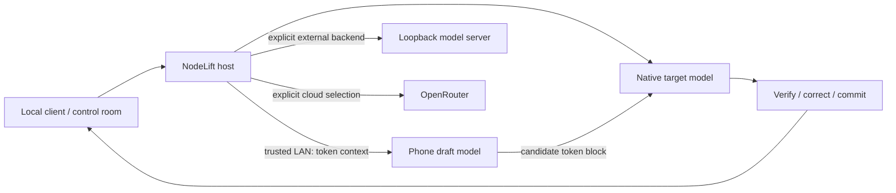

# Execution paths

The product objective is a shared local execution service that makes device RAM and compute available to everyday AI interfaces. The desktop UI is its control room. Memory-capacity execution and compute acceleration are core workstreams; the diagram below shows current execution paths. The [product roadmap](https://github.com/sev7enITA/NodeLift/blob/main/docs/ROADMAP.md) identifies unimplemented capacity work, candidate adapters and acceptance evidence.

The current mobile path proposes candidate tokens; the target remains on the computer. Target verification, correction and KV resynchronization precede committed output. A bounded lease carries epoch, prefix and model/tokenizer identities. Expired/unavailable work can fall back to the host.

The two external-provider paths are alternatives to native execution. They do not add phone drafting, merge caches across runtimes or increase NodeLift target memory.

The desktop control room now includes a selectable device relationship graph, run context and an evidence inspector. Accepted mobile draft share measures committed output attribution, not a share of computation or acceleration. [Device graph guide and product shape](https://github.com/sev7enITA/NodeLift/blob/main/docs/DEVICE-GRAPH.md) explains freshness, memory scopes, timing and the distinction between local runtimes and Z.ai/MiMo hosted GUIs.

Transport uses authenticated, pinned TLS between host and paired node. The dashboard/client gateway listens on loopback, with distinct admin/client authority. A phone receives tokenized prompt context and must be trusted. Current cancellation invalidates remote work; immediate interruption of a phone’s already-running native block is not guaranteed.

Capacity sharding, broader backend coverage, sustained multi-phone operation and proven single-chat gains remain research. [Detailed architecture](https://github.com/sev7enITA/NodeLift/blob/main/docs/ARCHITECTURE.md) and [measured limits](https://github.com/sev7enITA/NodeLift/blob/main/research/measurements/ENGINE_RESULTS.md) describe the boundaries.
