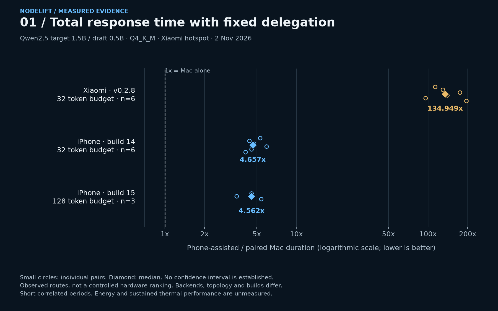

# Measure a specific model and connection

Use [NodeLift Impact v1](https://github.com/sev7enITA/NodeLift/blob/main/docs/IMPACT_BENCHMARK.md) for paired native host-versus-candidate sessions. It reports time saved, client SSE TTFT change, full-denominator reliability, measured-energy availability and session-cluster uncertainty. It does not pool RAM or enable delegation automatically.

```sh
python3 scripts/benchmark-impact.py collect \
  --native-library native/build/host/lib/libnodelift.dylib \
  --candidate remote_draft --node NODE_ID \
  --connection xiaomi-hotspot-mac \
  --tokens 32 --repetitions 1 \
  --output /tmp/nodelift-session.json
```

Use your actual library path and node ID. Configure the native target/draft first, keep the engine idle, and leave the matching companion draft ready in the foreground. The collector freezes its plan before inference, captures actual streamed text arrivals and retains failures, missing attempts, fallback and output mismatches. It never silently substitutes a retry. `--candidate host` is an instrumentation control; `local_draft` is local speculation.

In the desktop **Measurements** section, choose the recorded session JSON, select **Analyze session**, inspect the five dimensions and exclusions, then **Download impact report**. Analysis runs only on the local authenticated host. Imported data is reported evidence, not live hardware attestation.

The [2026-11-02 physical Xiaomi pilot](https://github.com/sev7enITA/NodeLift/blob/main/research/impact-2026-11-02/REPORT.md) completed three paired runs with matching outputs, one host fallback and no observed speed benefit. That single continuous session does not establish confidence intervals or a general device ranking. No power meter was connected, so energy remains unavailable.

At least ten independently collected sessions are required before the current descriptive bootstrap can return an interval. Repeating a script or renaming files does not create independence. Effective GPU offload, memory residency, thermal recovery and independent-session qualification remain incomplete. `qualified_recommendation` is always false in v1. Missing information cannot become a positive recommendation.

Energy requires matched meter scope and complete power traces. Battery percentage and rated TDP are not joules. Clean latency excludes fallback; a separate service metric includes its elapsed cost. Both retain full planned reliability denominators. Output equivalence does not prove semantic accuracy.

The older `benchmark-connected.py` and `benchmark-engine.py` remain legacy diagnostic tools. Their records cannot be imported as v1 sessions or promoted into qualified evidence. Network/CPU diagnostics, raw backend throughput and client SSE latency have different measurement boundaries.

[Detailed protocol and schema](https://github.com/sev7enITA/NodeLift/blob/main/docs/IMPACT_BENCHMARK.md) · [Current engine boundaries](https://github.com/sev7enITA/NodeLift/blob/main/docs/ENGINE_STATUS.md) · [Contribution requirements](https://github.com/sev7enITA/NodeLift/blob/main/CONTRIBUTING.md)

## Physical trade-off follow-up

The [new 18-pair Xiaomi study](https://github.com/sev7enITA/NodeLift/blob/main/research/phone-tradeoffs-2026-11-02/REPORT.md) compares fixed and adaptive phone delegation with the host, plus three local speculation control pairs. In the tested Qwen2.5 1.5B/0.5B hotspot scope, fixed delegation had a median 134.949x slowdown. Adaptive probing abandoned the phone in every request, adding median paired overhead of 43.738 ms at a 32-token budget and 87.604 ms at 128 tokens. All paired outputs matched. These are descriptive observations from correlated cells, not universal phone rankings.

Use `--policy fixed` or `--policy adaptive` and `--draft-k 4` in the collector; these parameters enter the comparison fingerprint. Measurements now shows fallback-inclusive completed-service latency separately from clean no-fallback timing. No accepted phone tokens means no demonstrated phone acceleration even when service completion succeeds.

The standalone network diagnostic after these cells timed out without samples. Energy, sustained thermals, other phones/transports, larger targets and capacity sharding remain unqualified. See the linked report for raw records, the frozen plan, conditional stopping rule and next measurements.

## Physical iPhone comparison

The [iPhone study](https://github.com/sev7enITA/NodeLift/blob/main/research/iphone-tradeoffs-2026-11-02/REPORT.md) completed 18 pairs with matching output. Fixed 32-token delegation supplied 128 accepted proposals out of 246, but had a median paired 4.657x slowdown and +109.299 ms TTFT. Both adaptive cells used host fallback throughout. The later fixed-128 cell stopped after session loss and retains one invalid plus five missing primary attempts.

This is a smaller observed penalty than the Xiaomi route, not a controlled SoC ranking: backend requests, companion builds, topology and host load differed. A small negative service-time observation under adaptive fallback is not phone acceleration because no phone tokens contributed. Energy and independent confidence remain unqualified. A private iOS build-15 fix for obsolete-result handling is separate from the original build-14 measurements; its separate physical follow-up completed six pairs with matching output. Four obsolete proposals were discarded without losing the session, and fixed-128 completed without fallback, still 4.562x slower than its paired host baseline. This is short-run validation, not sustained reliability.

## Visual comparisons

[Open the localized benchmark gallery](https://www.fabriziodegni.com/NodeLift/#benchmark-charts) or [read the reproducible visual report](https://github.com/sev7enITA/NodeLift/blob/main/research/visual-benchmarks-2026-11-02/README.md). Four chart families show paired total duration, first-token delay, fallback-inclusive adaptive timing and proposal acceptance with incomplete requests retained. Individual observations and sample sizes accompany medians; no confidence interval or energy result is inferred.



## Performance diagnosis

[Read the measured cost analysis](https://github.com/sev7enITA/NodeLift/blob/main/research/performance-diagnosis-2026-11-02/REPORT.md). The Android 0.2.8 binary was built without native optimization; the corrected native library cross-compiles with `-O3`, but has not been installed or benchmarked on a phone. Nine new iPhone pairs with draft widths 1, 4 and 8 remain approximately five times slower than the Mac. Remote wait includes computation and communication; it is not network RTT. The report gives a break-even budget, external-review adjudication and a bounded asynchronous experiment proposal.

## Generic desktop and server probe

[Node probe 0.1.0](https://github.com/sev7enITA/NodeLift/blob/main/docs/NODE_PROBE.md) collects an allowlisted local hardware/software profile and can explicitly run a separately supplied `llama-bench` executable on a chosen GGUF. [Download the Python 3.10+ package](https://www.fabriziodegni.com/NodeLift/assets/NodeLift-node-probe-0.1.0.pyz) and verify its [manifest](https://github.com/sev7enITA/NodeLift/blob/main/releases/node-probe.json). The dashboard can probe and export its own host; remote PC enrollment is not implemented.

[Physical Mac inventory and short local kernel records](https://github.com/sev7enITA/NodeLift/blob/main/research/node-probe-2026-11-02/README.md) are available. Windows/Linux ARM and x86 adapters have fixture tests only. Kernel rates do not include client TTFT, connection cost, verified accelerator allocation, energy or distributed speedup. Run the separate paired Impact protocol before recommending a real model/device/connection route.

The [standalone macOS Apple silicon preview](https://github.com/sev7enITA/NodeLift/blob/main/docs/NODE_PROBE.md#standalone-package-without-system-python) bundles Python and the native benchmark, checks them at startup and needs no system Python. It is ad-hoc signed and not notarized; other Macs remain unqualified. A model is supplied separately.
