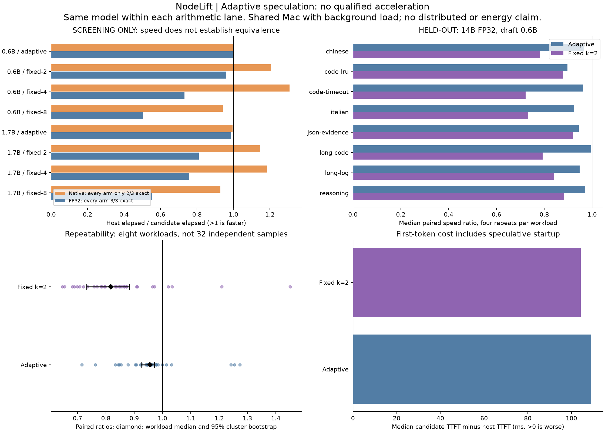
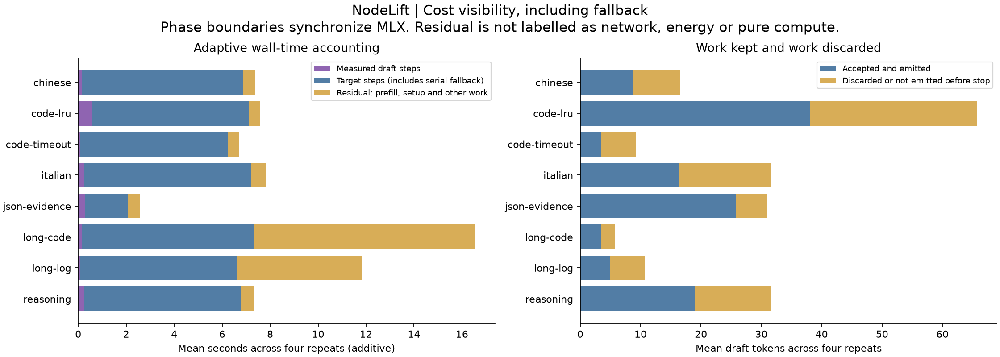

# Adaptive scheduling and larger local targets

5 November 2026. **No configuration qualifies as repeatable acceleration in this experiment.** The cost-aware scheduler reduces observed overhead compared with the selected fixed speculative path, but remains slower than target-only decoding. This is an isolated MLX research prototype, not an enabled NodeLift production backend or a new mobile release.

## Measured result

Mac M3 Max, 64 GiB unified memory. Official Qwen3 four-bit MLX target 14B and drafts 0.6B/1.7B. There were 54 screening requests and 96 held-out validation requests. Validation compares target-only, the screening-selected fixed configuration and adaptive configuration on eight prompts, twice in each of two fresh processes. Each candidate therefore has 32 paired comparisons, not 32 independent workloads.

| 14B FP32 lane, draft 0.6B | Adaptive | Selected fixed k=2 |
| --- | ---: | ---: |
| Exact tokens and finish reason | 32/32 | 32/32 |
| Median paired host/candidate elapsed ratio | 0.950x | 0.835x |
| Median paired duration increase | 5.28% | 19.78% |
| Process 0 median ratio | 0.915x | 0.848x |
| Process 1 median ratio | 0.956x | 0.784x |
| Workload-median ratio | 0.955x | 0.817x |
| 95% prompt-cluster bootstrap interval | 0.925 to 0.972 | 0.733 to 0.883 |
| Median first-token delay added | 109 ms | 104 ms |
| Workload medians below target-only speed | 8/8 | 8/8 |
| Requests that disabled further drafting | 29/32 | Not applicable |
| Admission result | Rejected | Rejected |

Ratios above one mean faster. Median paired ratios, median workload ratios and paired duration changes are distinct statistics. All repeated target-only token sequences were identical within each of the eight workloads. Exact equality here is empirical evidence over this dataset, not a proof for other prompts or generation lengths.

The initial native-arithmetic screening produced a 1.307x median ratio for draft 0.6B, fixed k=4, but every speculative configuration differed from the target-only output on one of three screening prompts. Those timings do not establish an equivalent optimization. A separately declared FP32 diagnostic converted floating parameters while retaining packed integer quantized weights. All eight FP32 screening configurations matched 3/3 outputs, but none had a median ratio above one. Only that lane proceeded to the frozen held-out validation. There is no matched native-arithmetic baseline on those held-out prompts and no cross-precision speed claim.

## What was implemented

`policy.py` implements a bounded per-request controller. It starts at k=2, caps k at 8, and compares observed block wall time per emitted token with a separate serial calibration. High acceptance can increase k only when the measured cost also clears the margin. Three consecutive unprofitable blocks permanently disable drafting for the request. It cannot resume with a stale draft KV cache. Every new request resets the policy.

`adaptive_mlx.py` is a small attributed MIT-derived variant of MLX-LM 0.32.2 speculative generation. It records draft steps, target verification, generated candidates, accepted emitted tokens and fallback decisions. Synchronization used for measurement is part of the timed implementation. The generator is not claimed to be a new underlying inference kernel.

Phase durations include the execution and synchronization at their boundaries, not isolated GPU kernel time. The residual includes prefill, initialization and other work; it is not labelled as pure compute or network delay. Target-step time includes serial fallback. The last block can close on EOS or the output cap before a policy update, but its generated/accepted tokens and draft/target durations remain recorded. Fixed upstream paths do not provide this detailed phase trace, and no missing component is invented.

## Models downloaded and retained locally

| Official Hugging Face snapshot | Approximate downloaded size | Role/status |
| --- | ---: | --- |
| [Qwen3-0.6B-MLX-4bit](https://huggingface.co/Qwen/Qwen3-0.6B-MLX-4bit) | 0.31 GiB | Draft, selected in FP32 screening |
| [Qwen3-1.7B-MLX-4bit](https://huggingface.co/Qwen/Qwen3-1.7B-MLX-4bit) | 0.87 GiB | Draft, screened |
| [Qwen3-14B-MLX-4bit](https://huggingface.co/Qwen/Qwen3-14B-MLX-4bit) | 7.32 GiB | Target, screened and validated |
| [Qwen3-32B-MLX-4bit](https://huggingface.co/Qwen/Qwen3-32B-MLX-4bit) | 16.23 GiB | Downloaded; memory admission failed before inference |

All snapshots are revision-pinned in `catalog.json`. Every downloaded file is SHA-256 recorded in `model-file-sha256.json`; hashing ran after the timed validation. No weights are committed to Git. The 32B attempt required 20.29 GiB available for its loaded model set and working allowance, but measured 18.10 GiB. This is a resource-admission result, not a 32B performance measurement. Downloading additional unqualified models would not solve that constraint.

The 1.7B tokenizer template did not honor `enable_thinking=False` in the same way as the other snapshots. The initial smoke test stopped before inference. `TEMPLATE-AMENDMENT.md` records the correction: use the pinned 0.6B canonical no-thinking serialization for every arm, verify complete vocabulary equality and verify the exact encoded prefix on every request. Results apply to that serialization, not to each model's native-template quality.

## Method and limitations

- `PLAN.md`, `prompts.json` and `catalog.json` were frozen and hashed before measurements. `PRECISION-AMENDMENT.md` records the additional precision lane before held-out validation. `selection-14B-fp32.json` fixes the selected arms from screening only.
- Greedy generation, batch one, maximum 128 generated tokens, EOS respected, fresh KV per request. Model load is excluded; within-request startup, prefill, discarded work and fallback are included. The same target and both draft models remain resident across arms.
- Each prompt's arm order is shuffled, with separate seeds across processes. The confidence interval resamples eight workload clusters, not the 32 correlated repeated pairs. Eight judgment-sampled workloads are too few for broad population claims or tail-latency certification.
- **The Mac was shared with active user applications and browser-based review acquisition.** Recorded one-minute system load ranged from 5.93 to 218.19; load average is not CPU-utilization percentage. Global swap occupied about 23.30 GiB at the first validation request and 24.09 GiB at the last. The minimum sampled available memory before a request was 9.97 GiB. These are system-wide observations, not attribution of swap or contention to this experiment. The sessions are not clean-room or thermally controlled benchmark runs. Randomization does not remove this limitation.
- Native and FP32 screening also overlapped download activity or its surrounding session. Screening cannot qualify a gain. No validation model download was active, but other background activity remained.
- No energy, thermal-sensor, phone, P16, Wi-Fi, distributed capacity or pooled-memory measurement was made. No faster production backend, app release or universally superior model pair is established.

The current data rejects promotion under the declared gate. It does not prove that this model pair can never accelerate on an idle host or another backend. An idle-host qualification is needed before generalizing either gains or regressions.

## Reviews, verification and next decision

GLM 5.3 Max and Gemini 4 Argon High completed browser-based static reviews of the supplied methodology, followed by corrections after the coordinator challenged unsupported claims. [Adjudication and retained excerpts](review-adjudication.md) distinguish their analysis from these local measurements. Neither model inspected the source or ran the hardware. Earlier incomplete API attempts remain recorded separately.

Checks passed: 58 pure scheduling checks, 12 real-model fixed-policy comparisons against upstream in the smoke test, five synthetic negative controls for the analysis gate, and integrity/accounting checks over all 150 measured requests. The smoke test used a self-draft and does not cover every rejection/cache path. Full validation supplies additional empirical evidence, not a formal equivalence proof.

The next bounded policy experiment should use a charged target-only warm prefix to estimate request-local cost, retain explicit KV synchronization, and test on a new held-out set. First-divergence diagnostics remain necessary for the native lane. An empirical top-logit margin cannot certify token equivalence, and changing precision mid-history cannot restore a serial oracle. No such shortcut or post-hoc policy change was adopted here. The 32B run awaits sufficient available memory, preferably on a quiet host.

## Reproduction and evidence

Use Python 3.12 and the pinned `environment.txt` in an isolated environment. `download.py` obtains the revision-pinned snapshots with a disk reserve. Run `check_policy.py`, then `runner.py --target 0.6B --stage smoke --out <new-directory>`. Screening uses `runner.py` or the explicitly labelled `runner_fp32.py`, `--target 14B --stage screen`. Validation uses `runner_fp32.py --target 14B --stage validate --block 0` and then block 1 in fresh processes, passing `--selection selection-14B-fp32.json` and distinct new output directories. The runner writes to the repository's ignored `artifacts/adaptive-targets-2026-11-05` convention; retain the downloaded model manifest there.

`results/raw` contains original manifests, warmups, calibrations, complete generated token IDs, timings, resource samples and traces. `results/validation-pairs.json` and `results/summary.json` are derived by `analyse.py`; `render.py` draws both figures. `validate.py` checks source/input hashes and accounting. `artifact-sha256.json` identifies the final publication files. Model loading, snapshots and private credentials are not packaged in this research directory.

## References and acknowledgements

This prototype builds directly on [Apple MLX-LM](https://github.com/ml-explore/mlx-lm), with its MIT license retained in `MLX-LM-LICENSE.txt`, and the official [Qwen model releases](https://huggingface.co/Qwen). The installed source version and original function hashes are recorded in `upstream-source.json`. [MLX-LM issue 1470](https://github.com/ml-explore/mlx-lm/issues/1470) is related external evidence about speculative output divergence; it is not proof of the cause or a fix for this run. NodeLift's earlier [DistAI study and acknowledgements](../distai/LESSONS_LEARNED.md) remain part of the project lineage. Research implementation and experiment coordination: Fabrizio Degni, [NodeLift](https://github.com/sev7enITA/NodeLift).
