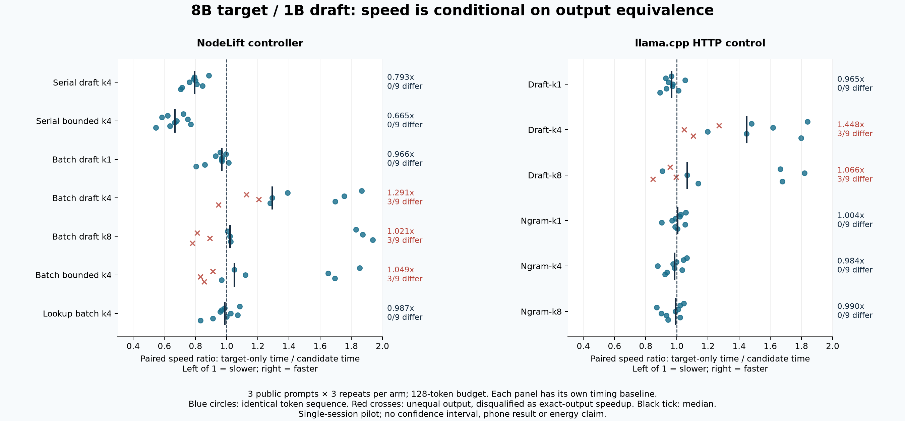

# Bounded lookahead, native timing and the 8B control pilot

**No reliable speedup has been established.** The exact-output serial variants are slower in this local pilot. Some batch variants are faster but diverge from the serial token sequence. The new optimized Android APK is available for physical qualification; these results are Mac measurements, not phone results.



## Measured local results

Target: Llama 3.1 8B Q4_K_M. Draft: Llama 3.2 1B Instruct Q4_K_M. Actual token-ID fingerprints match. Three public prompts, three repetitions, 128-token limit, context 2048, eight requested CPU threads, Metal offload. All recorded completions emitted 128 tokens. A ratio above one is faster, below one slower.

| NodeLift candidate | Median paired time ratio | Identical outputs |
|---|---:|---:|
| Serial draft, k4 | 0.793x | 9/9 |
| Serial bounded lookahead, k4 | 0.665x | 9/9 |
| Batch draft, k1 | 0.966x | 9/9 |
| Batch draft, k4 | 1.291x | 6/9 |
| Batch draft, k8 | 1.021x | 6/9 |
| Batch bounded lookahead, k4 | 1.049x | 6/9 |
| Prompt lookup, batch k4 | 0.987x | 9/9 |

The direct controller measures request work including cleanup, with both models resident after warmup. Candidate order is randomized within prompt/repetition blocks. The experiment is opt-in and serial verification remains the default.

| Upstream llama.cpp HTTP candidate | Median paired time ratio | Identical outputs |
|---|---:|---:|
| draft-simple, k1 | 0.965x | 9/9 |
| draft-simple, k4 | 1.448x | 6/9 |
| draft-simple, k8 | 1.066x | 6/9 |
| ngram-mod, k1 | 1.004x | 9/9 |
| ngram-mod, k4 | 0.984x | 9/9 |
| ngram-mod, k8 | 0.990x | 9/9 |

Upstream uses a separate HTTP harness, restarts/warmups per arm, identical serialized prompt IDs and explicit greedy sampling. Its ratios must not be compared directly with the controller's absolute durations. Ngram k1 has the largest observed median among exact-output upstream candidates, but 1.004x in this small single-session pilot does not demonstrate a meaningful improvement. A wider search of runtimes, tuning and workloads remains open.

## What the divergence tells us

On the RAM/bandwidth prompt, both NodeLift batch k4 and upstream draft-simple k4 first differ at **generated token index 36 (the 37th token)** in all three repeats: serial token ID **6104**, batch token ID **5810**. The other two prompts match in those arms. This is reproducible in the two measured harnesses; it is not yet proof of a specific faulty kernel. See [first-divergence.json](first-divergence.json).

An identical-prefix probe now reproduces this token flip. With serial KV history, changing only the current batch width in 13 windows changes logits but does not change the winning token. Feeding the same generated history in chunks of three or five tokens, then evaluating a five-token batch, changes the winner at step 36 from 6104 to 5810. Serial repeat controls remain identical. Cache construction history and current batch shape jointly affect numerical equivalence in this tested Metal configuration; this does not isolate a particular faulty kernel. See [the original shape probe](shape-metal-fa.json), [the history-controlled probe](shape-history-metal-fa.json) and [their provenance](shape-provenance.json).

Changing the canonical output to the batch result would change the contract. Keeping serial verification protects the current equivalence contract at a performance cost. A margin heuristic cannot be advertised as exact without a supported error bound. The next step is to isolate cache precision, attention and matrix multiplication effects while retaining the same serial oracle.

## Implementation and validation

- Native schema 1 records prefix synchronization, after-sync duration, overlapping decode duration and work counts. Host schema 3 separates model loading, target prefill, first token/text readiness, per-block work, remote waiting and cleanup.
- The bounded host ledger records late responses with zero committed credit; it validates timing partitions independently of token identity. Prefix contents are not retained in the ledger.
- Android 0.2.13 build 16 has optimized ARM64 kernels, worker timing, one-block speculative lookahead, exact prefix/epoch/sequence checks and expiry. An expired draft response no longer breaks the session. The build is debug-signed for laboratory use.
- iOS 0.2.13 build 16 compiles as an unsigned ARM64 package with timing support. It does not advertise bounded lookahead and requires Apple signing/provisioning for installation.
- The native wrapper now contains response allocation failures, supports cooperative cancellation during model loading and rejects recognized control-token spellings/NUL inside chat content. The latter also rejects legitimate literal discussion of those spellings; it is not a semantic prompt-injection defense.
- 163 host tests, 25 Android JVM tests, Android lint (0 errors, 18 warnings), Swift protocol/transfer checks on macOS, 31 real-weight serial checks on the final host library and 15 final-library boundary checks passed. Four additional fault-injection checks passed in a separate test build. Five real-weight TLS loopback cases preserved output, including fallback and late-result rejection. Loopback is not a phone test.

Read the [timing contract and limits](TIMING.md), [predeclared plan](PLAN.md), [review adjudication](REVIEW.md) and [validation receipt](validation.json).

## Physical qualification still required

The optimized Xiaomi build has not yet been observed by the host. No physical result from 0.2.13 is included. Start with the existing Qwen control pair to verify telemetry, then transfer the compatible 1B draft for the 8B target and run matched host/local/remote arms. Keep thermal snapshots, failures, fallback and discarded work. ACK wait, failed native work and unreachable cleanup remain incompletely measured and must not be reported as zero. Battery percentage is not energy consumption.

The historic O0 Android binary and new O3 binary differ in more than compiler optimization. A causal O0/O3 comparison needs two otherwise matched builds on the same phone. No pooled memory, model sharding or distributed acceleration is claimed.

## Reproduction

```sh
python3 scripts/check-native.py --strict --output artifacts/native-serial.json
python3 scripts/check-native-boundaries.py --output artifacts/native-boundaries.json
python3 scripts/benchmark-bounded.py --output artifacts/bounded-8b
python3 scripts/benchmark-upstream.py \
  --target .models/llama3.1-8b-ollama.gguf \
  --draft .models/Llama-3.2-1B-Instruct-Q4_K_M.gguf \
  --prompt-manifest artifacts/bounded-8b/manifest.json \
  --repetitions 3 --tokens 128 --draft-widths 1 4 8 \
  --output artifacts/upstream-8b
```

Supply lawfully obtained models matching the recorded hashes. The Ollama filename used here is a local symlink to an already installed model, not a download included in this repository. Run performance arms serially, without concurrent compilation/inference. Each manifest and raw JSONL file retains the model/library identities, settings, tokens, phases and ordering needed to examine the result. Read the separate harness limitations before drawing comparisons.

Build the optional `nodelift-shape-probe` with `NODELIFT_BUILD_SHAPE_PROBE=ON`, then pass the recorded model, either `shape-cases.json` or `shape-history-cases.json`, an output path and `999 8 1 2048 1` (GPU layers, threads, requested flash attention, context, serial reference history). Per-case `history_batch_width` changes only the candidate history construction. Probe durations are diagnostic and are not performance evidence. Run `render_charts.py` with Matplotlib to regenerate the comparative figures from the retained summaries.

## Acknowledgements

This work builds on [llama.cpp](https://github.com/ggml-org/llama.cpp) and the models distributed by [Meta Llama](https://huggingface.co/meta-llama). The quantized 1B draft came from [bartowski's GGUF repository](https://huggingface.co/bartowski/Llama-3.2-1B-Instruct-GGUF). We retain and thank [DistAI and the other related-work projects](../../docs/ACKNOWLEDGEMENTS.md) for their research and implementation work. These acknowledgements do not imply endorsement.
