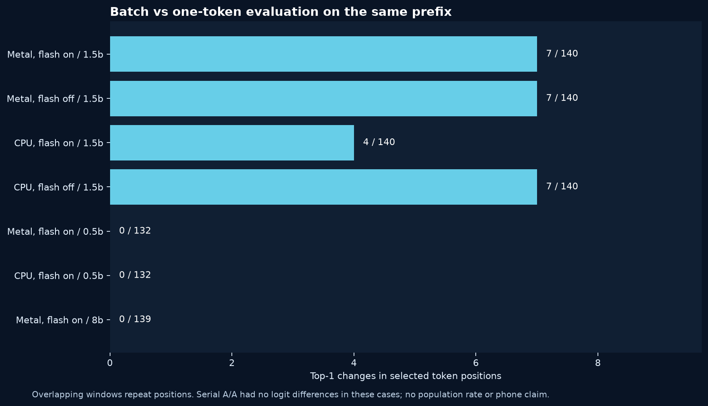

# Batch shape and numerical parity: controlled target-only study

2 November 2026. This study follows the [observed verifier mismatch](../engine-investigation-2026-11-02/README.md). It isolates a possible contributor using real target models and the same token windows. It does not demonstrate a general model defect or quantify a population-wide failure rate.

## Method

The [plan](PLAN.md) was recorded before the six runs. The [research-only probe](../../native/experiments/shape_probe.cpp) creates three independent llama.cpp contexts. For every fixed window it clears all three, prefills each with the same preceding token sequence, evaluates the same anchor and subsequent authoritative tokens twice one at a time, and evaluates that window once as a batch. It records each position's top-1 and top-2 IDs, margins, maximum absolute difference over the vocabulary, and the serial-versus-serial repeat control. The probe is built only when `NODELIFT_BUILD_SHAPE_PROBE=ON`; no production route uses it.

This setup isolates evaluation-shape differences more tightly than comparing final text, but it cannot identify the individual kernel, rounding operation or other mechanism that causes a difference. The prefixes were re-prefilled in separate contexts, so the zero A/A result is important evidence for these cases, not a guarantee of backend determinism. Later positions within a batch can include KV written under different shapes. Every run is one short, targeted period; overlapping windows and repeated prompts are correlated. Durations in raw output are order-fixed and are not a benchmark of user-facing latency.

## Observations



| Model / requested backend | Flash requested | Windows | Token positions | Batch vs serial top-1 changes | Serial vs repeat top-1 changes |
| --- | --- | ---: | ---: | ---: | ---: |
| Qwen2.5 1.5B Q4_K_M / Metal | On | 39 | 140 | 7 | 0 |
| Qwen2.5 1.5B Q4_K_M / Metal | Off | 39 | 140 | 7 | 0 |
| Qwen2.5 1.5B Q4_K_M / CPU | On | 39 | 140 | 4 | 0 |
| Qwen2.5 1.5B Q4_K_M / CPU | Off | 39 | 140 | 7 | 0 |
| Qwen2.5 0.5B Q4_K_M / Metal | On | 38 | 132 | 0 | 0 |
| Qwen2.5 0.5B Q4_K_M / CPU | On | 38 | 132 | 0 | 0 |
| Llama 3.1 8B Q4_K_M / Metal, separate follow-up | On | 38 | 139 | 0 | 0 |

The seven Metal 1.5B differences correspond to overlapping windows covering the **same** Italian-prompt output position, not seven independent failures. CPU differences cover up to four distinct positions of that prompt. The 0.5B control did not flip top-1 in these selected windows, but did produce different logits. In all seven runs the repeated serial path produced identical logits for every recorded vocabulary entry. The width-1 comparison also matched in these runs. Requested offload and flash configuration are recorded; effective kernel and accelerator placement were not independently attested.

Turning off the requested flash mode did not remove observed top-1 changes. These results support investigating batch shape as a contributor in this configuration, but not assigning causality to a specific GPU or CPU kernel. Exact greedy identity across shapes is not established. A threshold based on observed logit margins would be an empirical heuristic, not a proof for unseen inputs; it has not been enabled.

[Machine-readable summary](summary.json), [source and model identities](manifest.json), fixed case files and raw per-position results are retained in this directory. The 0.5B and 1.5B model files are not included.

## Relation to upstream work

The llama.cpp [single versus block numerical discussion](https://github.com/ggml-org/llama.cpp/discussions/28042) describes a related comparison with identical token windows and a serial determinism control. Other contributors have reported related speculative-path differences in [issue 25618](https://github.com/ggml-org/llama.cpp/issues/25618) and [issue 31472](https://github.com/ggml-org/llama.cpp/issues/31472). Their reported architectures, diagnostics and proposed causes are separate from this experiment. We wrote this probe independently against the locked public llama.cpp API and did not copy those implementations.

## Reproduce

```sh
cmake -S native -B /tmp/nodelift-shape-build \
  -DLLAMA_SOURCE_DIR=/path/to/locked/llama.cpp -DCMAKE_BUILD_TYPE=Release \
  -DGGML_METAL=ON -DNODELIFT_BUILD_SHAPE_PROBE=ON
cmake --build /tmp/nodelift-shape-build --target nodelift-shape-probe -j 4
/tmp/nodelift-shape-build/nodelift-shape-probe \
  /path/to/model.gguf research/batch-numerics-2026-11-02/cases-1.5b.json \
  /tmp/shape-output.json 999 8 1
python3 research/batch-numerics-2026-11-02/summarize.py /tmp/summary.json /tmp/shape-output.json
```

Use the exact model matching the case-file SHA-256, or regenerate the fixed cases with `make_cases.py`; token IDs are model-specific. Repeat with layer request `0` for CPU, and the final flag `0` for flash attention disabled. The Python scripts are developer research tools, not a dependency imposed on the standalone user application. An [additional 8B control](PLAN-8B.md) was planned separately after the first set. Its serial verification also passed [31 real-model checks](correctness-serial-8b-metal.json); this does not prove all 8B prompts or backends match.

## Review status

A fresh methodological review was requested from Gemini 4 Argon High, but the browser reported an error and no response was obtained after a retry. A fresh request to GLM 5.3 Max was submitted and remained in the thinking state when this record was prepared. Neither is presented as having independently validated these new measurements. Their completed reviews from the previous engine investigation are documented separately in that [report](../engine-investigation-2026-11-02/README.md).
