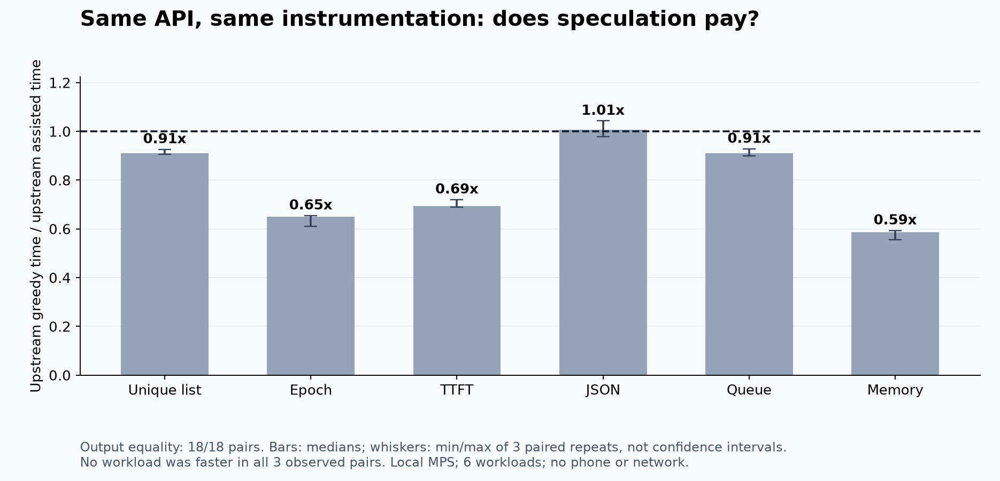
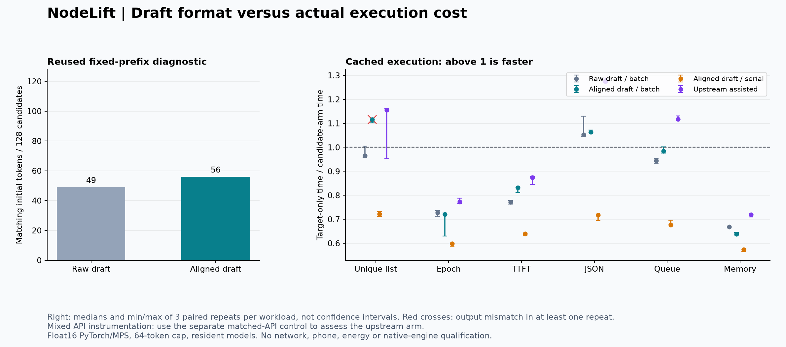

# Draft formatting, cached verification and a matched API control

4 November 2026. Follow-up to the [Heretic Mac pilot](../heretic-mac-2026-11-04/README.md). Actual local model execution on Apple M3 Max, 64 GiB unified memory. No further weight editing, remote inference, mobile release or production engine change.

**Outcome:** correcting the draft-only template improves candidate agreement on reused diagnostic prefixes, but does not establish acceleration. The new cached prototype is slower overall than its target-only reference. An aligned batch path changes output on one workload in all three repetitions. A separate matched upstream API comparison preserves output in all 18 pairs but is slower overall, with no workload consistently faster in all three repetitions.

## What was implemented and executed

This research adds a cached decoding prototype with separate target and draft state, draft-only response formatting, bounded four-token proposals, first-candidate rejection using already available target logits, cache rollback and repair, serial or batched target verification, and per-phase accounting. The custom path emits the first authoritative target token before draft prefill. Candidate tokens never bypass target verification.

Actual work comprises:

- 64 real four-token candidate blocks across two formatting conditions and four frozen target continuations.
- 90 measured executions: six new technical prompts, five arms and three shuffled repetitions. Warmups and the initial smoke tests are retained separately.
- 36 additional executions comparing upstream greedy and assisted generation through the same API and streamer, with the same six prompts and three paired repetitions.
- One instrumented mismatch replay and a fresh serial-history logit comparison.
- 288 synthetic protocol cases covering exact, wrong and mixed candidates, EOS and output limits. These check control flow, not physical performance or numerical equivalence.

All model runs used the original pinned Qwen3-4B-Instruct-2507 target and Qwen3-0.6B draft, float16, PyTorch 2.15.0, Transformers 5.22.1, MPS and SDPA. Both models were resident during timed comparisons. The target prompt was unchanged. The environment and model hashes are in the preceding pilot. The new source, plans, raw outputs, hashes and derivation scripts are retained here.

## 1. Formatting helps, but does not solve initial disagreement

The Qwen model card documents `enable_thinking=False`. We used the draft tokenizer's corresponding template, then appended the exact committed target tokens. The draft prefix was checked to consist of the original target prefix plus a draft-only suffix. This is a candidate-generation heuristic; it does not change the target's distribution or authorize any draft output.

| Reused diagnostic prefix | Raw draft prefix | Aligned draft prefix |
|---|---:|---:|
| Race question | 17/32 | 17/32 |
| Experiment question | 9/32 | 9/32 |
| Correction question | 3/32 | 4/32 |
| Clean-code question | 20/32 | 26/32 |
| Total initial matching tokens | 49/128 | 56/128 |

Only tokens before the first mismatch of each four-token block count. These are actual autoregressive candidates against frozen target continuations, not teacher-forced argmax counts. The previous ambiguous question and continuations were intentionally held fixed, so these are reused diagnostics rather than a new independent quality benchmark.

The aligned draft stops beginning with `<think>`, but **the first candidate token still differs from the target in all four prefixes**. The seven additional matches occur later. Thus the earlier formatting mismatch was real, but it was not the sole cause of low agreement. Equal vocabularies also do not imply similar continuation probabilities.

## 2. Cached prototype: agreement does not pay for all work

The prototype uses fresh KV state per request, up to 64 generated tokens, and respects EOS. One JSON response ends at 38 tokens; the other workload outputs reach the 64-token cap. Requests are not claims about complete application answers or task quality. Runs use a fixed shuffled order, with three same-session repeats for each of six workloads.

| Arm | Exact output against paired custom target-only | Median paired target-time / arm-time |
|---|---:|---:|
| Raw draft, batch verification | 18/18 | 0.856x |
| Aligned draft, batch verification | 15/18 | 0.905x |
| Aligned draft, serial verification | 18/18 | 0.660x |
| Upstream fixed-k assisted generation, preliminary comparison | 18/18 | 0.915x |

A ratio below one means slower. All three custom target-only repeats agree within each workload. The aligned batch mismatch occurs on the unique-list function prompt in all three repetitions. Faster output from that arm is disqualified as equivalent acceleration on that workload.

The preliminary upstream row uses different instrumentation from the custom reference. It is retained for transparency, but the matched API control below is the appropriate comparison for that implementation. Neither is an exhaustive search for the best local speculative configuration.

Mean phase times across the 18 aligned batch runs show why a better draft score is insufficient:

| Work category | Mean seconds per request |
|---|---:|
| Target-only prefill and decode | 2.353 |
| Target work in aligned batch path: prefill, decode, verification and repair | 1.433 |
| Draft work: prefill, generation and synchronization | 1.360 |

The observed reduction in target work is approximately 0.920 s, while draft work adds approximately 1.360 s, before residual orchestration. These are synchronized, instrumented phase durations from this local harness, not transferable phone latency budgets. The batch arm also fails output equality. Removing draft time algebraically would not establish achievable asynchronous execution, GPU independence or a remote speedup.

The aligned batch arm proposed 1,539 candidate tokens, accepted 663 and discarded 876 across the 18 runs. The raw arm proposed 1,599, accepted 654 and discarded 945. These executions can follow different target trajectories where numerical divergence occurs; the aggregate counts are operational observations, not a clean fixed-output causal estimate of formatting quality.

## 3. Matched upstream API control

The initial mixed-API comparison suggested improvements on some workloads. That could not isolate algorithmic benefit because finite checks, synchronization points and Python calls differ between implementations. We therefore declared a follow-up using upstream `generate()` for both baseline and assisted generation, with the identical timing helper and streamer. All six prompts were retained, including the slower ones.

The assisted configuration uses four candidate tokens, constant scheduling and confidence threshold zero. This is a controlled fixed-k comparator, not the default adaptive configuration or a best-of-all-settings claim. Per-call cache state is fresh; model weights remain resident.

| Workload | Median paired speed ratio | Range across three pairs | Exact output |
|---|---:|---:|---:|
| Unique-list function | 0.910x | 0.906-0.926x | 3/3 |
| Epoch explanation | 0.651x | 0.611-0.655x | 3/3 |
| TTFT explanation | 0.693x | 0.690-0.720x | 3/3 |
| JSON evidence | 1.007x | 0.979-1.043x | 3/3 |
| Bounded queue | 0.911x | 0.899-0.928x | 3/3 |
| Memory explanation | 0.585x | 0.556-0.593x | 3/3 |

All 18 paired outputs match. None of the six workloads is faster in all three paired observations. JSON is approximately at parity, with the range crossing one. Across all pairs, the median speed ratio is 0.810x; the separately calculated median percentage increase in request duration is 25.0%. These summaries are not algebraic reciprocals because the median of an even sample interpolates the middle observations. The median first-token delay is 66.3 ms relative to upstream greedy generation.

Ranges are observed min/max values, not confidence intervals. These repeated measurements share a host session and only six workloads. They do not establish population reliability or a general model ranking. The earlier apparent improvements are not retained as acceleration evidence after this matched control.

## 4. The output divergence has a measurable numerical signature

The instrumented replay reproduces the aligned batch result on the unique-list prompt. Its first differing output token has zero-based index 48. The token history up to that point is identical to the reference. The logits used to emit that token came from `target_sync`, a one-token step after prior batched execution.

| Observation at the same token context | Value |
|---|---:|
| Batched-history next-token choice | 23094 |
| Fresh serial-history choice | 70618 |
| Original target-only reference choice | 70618 |
| Maximum absolute final-logit difference | 0.041015625 |
| Reference-token minus alternative logit under batched history | 0.0 |
| Same margin under fresh serial history | 0.03125 |

The instrumented replay has the same output as the original batch run, and retained cache token IDs agree with the intended context. This is direct evidence of differing final logits and an argmax tie under different execution histories, despite an identical token prefix. It is not evidence of an incorrect token-ID crop in this replay.

It does **not** identify the first divergent layer, prove that KV alone is responsible, identify a unique Metal kernel, or establish all other cases deterministic. It also does not prove that a tie-only fallback would repair every possible divergence. A current width-one step does not erase numerical differences accumulated through prior execution geometry. Blindly trusting token-ID overlap is insufficient to establish serial equivalence.

This is a PyTorch/MPS reproduction on a different model pair from the existing native investigation. It neither fixes nor requalifies NodeLift's llama.cpp verifier.

## Timing, validation and failures

- The initial smoke run reached the custom arms, then failed because the harness supplied a list of EOS IDs as a scalar padding ID to upstream generation. The corrected helper selects a scalar padding ID while retaining the EOS configuration. The failed log and initial source are preserved. The retry passed, including custom serial versus upstream serial output checks.
- The completed 90-run source is unchanged and its SHA256 matches the saved execution manifest. Follow-up diagnostics and API controls are separate files and plans. Plans and new prompts were hashed before the primary executions.
- Custom phase measurements include explicit MPS synchronization, finite-logit checks, tensor construction and Python overhead. Residual elapsed time is reported separately. They are instrumented execution costs, not optimized kernel throughput. The matched API control uses identical instrumentation for its two arms.
- First-token readiness is local to the worker/harness, not HTTP or UI-observed TTFT. No load time, remote queue, radio link, energy meter or sustained thermal qualification is included. Background OS effects were not experimentally eliminated.
- All original and modified records, failed attempts, generated tokens and discarded-candidate counts are retained. No model-generated code was executed.
- The 288 synthetic checks validate protocol branches with a fake state implementation. Actual model smoke and paired runs separately exercise real KV caches and hardware. Neither substitutes for cancellation, disconnect, multi-user or phone tests.

## Engineering decision

Keep this prototype experimental. Do not enable the aligned batch path in production or advertise distributed acceleration. The current evidence favors target-only execution for this tested model pair and fixed-k setup.

The next useful gates are:

1. Compare adaptive local candidate scheduling and other compatible draft/target pairs against a matched upstream control before claiming a best-local baseline. Test larger targets where avoided target computation may outweigh candidate cost, with the same correctness gates.
2. Localize the numerical discrepancy with per-layer/state observations before designing selective replay or precision changes. A margin threshold needs measured coverage and replay cost; it is not a correctness guarantee by itself.
3. Use the P16 to measure a genuinely independent worker: probe the backend, measure its draft production, then account for transport, synchronization, discarded work and fallback. Independent compute might change the cost balance, but this Mac-only result cannot establish that.
4. Preserve host-only fallback and model/link-specific evidence. Independent whole-task workers remain a separate route from speculative decoding and from partitioning one model's memory.

The research implements and measures the proposed paths; it does not silently install them into the application.

## Reproduction and acknowledgements

See [the original plan](PLAN.md), [API-control plan](API-CONTROL-PLAN.md), [diagnostic plan](DIAGNOSTIC-PLAN.md), [protocol checks](protocol-checks.json), [primary summary](results/summary.json), [matched API summary](results/api-control/summary.json), and [numerical diagnostic](results/diagnostic.json). Raw execution records and warmups are under `results/`. Run `analyse.py` and `analyse_api.py` only when the corresponding local artifact directories are present; the published JSON and plots can be inspected without model downloads. Rendering scripts require Matplotlib and NumPy.

Model snapshots and the isolated environment are the pinned artifacts documented in the preceding Heretic pilot. The timed primary, smoke and follow-up subprocess stages had explicit time limits. Re-running a measured stage requires a new output directory; historical outputs are not overwritten. Hardware or package changes can alter numerical results.

Thanks to the Qwen, Hugging Face Transformers and PyTorch contributors for the models and execution APIs used in these controls. This prototype builds on established speculative-decoding techniques and does not claim invention of them.

- [Qwen3-0.6B model card and non-thinking mode](https://huggingface.co/Qwen/Qwen3-0.6B#enable_thinkingfalse).
- [Transformers generation strategies](https://huggingface.co/docs/transformers/main/en/generation_strategies).
- [Transformers source](https://github.com/huggingface/transformers), including the installed 5.22.1 cache and assisted-generation APIs inspected for this experiment.
- [Previous NodeLift numerical investigation and reviewer adjudication](../lateral-algorithms-2026-11-03/FOLLOWUP-2026-11-04.md).
