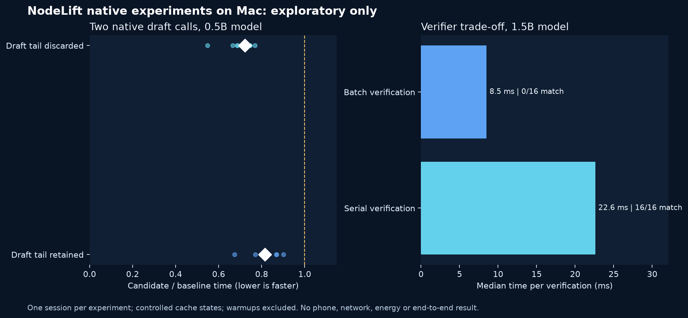

# Engine investigation: KV reuse and verification parity

2 November 2026. This is exploratory engineering, not a phone or distributed-inference speed claim. The deferred-draft optimization is compiled **off by default**. The native `strict: true` verification request is opt-in and is not yet connected to the desktop or mobile UI. No mobile build was installed or released as a result of this investigation.



## The correctness finding

The existing batched verifier did not always reproduce the single-token greedy reference. On Qwen2.5 1.5B Instruct Q4_K_M with the baseline library, the full `scripts/check-native.py` test failed on Metal at width 4 for the Italian sky prompt. An additional inspection found the first differing token at zero-based position 23. The unchanged baseline on CPU also failed at width 1 on a different prompt. The experimental build had the same Metal failure. [Failure observations](baseline-drift.json) and [prior broader qualification limits](../measurements/ENGINE_RESULTS.md) are retained.

A plausible explanation is a numerical difference between execution shapes; this experiment does not prove the root cause. A verifier's use of target logits does not on its own demonstrate identity with the target's separate one-token execution. This difference is a release qualification issue, not evidence that an answer is semantically incorrect.

We implemented an **opt-in** serial verifier. It decodes one accepted proposal at a time and can be invoked through the native JSON ABI with `strict: true`. It does not currently alter host routing or any shipped app. The real-model suite completed 31 checks on Qwen2.5 1.5B in both [Metal](correctness-serial-final-1.5b-metal.json) and [CPU](correctness-serial-final-1.5b-cpu.json) experiments; the default build with the cache optimization disabled also passed [Metal](correctness-serial-default-1.5b-metal.json). These finite checks are not a universal bitwise guarantee, and the serial approach gives up the parallel verification advantage.

Before the subsequent context-limit patch, for one deliberately selected known-divergent 1.5B context, after prefill and using the same four supplied proposals, 16 measured repeated pairs all matched the greedy oracle with serial verification; none matched with the batched path. The serial median was 22.61 ms versus 8.49 ms batched, and the median paired ratio was 2.74. This is a narrow verifier microbenchmark, not a complete request. It cannot estimate aggregate model quality or the prevalence of divergence. The exact [samples](verifier-metal.json) and [runner](compare_verifiers.py) are available.

## Context boundary correction

At a 256-token context with 255 tokens already present and one accepted proposal, the previous native verifier returned two tokens, exceeding the remaining context by one. The corrected default build returns one. Both verifiers now cap their output by remaining context space and reject an already-full prefix; the controller had separately guarded its context budget. [Before/after observations](context-boundary.json) use separate CPU processes. The updated real-model test exercises an accepted proposal in the last slot. One initial exploratory harness left two native handles open and aborted on process teardown after printing its result; that harness is not used as passing evidence. The retained separate-process reproduction closes its engine normally.

## Experimental draft optimization

Two changes are behind `NODELIFT_EXPERIMENTAL_DEFERRED_DRAFT=ON`:

1. When the new authoritative prefix includes an unevaluated suffix, reuse all valid common-prefix KV cells and obtain fresh logits by evaluating that suffix. A prefix ending at the common prefix still replays the anchor when required.
2. Do not evaluate the final predicted draft token until a later authoritative prefix actually includes it. Cached tokens continue to describe only tokens evaluated into KV.

The selected experiment, performed before the subsequent context-limit patch, compares two independently compiled libraries using the same locked llama.cpp source and the same real 0.5B model on this Mac. It alternates execution order, excludes warmups and checks both native outputs. The two-call cache scenarios deliberately construct retained or discarded draft tails; they are **controlled state transitions, not actual phone acceptance measurements**. Twelve measured pairs per state produced these descriptive results:

| Controlled two-call state | Baseline median | Experimental median | Median paired time ratio |
| --- | ---: | ---: | ---: |
| Draft tail discarded | 36.56 ms | 26.43 ms | 0.722 |
| Draft tail retained | 32.48 ms | 26.68 ms | 0.815 |

The complete [raw samples](draft-metal-final.json) retain per-pair ratios and hashes. The post-boundary run is [retained](draft-metal-post-boundary.json); overlap with a separate CPU check cannot be excluded, so it is not used for the table. Earlier [Metal](draft-metal-initial.json), [CPU](draft-cpu-initial.json), [expanded](draft-metal-expanded.json), and [guarded](draft-metal-guarded.json) runs are not silently replaced; the isolated 32-token autoregressive results were noisy across Metal runs and do not establish a gain. Hardware load, thermal conditions and independent sessions were not controlled. Neither these measurements nor the optimization establish a faster Mac-plus-phone session. The earlier iPhone study showed remote wait dominating that particular critical path, so these savings alone cannot explain away its slowdown.

The optimization remains disabled by default. Before activation, test EOS, context limits, cancellation and resumption, long prefixes, full and partial rejection, identical prefixes after prefill, batch-shape drift and stochastic/unsupported model restrictions on every intended backend. In particular the Gemini review warned that physical KV and the returned logical draft must never be confused and that a fully accepted tail can require a multi-token resynchronization. These are test requirements, not independently verified statements about other runtimes.

## Research and design decisions

- [llama.cpp RPC](https://github.com/ggml-org/llama.cpp/blob/master/tools/rpc/README.md) is a concrete starting point for testing desktop memory/capacity distribution. Its experimental RPC service has serious security warnings; do not expose an unauthenticated endpoint to office or public networks. Evaluate process isolation and authenticated transport before integration.
- [Nakshatra](https://github.com/fthrvi/nakshatra) implements model layer partitions across heterogeneous machines. Study layer placement, KV residency, topology and its stated licensing at a pinned revision; its numbers are author reports, not NodeLift results.
- [exo](https://github.com/exo-explore/exo) is relevant for cluster discovery and real distributed execution. Its supported backends and hardware need qualification for each NodeLift deployment.
- [SpecEdge](https://github.com/kaist-ina/specedge) and [PipeSD](https://proceedings.mlr.press/v306/han26k.html) motivate carefully bounded asynchronous work. Their serving scenarios do not establish a single-request speedup on our Mac, phones or future PC. The host must verify tokens, tag each job with the authoritative prefix and discard stale work.
- [Speculation at a Distance](https://arxiv.org/abs/2606.25091) argues for explicit break-even analysis and a strong colocated speculative baseline. Match model, quantization, context, network, decode configuration and output semantics.
- [Lucebox](https://github.com/Luce-Org/lucebox) is useful for studying specialized speculative implementations and their documented hardware constraints. Its reported speedups are not portable guarantees.
- YouTube search surfaced [Bijan Bowen's distributed vLLM demonstration](https://www.youtube.com/watch?v=ITbB9nPCX04) and a [llama.cpp 2026 configuration discussion](https://www.youtube.com/watch?v=ZjQKWVptq7w). Search titles, descriptions and visible chapters were inspected, not the full videos; they are discovery leads, not sources for benchmark claims. A read-only X search was inspected but did not provide a sufficiently reproducible primary result for performance claims.

The strongest next paths are separate: (a) a correctness-qualified, bounded remote-draft pipeline with measured cost and fallback and (b) authenticated desktop/server capacity experiments using actual model partitioning. Neither is presently equivalent to pooled mobile RAM. Compare single-request latency, aggregate throughput and capacity as different outcomes.

## Reproduce

Source archive used: llama.cpp `ddf48f85c933c1f438212a02eb21e7b001d2d37d`, archive SHA-256 `48ec81d2f8c7019b8660ce50b2a6b7b889cc983b4846f3b09afff37b4d0474a0`. Compiled in Release with AppleClang and requested Metal on the Mac; samples record exact native and model SHA-256 values. Eight threads and a 1,024-token context were used for the draft microbenchmark, and a 512-token context for verifier measurement. Metal layer count is requested, not separate per-layer attestation.

```sh
# Build two libraries from a baseline and this source with identical flags.
# Set NODELIFT_EXPERIMENTAL_DEFERRED_DRAFT=ON only for the candidate build.
python3 research/engine-investigation-2026-11-02/compare_draft.py \
  "$PWD" /path/to/0.5b.gguf 999 /tmp/draft-results.json \
  /path/to/baseline/libnodelift.dylib /path/to/candidate/libnodelift.dylib
NODELIFT_LIBRARY=/path/to/candidate/libnodelift.dylib \
  python3 research/engine-investigation-2026-11-02/compare_verifiers.py \
  "$PWD" /path/to/1.5b.gguf 999 /tmp/verifier-results.json
NODELIFT_LIBRARY=/path/to/candidate/libnodelift.dylib \
  python3 scripts/check-native.py --model /path/to/1.5b.gguf --gpu-layers 999 --strict --output /tmp/correctness.json
```

The benchmark scripts require Python only for research reproduction; they are not an installation requirement imposed on users of packaged desktop software. The forthcoming Lenovo test must first identify the actual OS, backend, GPU and connection. It must compare host-only, strong local speculation and remote contribution on identical target artifacts, include a model exceeding host capacity if testing capacity, and record failures, TTFT, duration, verified tokens/s, power where genuinely measured, and repeated independent sessions.

## Independent model review

A fresh review request was sent to Gemini 4 Argon with High reasoning, using a short description of the algorithm rather than private device logs. Gemini proposed checking the physical versus logical KV length, logits position, a two-token suffix after full acceptance, cancellation, EOS and context-boundary behavior. These are hypotheses and test ideas: Gemini did not execute the code or inspect the actual source during that request. In the actual implementation, `decode` requests the final batch logit via `llama_get_logits_ith(...,-1)`, rejects empty prefixes and resets state on errors. The proposed fuzzer and cross-backend boundary qualification remain open. Its unsupported numeric assertions about typical hardware behavior were not adopted.

GLM 5.3 Max subsequently completed a review, also based only on the prose description. It suggested testing physical KV alignment, two-token synchronization after full acceptance, EOS, bounded context and A/A versus A/B measurements. Its suggestions contributed test ideas but it did not run the code or inspect the locked llama.cpp source. Its categorical suggestion to avoid aborting inside a decode was not adopted without further validation: the current implementation uses the upstream abort callback and clears state on errors, while a deeper cancellation fault-injection study remains open. Numerical cost estimates in both model reviews remain hypotheses rather than measurements.

## Publication and checks

The source investigation and code were committed as `dc260cb4a51f5ffc7117675d649eb7f4fd3a517e` and pushed to `main`. The scoped website update was read back anonymously with HTTP 200 and matching SHA-256; the new note was also inspected in English, Simplified Chinese and Italian. [Publication readback](site-readback.json). Host tests: 157 passed in the current working tree, which includes separate pre-existing uncommitted timing work; this does not qualify a mobile release.
