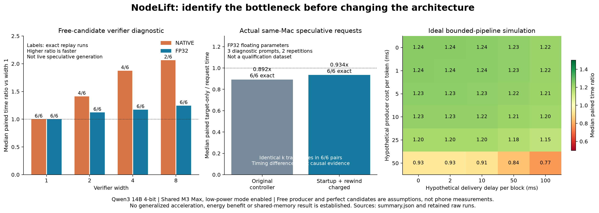

# Five-case investigation: where useful acceleration could come from

Research by Fabrizio Degni for [NodeLift](https://github.com/sev7enITA/NodeLift), 5 November 2026. This cycle investigates the five limitations identified after the adaptive-target experiment. **No architecture replacement is selected. No physical-device acceleration is established.**

## What was actually executed

- 48 teacher-forced verifier replays: three diagnostic prompts, two repetitions, four widths, two separate arithmetic lanes.
- 18 complete same-Mac requests comparing target-only, the original adaptive controller and startup/rewind accounting. FP32 floating parameters, with packed quantized integer weights retained.
- Six additional executions comparing accounting-only instrumentation to the old fixed generator at caps 1, 5 and 17. All three pairs matched.
- A four-cell history/current-width diagnostic at a historical failing token position, with instrumented and uninstrumented forwards. Follow-up attention-input and isolated projection probes further localize the difference.
- Twelve helper negative controls for admission and bounded queue accounting. These are not LLM correctness tests.
- Fresh device readiness: no currently available phone worker. Historical readiness flags were not treated as live capability.

The pinned Qwen3 14B four-bit target, 0.6B draft, dependencies and canonical token template are inherited from [the previous cycle](../adaptive-targets-2026-11-05/README.md). No further model weights were downloaded. Each arithmetic lane uses its own serial reference; FP32 is not asserted to reproduce native-precision outputs. Model loading is excluded; caches are fresh per request, EOS is respected, and the output cap is 128. These three diagnostic prompts are not a qualification or held-out model-selection dataset.

## 1. Placement and overlap

**Verified in code:** the current local generator finishes candidate production with `mx.eval` before invoking the target. Draft and verifier phases are sequential on the same Mac. Pairing another device does not automatically create useful overlap.

**Experiment:** `simulate.py` consumes measured verifier block timings and models a separate producer with at most one pending block. It explicitly assumes perfect continuation candidates, zero draft startup and no rejections, resynchronization or shared-host contention. Producer time and delivery delay are hypothetical inputs, not measured phone latency. The heatmap shows the resulting counterfactual, including losing cells.

At zero producer/delivery cost, FP32 width 8 has a median paired request-time ratio of **1.244x**, but the individual diagnostic pairs range from approximately **0.825x to 1.480x**. Even the optimistic path does not win every repetition. This is a measured verifier path with an idealized producer, not a rigorous universal upper bound on all possible implementations.

**Next falsifier:** run an actual independent worker, with identical committed-prefix hashes and bounded candidate queue, against target-only and the best qualified local speculation. Charge all host work, waiting, stale suffixes and cache reconstruction. The physical part remains untested because the phones were offline. Multi-request throughput is a separate experiment and cannot replace this latency comparison.

## 2. Full cost and admission

**Implemented in research:** `accounted_mlx.py` records draft prefill, target prefill, candidate production, verification, rewind and final cleanup. The controller observes the completed block after rewind and can charge draft startup to its first observation. Complete request timing remains authoritative. The remaining elapsed time is reported as unattributed overhead, not assigned to an invented kernel category. Pure GPU time, energy and network waiting are not measured by `perf_counter`.

| Path | Exact output against paired target-only | Median paired time ratio | Median TTFT change | Requests disabling draft |
|---|---:|---:|---:|---:|
| Original adaptive controller | 6/6 | 0.892x | +81.8 ms | 6/6 |
| Startup and rewind charged | 6/6 | 0.934x | +72.1 ms | 6/6 |

Ratios below 1 are slower. **All six paired controller trajectories chose the same sequence of draft widths.** Therefore, the apparent timing difference does not demonstrate that the new charge rule accelerated inference. The new accounting is useful instrumentation; the runs still fail the speed objective. Median measured draft prefill was 58.8 ms, and the accounting residual was nonnegative in all six charged runs, with a median of 7.7 ms.

The scalar serial calibration is still a limitation. Context-length-dependent calibration and a bounded startup-debt policy are hypotheses in the knowledge base, not promoted scheduling rules. Permanent disable is retained; stale draft state is never resumed.

## 3. Verifier performance envelope

The experiment makes immutable serial target tokens available for free, then scores every next-token prediction at the selected width. A fresh cache and matched prefill prevent silently reusing future state. Width-one alignment with the upstream generator is checked before each lane.

| Width | Native median time ratio | Native exact replays | FP32 median time ratio | FP32 exact replays |
|---:|---:|---:|---:|---:|
| 1 | 1.000x | 6/6 | 1.000x | 6/6 |
| 2 | 1.412x | 4/6 | 1.122x | 6/6 |
| 4 | 1.874x | 4/6 | 1.171x | 6/6 |
| 8 | 2.065x | 2/6 | 1.244x | 6/6 |

The attractive native numbers fail the exact-prediction contract. FP32 retains all 24 replay matches on this small sample but leaves a more modest margin before paying for a producer. Its width-eight per-workload median ratios are 1.244x, 1.300x and 1.092x. None establishes general equivalence, future gain or physical offload performance. The replay does not model live branch acceptance or rejection.

**Next falsifier:** compare a cheap exact-prefix lookup or n-gram candidate source with the neural draft, including lookup/miss cost, on new prompts. A cached continuation is a proposal, never trusted output.

## 4. Numerical correctness

The frozen historical `screen-code` prefix first differed at generated position 29. This cycle rebuilds exactly that token history and crosses history construction width with current forward width. No draft model participates in this test.

| History width | Current width | Raw target argmax at position 29 | Matches historical serial token |
|---:|---:|---:|---|
| 1 | 1 | 11136 | Yes |
| 1 | 4 | 279 | No |
| 4 | 1 | 279 | No |
| 4 | 4 | 279 | No |

Normalized-logprob argmax agrees with raw argmax in these cells. Instrumented and uninstrumented final logits match exactly within each cell, so this trace did not perturb the measured final result. Serial and batched cache histories differ in populated KV entries beginning at layer zero. With the same serial history, the first captured forward difference appears at the first layer's attention output projection. Its selected input row matches; the output differs by about 7.45e-9 in one element, with larger differences later in the network.

An isolated projection probe repeats that identical input row four times. Width one versus width four reproduces the same 7.45e-9 single-element difference, and each output exactly matches its corresponding captured full-forward output. This is a reproducible primitive-level batch-shape effect for this input and installed implementation.

This separates **current batch-shape effects** from **cache-history effects**. It does not prove that a kernel is defective or that fixing a single projection will make the entire model batch-invariant. The isolated result is retained in `results/projection-probe/result.json`; other primitives, inputs and cache states remain to be tested.

**Next falsifier:** evaluate one explicitly batch-invariant primitive or serial-history rebuild on the same fixed prefix, then new prompts and context lengths. Measure its cost as well as token equality. FP32 and empirical logit margins are not general correctness proofs.

## 5. Measurement quality

The Mac remained in low-power mode, with pre-existing swap and other active applications. Recorded OS thermal pressure was nominal in the completed runs, but this does not measure temperature, energy or absence of resource contention. Whole-machine CPU samples reached 99.9% during the accounting process; they include this experiment's own work and cannot all be attributed to background activity.

The supervisor records preflight, resources, bounded execution and exit status. Missing samples, invalid CPU values, unknown thermal state, thermal pressure, insufficient memory and insufficient disk reserve reject admission. Passing this diagnostic gate **never** sets isolated-performance qualification to true. Source/instrumentation failures are retained: one unsupported MLX array-copy call and one output-folder collision, both corrected before successful reruns. No failed run was relabeled as a completed benchmark.

Fresh process boundaries, shuffled width/arm order and matched inputs reduce some confounding. Two repetitions of three prompts remain insufficient for systematic performance claims. Energy benefit, sustained mobile thermal behavior, controlled power-mode comparisons, simultaneous multi-device attribution and independent hardware replication remain untested.

## Reviews, knowledge base and completion boundary

Actual current-cycle responses were obtained from Nemotron 3 Ultra and Cohere North Mini Code via free OpenRouter endpoints. Several detailed claims and citations were unsupported or inconsistent with the supplied code; they were rejected, not converted into consensus. Gemma returned a rate limit and no review. **New Gemini 4 Argon High, GLM 5.3 Max and Kimi assessments remain pending browser availability.** Earlier reviews are not counted again. See [raw responses and adjudication](review-adjudication.md).

[The hypothesis register](HYPOTHESES.md) separates locally measured, simulated, proposed and physically untested work for each case, including bounded unusual approaches and falsifiers. It credits the primary research and MLX implementation foundations. The first local diagnostic cycle is complete; the full requested multi-model and physical-device assessment is not. A paradigm change remains deferred.

## Reproduction and evidence

Read `PLAN.md`, `prompts.json`, `summary.json`, `checks.json` and `results/`. The previous cycle's model manifest maps pinned snapshots to local cache paths; reconstruct those paths locally rather than publishing private absolute locations. Use the dependency versions frozen in the previous cycle's `environment.txt`.

1. Compile `sample-host.swift` as `/tmp/nodelift-five-thermal` on macOS.
2. Run `python checks.py` and the envelope twice in separate processes, once with `--precision native`, once with `--precision fp32`. Supply fresh `--out` directories.
3. Use `run_bounded.py --name UNIQUE_NAME PYTHON SCRIPT ...` for the resource and timeout supervisor. Scripts are intended to run from the repository root. The default evidence directories refuse overwriting prior runs.
4. Run `accounting_run.py`, `localize.py`, `localize_attention.py` and `projection_probe.py` separately, never concurrently with another inference process. Prior failed attempt sources and logs are preserved.
5. Run `analyse.py` and `render.py`. No confidence interval is asserted from these three diagnostic workloads. Do not infer phone performance from the simulator.

The research generator derives from Apple MLX-LM under the included [MIT license](MLX-LM-LICENSE.txt). No production engine or mobile build is released by this research package.
