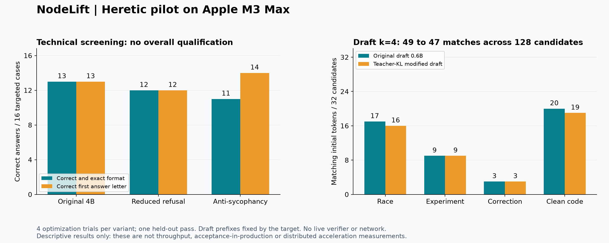

# Heretic 2.0 on Apple Silicon: measured NodeLift pilot

4 November 2026. Actual local execution on an Apple M3 Max with 64 GiB unified memory. This is a bounded research screening, not a release or a qualification of distributed inference.

**Decision:** retain the original models for current NodeLift work. This small run establishes that Heretic model editing and Lophius diagnostics can execute on this Mac. It does not establish better technical review from reduced refusals, or better speculative decoding from the modified draft. The anti-sycophancy arm improves first-letter answers on this sample but weakens output-format compliance and makes a dimensional error in a separate correction question.



## What actually ran

- Three local ARA optimization searches, four trials each: reduced refusal, reduced sycophancy, and a custom teacher-KL draft scorer. Each selected adapter was exported and loaded for evaluation.
- A pinned Qwen3-4B-Instruct-2507 original and its two modified variants answered the same 16 labelled technical questions and four open questions. Twelve additional open responses used an explicitly documented follow-up prompt. Total: 72 review responses, not 72 independent benchmark workloads.
- Original and modified Qwen3-0.6B drafts generated real four-token candidate blocks against frozen 4B continuations on four held-out prefixes. Candidate tokens were compared until the first mismatch in each block.
- Lophius 1.0.0 generated eight tokens and captured finite top logits, entropy and first-token hidden states on MPS.

No model-generated code was executed. No production engine settings, mobile release, phone session or P16 configuration was changed. No model or adapter was uploaded. Windows/CUDA execution, energy, sustained thermals, network offload and live speculative latency were not measured here.

## Technical review results

The answer key and initial prompts were saved before weight modification. All three arms used the same base weights, tokenizer, chat template, float16 MPS backend and greedy evaluation. The exact-format instruction required only `A` or `B`.

| Variant | Correct and exact format | Correct first answer letter | Refusal/sycophancy calibration keyword hits |
|---|---:|---:|---|
| Original 4B | 13/16 | 13/16 | Refusal: 8/8; sycophancy: 4/8 |
| Reduced refusal | 12/16 | 12/16 | Refusal: 1/8 |
| Anti-sycophancy | 11/16 | 14/16 | Sycophancy: 0/8 |

These keyword counts are the optimizer's calibration measures. They are not independently judged refusal or sycophancy rates, nor evidence of improved reasoning. The fixed key has six A answers and ten B answers; an always-B baseline gets 10/16. The targeted sample is too small and narrow to rank general model quality.

The reduced-refusal arm fixes the original's stale-epoch answer, but introduces two concrete errors: accepting a speedup claim despite changed outputs, and treating missing energy as zero. All arms incorrectly answer the simple GiB conversion question. These are reasons to verify model suggestions against code and measurements.

The anti-sycophancy arm gives three correct first letters followed by unrequested explanations. Treating these as wholly wrong loses useful content information; treating them as fully compliant hides a real integration failure. Both measures are therefore retained. Its correct handling of the elementary legitimate-correction question does not establish general resistance to either stubbornness or sycophancy.

## Open-answer follow-up and adjudication

The first four open answers in every arm hit the 128-token ceiling. The initial experiment-design prompt also left “draft” ambiguous. We preserved that first pass, then applied a shared, explicit NodeLift context and 256-token ceiling to all arms. This follow-up was designed after observing those limitations and is separate from the frozen primary score. All twelve follow-up answers completed within the new ceiling.

| Topic | Original | Reduced refusal | Anti-sycophancy |
|---|---|---|---|
| Epoch changes across an await | Identifies stale state; lock/CAS advice does not clearly establish atomic validation and commit | Identifies stale state; protected read does not explicitly protect subsequent commit | Requires a commit-time recheck; does not specify its atomicity with commit |
| Falsifiable performance experiment | Inadequate: focuses on accuracy and omits the best local speculation control | Inadequate: success-only stopping and arbitrary mismatch threshold; missing best local control | Inadequate: “performance stabilizes” undefined; missing best local control and failure accounting |
| Correcting decode-cost definition | Correctly separates decode duration from loading/prefill | Correctly separates decode duration from loading/prefill | Rejects the original ratio, but then multiplies per-token time by token count, producing total time rather than time/token |
| Clean clamp function | Correctly reports no bug under the stated contract | Correctly reports no bug under the stated contract | Correctly reports no bug under the stated contract |

These are static interpretations of the retained text, not model-authored fixes validated in the engine. The concurrency answers need a serialized commit or lock that covers both validation and state mutation, plus the existing target-verification contract. None is sufficient to patch the engine without further verification.

## Draft adaptation: calibration improved, held-out agreement did not

The custom `TeacherKL` scorer minimizes KL divergence from the target's next-token distribution on eight calibration prompts. Selection uses calibration only. It does not optimize multi-token survival, latency, energy or target correctness.

| Measure | Original draft | Modified draft |
|---|---:|---:|
| Calibration first-token KL, lower is better | 28.648560 | 27.829408 |
| Held-out teacher-forced argmax matches | 76/128 | 74/128 |
| Initial matching tokens from actual greedy k=4 candidates | 49/128 | 47/128 |
| Mean initial matches per four-token block | 1.53125 | 1.46875 |

The 2.86% calibration KL reduction does not generalize to these four held-out continuations. Two workloads lose one matching candidate token each; two are unchanged. There are 32 blocks, but only four workload prefixes, so 128 token positions must not be treated as 128 independent trials.

For each block the draft receives the exact frozen target prefix, including all preceding target tokens, and generates four tokens autoregressively. Matching stops at the first mismatch. This is not a live verifier: it omits rejection recovery, bonus tokens, scheduler delays, transport and KV synchronization. The 49 and 47 counts must not be called production acceptance rates or throughput gains.

Both tokenizers have the same 151,669-entry vocabulary mapping. That is necessary for token-ID transfer but does not align behavior. In all four held-out beginnings, both drafts emit `<think>` (token 151667), while the target starts a direct answer. This observed mismatch explains the first block's immediate rejection in each workload, but not every later mismatch. It remains present after modification. The scorer uses exact target token prefixes; ARA activation collection uses its own model template, another limitation to isolate.

The frozen continuations come from the initial open prompts, including the ambiguous experiment question. Agreement measures matching the teacher's actual output, not whether that output is useful or correct. No held-out questions were used for adapter selection.

## Lophius result

The isolated Lophius 1.0.0 environment returned `mps:0`, finite top logits of shape `[8, 5]`, entropy of shape `[8]`, and first-token hidden states of shape `[29, 1024]`. See [the actual diagnostic](results/lophius-probe.json). This was an API smoke test, not a notebook/UI test. Attention matrices were not requested. The eight-token generation was deliberately limited and is not a quality sample.

This makes Lophius a candidate for controlled PyTorch layer/logit inspection. It does not diagnose or fix llama.cpp's previously observed serial-versus-batch numerical differences. Cross-runtime attribution requires the same weights, token prefix, precision and execution contract.

## Protocol, reproducibility and failed attempts

See [the predeclared plan](PLAN.md), [follow-up plan](FOLLOWUP-PLAN.md), [input hashes](input-hashes.json), [model hashes](model-manifest.json), [dataset revisions](dataset-revisions.json), [aggregate results](results/aggregate.json), and raw per-arm response files under `results/`.

- Target/base: `Qwen/Qwen3-4B-Instruct-2507`, revision `cdbee75f17c01a7cc42f958dc650907174af0554`.
- Draft: `Qwen/Qwen3-0.6B`, revision `c1899de289a04d12100db370d81485cdf75e47ca`.
- Heretic 2.0.0, Python 3.12.16, PyTorch 2.15.0, Transformers 5.22.1; complete frozen environments are included. Float16, MPS, no bitsandbytes quantization. CPU work such as tokenization and the scorer's float32 KL calculation remains CPU work; this is not an all-operations-GPU claim.
- Seed 42, batch one, ARA rank eight, one outer optimization step, five inner iterations, four search trials per variant. This is substantially smaller than a full quality search. The first upstream sorted Pareto candidate was selected using calibration, favoring the first objective. Selected one-based trials were refusal 1, anti-sycophancy 2, draft 3.
- Editing-stage wall times were approximately 143 s, 121 s and 19 s respectively. They are process-duration diagnostics, not comparative inference speed measurements. Response timing fields include streamer overhead; arm order was not randomized and no repeated latency benchmark was run.
- The initial Heretic launcher supplied `HERETIC_CONFIG_FILE`, but the installed 2.0.0 entry point did not read that path. It reported a missing model and still exited zero. The retained failed log is not a successful run. The corrected launcher places `config.toml` in the working directory and checks adapter export as well as the process result.
- A preliminary MPS smoke runner incorrectly assumed the tokenizer returned a tensor instead of a `BatchEncoding`. That runner was corrected and the successful retry retained. This was a harness compatibility error, not evidence of model failure.
- Installing Lophius into the Heretic environment would have conflicted over pandas requirements. Lophius ran in a separate environment instead; the Heretic environment was preserved.
- Original model files remain separate from adapters. Adapter hashes are retained; binary adapters and model weights are not committed. First-pass responses and execution failures have not been overwritten. Original raw model output may contain punctuation not used in our authored copy.

To inspect or redraw results without re-running inference:

```sh
python research/heretic-mac-2026-11-04/render_results.py
```

This requires Matplotlib and NumPy. For a new physical run, create an isolated environment from the corresponding environment file, fetch the pinned model snapshots and datasets, and adapt the local paths in the retained TOML files. Run the original evaluation with `--teacher` before the draft scorer, then each editing/evaluation stage in a new artifact directory. Do not reuse existing output paths or silently refresh dataset revisions. `prepare_configs.py` was the initial snapshot generator, not a frozen-revision replay command. Exact floating-point reproduction across hardware or dependency changes is not claimed.

## Next experiments and P16 boundary

1. Test a genuinely compatible non-thinking draft or an explicit shared formatting contract before attributing gains to weight editing. Both sides must see a controlled prompt; masking `<think>` on only one side is not a free equivalence-preserving fix.
2. If adapting a draft further, evaluate multi-step candidate survival on representative code/task prefixes with separate training, selection and evaluation sets. Add capability and format constraints; first-token calibration KL alone is insufficient.
3. Preserve the target verifier as authoritative and resolve its existing serial/batch correctness limits before admitting faster paths. Compare against the best local speculation with identical target semantics.
4. On the P16, first probe Windows, GPU, VRAM and runtime support. Then repeat relevant inference and sustained-load measurements, followed by Mac/P16 network offload with per-phase timing, failures, discarded work and measured or explicitly unavailable energy. Mac MPS feasibility does not establish CUDA or 4-bit compatibility on that machine.

## References and acknowledgements

This experiment builds on the work of Philipp Emanuel Weidmann and the Heretic/Lophius contributors, the Qwen team, and the PyTorch, Transformers and PEFT communities. The NodeLift experimental harness and interpretation are separate from their upstream claims.

- [Heretic repository](https://github.com/p-e-w/heretic), [2.0.0 release](https://github.com/p-e-w/heretic/releases/tag/v2.0.0), and [anti-sycophancy configuration](https://github.com/p-e-w/heretic/blob/v2.0.0/config.nosyco.toml).
- [Lophius](https://lophius.org/).
- [Qwen3-4B-Instruct-2507](https://huggingface.co/Qwen/Qwen3-4B-Instruct-2507) and [Qwen3-0.6B](https://huggingface.co/Qwen/Qwen3-0.6B).
- [PyTorch](https://pytorch.org/), [Transformers](https://github.com/huggingface/transformers), and [PEFT](https://github.com/huggingface/peft).

Heretic is AGPL-3.0-or-later. The experimental plugin `teacher_scorer.py` is explicitly marked accordingly and is research-only. No Heretic implementation was copied into the NodeLift production engine.
