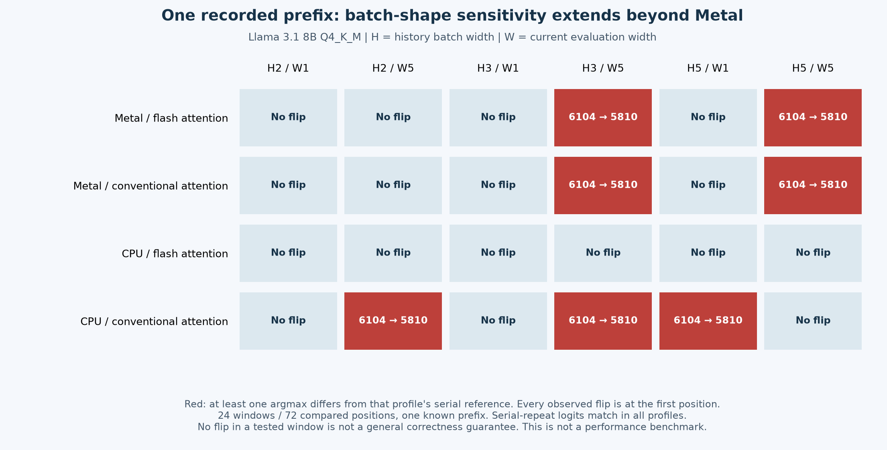

# Experimental alternatives: reviewer challenges and numerical isolation

## Outcome and scope

This investigation produced a new physical Mac numerical diagnostic and a research-only late-draft protocol prototype. It did **not** produce a demonstrated distributed speedup, a qualified batched verifier, a new mobile release, or pooled model memory.

Gemini 4 Argon with High effort and GLM 5.3 with Max effort received the same evidence packet through their browser interfaces. Gemini's initial review and correction, and GLM's initial review, were acquired. Additional follow-ups were submitted to both; their final answers have not yet been acquired because the Mac became locked. Their acquired responses are static analysis of supplied evidence, not independent repository execution or physical-device tests.

The most useful distinction is between three objectives: faster equivalent generation for one request, higher throughput across independent requests, and fitting a model that cannot fit on one machine. These need different architectures and controls.

## New measured result

The existing shape probe was run on the Mac M3 Max with Llama 3.1 8B Q4_K_M. The frozen failing prefix, target artifact, eight threads and 2,048-token context were held fixed. History widths 2, 3 and 5 were crossed with current widths 1 and 5. Each candidate was compared with a serial reference in its own backend profile, plus a separate serial-repeat control.

| Effective profile | Argmax differences from serial | Serial-repeat differences |
|---|---:|---:|
| Metal, flash attention enabled | 2 / 18 positions | 0 / 18 |
| Metal, flash attention disabled | 2 / 18 positions | 0 / 18 |
| CPU, flash attention enabled | 0 / 18 positions | 0 / 18 |
| CPU, flash attention disabled | 3 / 18 positions | 0 / 18 |

All observed argmax changes were from token 6104 to 5810. The CPU profile without flash attention also changed the first token when current width was one but history width was five. This makes prior history relevant in this recorded case. Maximum serial-repeat logit difference was zero in all four profiles.

These are 72 position comparisons across 24 windows from **one recorded prefix**, not 72 independent workloads. CPU execution still used quantized Q4_K_M weights. It was not a full-precision reference experiment. Runtime logs confirm the requested attention setting and 33/33 or 0/33 offloaded layers.

The observations reject an explanation confined to Metal flash attention and reject disabling flash attention as a sufficient fix for this case. They do not identify the first divergent operation, exclude a structural bug, or qualify CPU flash attention for general correctness. Diagnostic elapsed times include probe overhead and must not be presented as performance comparisons.

Evidence: [predeclared plan](NUMERICAL-PLAN.md), [manifest](numerical-manifest.json), [effective runtime configuration](runtime-evidence.json), and the four profile JSON files. Raw local logs are preserved, with hashes in the runtime evidence file.

## What the external reviews contributed

The prompts, submitted text and rendered response captures are retained in this directory. Accessibility captures may truncate long code or mathematical blocks; they are evidence excerpts, not guaranteed verbatim full transcripts. Original reviewer wording is preserved, including unsupported claims. This adjudication takes precedence over those claims.

| Reviewer contribution | Assessment |
|---|---|
| Gemini: recover a still-relevant suffix from a late linear draft | Worth a bounded experiment. Exact overlap with committed tokens is necessary; the remaining suffix still requires target verification. |
| Gemini: isolate backend, history and attention effects | Partially executed here. First-divergent-layer instrumentation remains outstanding. |
| GLM: measure the transport floor with a canned response | Useful to separate communication from model computation. It cannot establish end-to-end acceleration. |
| Both: distinguish task workers, speculative workers and capacity workers | Adopted as separate experimental tracks. |
| Both: branch or tree speculation | Deferred until linear salvage and verifier correctness are understood. Trees add masks, KV ownership and synchronization risks. |
| Both: remote KV storage and cache affinity | Affinity deserves an early control. Remote storage requires measured transfer/import/recompute costs; no universal rejection or speed claim follows from current data. |

Corrections sent to the reviewers include:

- Total request time divided by output tokens is not an isolated decode-token cost. Subtracting timeout and cleanup from an interrupted request cannot isolate per-epoch phone service time. GLM's derived timing thresholds are not adopted.
- Ratios of median speed ratios under different correctness contracts do not provide an acceleration ceiling.
- Backend dispatch thresholds, phone branching overhead and SSD or Wi-Fi timings proposed without measurements are hypotheses, not NodeLift evidence.
- Grammar constraints do not guarantee a completed, semantically valid result after cancellation or truncation. Teacher-forced likelihood is not a semantic oracle.
- Fixed graph shape does not by itself prove equivalence to the existing serial oracle. Tree logits must be aligned with the parent prefix that predicts each token, and cache history must be controlled.
- Failure to reject a statistical null is not proof of equivalence. Eight successes do not establish 98% reliability: the exact one-sided 95% binomial lower bound is about 68.8%, and the two-sided 95% lower bound about 63.1%.
- A measured 256 MiB runtime KV allocation is not a measurement of serialized cache payload. Upload cost and subsequent read critical-path cost must be reported separately.

Gemini withdrew several unsupported timing and statistical assertions in its acquired correction. The numerical follow-up and GLM correction remain pending acquisition. No consensus or completed final audit is claimed.

## Experimental tracks and decision gates

### 1. Restore the correctness contract before accelerating verification

Instrument the first divergent tensors on the fixed failing prefix, starting with normalization, Q/K/V projections, positional transforms, KV writes, attention outputs and residual/MLP outputs. Record tensor shape, dtype, backend, operation and position. Compare serial history with batched history separately from current decode width.

Two discriminating experiments should precede a kernel rewrite:

1. With the same immutable token sequence, compare intermediate tensors across the four profiles and history/current-width combinations. Checksums locate disagreement; selected numeric values, maximum errors and top-token margins characterize it. Instrumentation itself must be checked against an uninstrumented run.
2. Rebuild the same committed prefix in fresh contexts using width-one history versus batched history, then decode the identical next position. This distinguishes a history-dependent state difference from a current-step-only path difference. It does not alone identify the responsible kernel.

Maintain serial-equivalent and explicitly fixed-shape experimental contracts separately. If fixed-shape execution changes the target's serial output, it cannot silently replace the serial-equivalence claim. Validate rollback, rejection, bonus/pending-token alignment, EOS, context boundaries and sampling behavior before advertising reliable speculative execution.

### 2. Let the host progress while a bounded draft is in flight

The candidate algorithm is **linear late-draft suffix salvage**. A worker receives one lease tied to a committed prefix. The host continues its own computation. If it has committed `m` tokens when the packet arrives, those tokens must equal the first `m` draft tokens. Only the remaining draft suffix is offered to the target verifier. Already-produced host tokens receive no acceleration credit.

The [research prototype](suffix_probe.py) checks lease/epoch/worker/model/tokenizer identity, exact anchor and overlap, expiry, cancellation, vocabulary bounds, EOS placement, context and output limits. It neither commits tokens nor imports worker KV. Twelve protocol tests passed; [validation](validation.json) records the exact source hash and scope.

This pure function assumes a serialized target actor and authenticated, decoded input. It does not implement network transport, concurrency ownership, native verification or mobile integration. These are remaining implementation gates, not implied by passing the tests.

Use a physical phone echo experiment first to measure round-trip service floor, queueing and reconnect behavior. Then measure real-draft suffix survival, useful verified tokens, late/expired packets, discarded computation, critical-path wait, target verification and cleanup. Compare against host-only and the best qualified local speculation using the same model and output contract. An exact serial verifier can qualify protocol behavior and bound regression; it does not establish speculative acceleration.

### 3. Keep complete task models resident on workers

Send a bounded document or task to a resident worker and validate the result before host synthesis. Candidate workloads include source-local retrieval, extraction and expensive independent preprocessing. A deterministic local selection baseline is essential: sending text already on the Mac to a phone for trivial filtering may add cost without useful work.

Use schema validation, source-span checks, task-specific ground truth and abstention. Compare matched selected-context and full-context controls locally, then compare remote execution. Include scheduling, serialization, validation, retries and final synthesis in wall-clock cost. Report both per-request latency and throughput under concurrent workloads.

This changes the computation and may change answer quality. It is not transparent equivalent inference and does not let a single model exceed a worker's memory. The existing resident-task pilot's strict JSON failures remain unresolved by this report.

### 4. Route requests to compatible warm state before transporting state

First compare session affinity with ordinary routing and cold starts. Fingerprint model, tokenizer, template, runtime, quantization, adapters, KV format and position settings as applicable. A cache catalogue is only a hint; the owner must validate exact compatibility and availability.

Remote opaque storage of a host-produced snapshot and direct import into a different worker are separate mechanisms. The former preserves bytes for the original compatible runtime; the latter additionally requires import compatibility and numerical validation. Neither is pooled live model memory.

A remote hit is useful only when its measured lookup, transfer, import and scheduling path beats the best available local RAM, local SSD or recomputation path for that workload. Separately report snapshot upload, eviction, reservations, miss/fallback behavior and lifetime costs. Unknown energy must remain unknown. No benefit is inferred from allocated KV size or nominal link speed.

### 5. Treat desktop/server capacity as a separate product path

Actual layer or tensor partitioning needs measured per-layer memory, KV growth, backend compatibility, communication cost and failure behavior. Start with discovered desktop/server capabilities and measured links. Compare against a single machine when the model fits; when it does not, identify the capacity comparison explicitly. A failed shard cannot simply fall back to the host if that host cannot fit the model.

This path remains an architectural experiment here. No sharded-model execution, pooled RAM or physical Lenovo benchmark was performed in this investigation.

## Measurement and admission policy

Use separate calibration and held-out evaluation prompts. Record model and runtime hashes, link topology, temperatures, battery/power state, session boundaries and failure status. Randomize or counterbalance comparative runs after a declared warmup. Treat repeated prompts within a session as correlated observations; do not inflate the effective sample count with individual tokens.

Report total time saved, TTFT difference, prefill and decode separately, useful-token throughput, completion reliability, timeout/fallback costs, discarded work and measured energy where instrumentation exists. Energy unavailable on a device must not become zero. Use intervals respecting workload/session clustering, and distinguish inconclusive evidence from proven benefit or harm. An admission margin and acceptable tail regression should be declared before evaluation, not chosen after seeing favorable cases.

Existing adaptive draft gating already exists in NodeLift. New evidence should qualify or replace its heuristics; merely adding a second heuristic is not a demonstrated proprietary advance.

## Related work and acknowledgements

These directions build on others' work and are not claims of algorithmic novelty:

- [Thinking Machines: Defeating Nondeterminism in LLM Inference](https://thinkingmachines.ai/blog/defeating-nondeterminism-in-llm-inference/) motivates investigation of batch-sensitive reductions beyond one attention kernel.
- [LLM-42](https://arxiv.org/abs/2601.17768) provides relevant fixed-shape verification and state-handling ideas. Its assumptions must be checked against this runtime and correctness contract.
- [Speculation at a Distance](https://arxiv.org/abs/2606.25091) provides a useful placement and contention perspective. Its results are not measurements of this phone/Mac topology.
- [Distributed Prompt Caching](https://arxiv.org/abs/2602.22812) motivates explicit cache discovery and transfer experiments. Its device and workload results do not transfer automatically to NodeLift.
- [llama.cpp](https://github.com/ggml-org/llama.cpp) supplies the inference runtime underlying these experiments. The existing NodeLift related-work acknowledgements remain applicable.

## Reproduction and retained limitations

Run `python3 research/lateral-algorithms-2026-11-03/suffix_probe.py -v` from the repository root for the protocol checks. Render the chart with `render_numerical.py` and its matplotlib dependency.

`run_numerical.py` is the actual collector used on this Mac, including its local binary/model paths and strict artifact hashes. It is not a portable installer. It overwrites this run's profile outputs if executed directly: copy the experiment and change its output directory before a new run. Rebuild instructions and the shape-probe source belong to the existing `research/async-pipeline-2026-11-03/` and `native/experiments/` materials. Record a new binary hash after any rebuild; do not silently reuse this run's identity.

No new production engine, mobile binary or portal release is implied. Remaining gates are final reviewer follow-up acquisition, native integration and concurrency testing, expanded correctness cases, and physical Android/iOS comparative runs under the declared controls.
