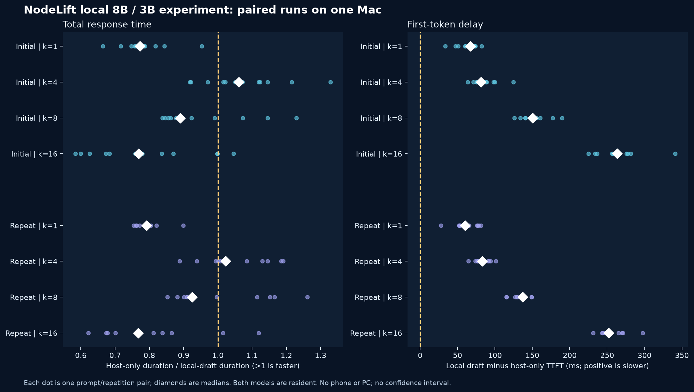

# Local 8B/3B draft pilot

2 November 2026. Two real-weight NodeLift sessions completed on the same Mac. Both target and draft models ran locally on that computer. These results are not phone, Lenovo, distributed-memory or multi-machine measurements.

## Scope and configuration

The target was the locally installed Ollama Llama 3.1 8B Q4_K_M, the draft Llama 3.2 3B Q4_K_M. The [preflight](tokenizer-preflight.json) found identical tokenizer fingerprints. The weights were already present, are not included in this repository and retain the respective upstream model license. The native core is the standard build with experimental draft-cache changes disabled. The fixed NodeLift source commit is `7d7b14a2d8b6aaeac9406fa2fb669bfb7ae42f`; the test used context 2048, eight threads and 999 requested GPU layers. See the [first plan](PLAN.md), [replication plan](PLAN-REPLICATION.md) and per-session manifests for exact hashes and order.

An initially considered Qwen2.5 7B/0.5B pair was not run because its [preflight](qwen-incompatible-preflight.json) found different tokenizer fingerprints and vocabulary sizes. We did not bypass that safety check. Two pre-measurement runner interruptions, including the isolated checkout's model catalog setup, are [retained](premeasurement-interruption.json).

Each session included 60 completed runs: six generic prompts, two repetitions, host-only and local draft widths 1, 4, 8 and 16. The same 12 prompt/repetition host results are paired separately with each width. Both models stayed resident after warmup, including during host-only requests. The request metric is NodeLift controller time including prefill and detokenization but excluding initial model load and an external client/network path. TTFT is the controller's time until the first token block, not browser delivery. The [first session](results/) may have experienced a [brief competing disk read](observation-confound.json); all its samples remain included. The [repeat](repeat/) used a new process and the same plan, source and seed, without intentionally starting other heavy work. The sessions share the machine, prompt set and nearby time period, and are not independent hardware replications.

## Paired results

A ratio above 1 means local draft finished sooner than its host-only pair. The median is of the individual paired ratios, not the ratio of two independent medians. TTFT changes are paired differences, where positive means a later first token.

| Draft width | Initial median ratio | Repeat median ratio | Initial / repeat faster pairs | Initial / repeat median TTFT change |
| --- | ---: | ---: | ---: | ---: |
| 1 | 0.773x | 0.791x | 0/12, 0/12 | +67.1 ms, +60.2 ms |
| 4 | 1.061x | 1.023x | 9/12, 9/12 | +81.2 ms, +82.9 ms |
| 8 | 0.891x | 0.925x | 3/12, 4/12 | +150.3 ms, +137.1 ms |
| 16 | 0.769x | 0.767x | 1/12, 2/12 | +263.6 ms, +252.1 ms |

All 120 requests completed. All 96 candidate-versus-host comparisons matched in token IDs and finish reason. At width 4, median paired time saved was 91.9 ms in the initial session and 35.1 ms in the repeat, while the median first token was later. These are small, variable observations for this model pair and path. They do not establish a robust universal speedup or a quality guarantee outside this sample. Width 4 was faster in 9 of 12 pairs in each session, but the pairs share only six prompts and the same machine. There are no confidence intervals and no energy, thermals or actual accelerator-allocation measurements.

The [analysis](paired-summary.json) includes all pair values, accepted/proposed counts, matching status, and hashes of the retained original logs. [Analysis](analyze.py) and [chart](render.py) scripts reproduce the table and graphic. The runner's inherited manifest says `small control models`; that is a generic string from the existing script, not a description of the 8B/3B inputs. No source was changed in the isolated runner.

## Adaptive gate follow-up

A third, separately [planned](PLAN-ADAPTIVE.md) period compared host-only, fixed local draft width 4 and the existing adaptive policy. All 36 requests completed; all 24 draft-versus-host comparisons matched in token IDs and finish reason. Fixed width 4 had a median paired speedup of 1.014x, was faster in 6/12 pairs and added a median 83.0 ms to TTFT. Adaptive had a median paired speedup of 0.949x, was faster in 4/12 pairs and added a median 4.0 ms to TTFT. The gate disabled drafting as `no_measured_gain` in all 12 adaptive requests after 24 draft verification blocks in total.

The adaptive gate limited the observed first-token delay but its exploratory probes and routing still cost time in this small 64-token workload. It did perform draft work before switching back, and this was a local-only test. One short period cannot establish that adaptive routing always loses or always disables drafting. [Raw decisions and requests](adaptive/), [paired summary](adaptive-summary.json) and the [runner](benchmark_adaptive.py) are available.

## Upstream control and next work

The [pinned upstream llama.cpp server control](PLAN-UPSTREAM.md) completed 36/36 HTTP requests on the same model pair and prompts. Compared with its own `none` baseline, `draft-simple` width 4 had a median paired wall-time speedup of 1.152x and was faster in 12/12 pairs; `ngram-mod` had 1.012x and was faster in 10/12 pairs. Both matched their server baseline in token IDs, stop reason and truncation for all 12 pairs. The [raw results](upstream/) and [paired summary](upstream-summary.json) retain the timing and proposal fields.

This server restarts and warms per arm, while NodeLift's controller uses a different path and both models are kept resident. HTTP overhead, process behavior, batching and residency differ. The two speedup ratios therefore do not establish a fair product ranking or explain the gap. Server TTFT was not measured because this control used non-streaming responses. A same-path, matched-residency investigation is needed before attributing a cause or claiming NodeLift superiority.

The later Lenovo test must first probe its actual hardware and link, then compare a strong local baseline with the remote configuration and account for transfer, thermal state, fallback and discarded work.

## Publication verification

The showcase was published on 2 November 2026. Authenticated FTPS readback and anonymous HTTPS readback matched the local bytes for the page, script and all three localized charts. The English, Simplified Chinese and Italian chart selection was also checked in the live browser. The [FTPS receipt](site-ftps-readback.json) and [HTTPS receipt](site-http-readback.json) contain file hashes and statuses, not credentials.
