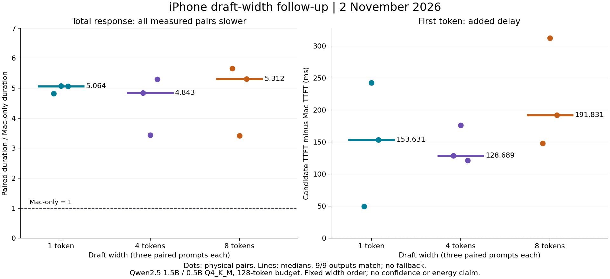

# Why phone drafting is slower, and what could change it

2 November 2026. We found a confirmed Android build defect and completed a new physical iPhone width sweep. Neither finding establishes phone-assisted acceleration. The immediate engineering priority is optimized native builds and decomposed timing, followed by an asynchronous experiment on a larger compatible resident target with fair local controls.

## Confirmed Android build confound

The native ELF in the distributed Android 0.2.8 APK has GNU build ID `6119bd85d6c75cd326d90f93ec8847c0df8171e5`, identical to the retained unstripped Android Debug library. Its actual compilation commands for the wrapper, ggml CPU and ARM quantization kernels have no optimization flag. Clang therefore uses its default unoptimized mode. The [binary/build audit](android-build-audit.json) records the matching identity and relevant flags.

This is a NodeLift packaging defect, not evidence that the Xiaomi hardware inherently needs 135 times the Mac's latency. The original observation remains valid for that binary and setup, but cannot characterize an optimized phone. Its contribution to the slowdown requires a matched physical before/after test.

The native CMake configuration now enables `-O3` in Android Debug builds, including dependencies. Debug symbols/assertions and the generic ARMv8-A baseline remain; no fast-math or unsupported CPU instruction is introduced. The [actual regenerated commands](android-optimized-flags.json) pass the new optimization audit. The corrected [Android AArch64 shared library](android-native-build.json) also compiled and linked successfully; five audit unit tests passed. No new APK was packaged or installed, and no optimized-phone result is claimed. This is distinct from changing the app signing or enabling GPU inference. It does not by itself prove an end-to-end speed benefit. The iOS native cache identifies a Release `-O3` build, so the Android defect must not be generalized to iPhone.

A median Xiaomi round of 3,001 ms originally suggested a timer. Code inspection does **not** establish that cause: the three-second Android sleep is in the not-ready branch, while the ready branch immediately long-polls. The host already uses a condition-variable mailbox and notification. Only 21 of 66 observed rounds lie between 2,900 and 3,100 ms. We reject the claim that removing a three-second poll sleep is a demonstrated fix.

## New physical iPhone experiment

The [plan](PLAN.md) fixed widths 1, 4 and 8, three paired prompts each, a 128-token output budget and a warmup pair excluded from each cell. Target/draft stayed Qwen2.5 1.5B/0.5B Q4_K_M, with the existing iPhone build 15. The first preflight stopped before inference when the screen locked; the user reopened the app and the original plan resumed. That interruption is recorded in [preflight](preflight.json), not silently replaced as a failed inference sample.

| Draft width | Complete matching pairs | Median paired duration / Mac | Median added TTFT | Accepted / proposed | Fallback |
| --- | ---: | ---: | ---: | ---: | ---: |
| 1 | 3/3 | 5.064x | +153.631 ms | 131/154 | 0 |
| 4 | 3/3 | 4.843x | +128.689 ms | 204/328 | 0 |
| 8 | 3/3 | 5.312x | +191.831 ms | 227/466 | 0 |



All 18 primary outputs match in token hash, count and finish reason. No inference failure or fallback occurred in this sweep. The six warmup attempts are separate. These are short correlated cells in fixed width order, not independent confidence evidence or a universal optimal-width ranking. Host load and thermal evolution are not experimentally isolated.

Width 1 had the highest proposal acceptance fraction but did not accelerate the request. Width 8 committed more tokens per round but also required more drafting and discarded more proposals. **Changing width alone did not solve the measured problem.** Raw [width 1](iphone-width-1.json), [width 4](iphone-width-4.json), [width 8](iphone-width-8.json) and [summary](width-summary.json) remain versioned.

## Where the cost sits

The serial critical path is:

```text
host prefill -> lease / phone KV synchronization / draft / return
             -> host batched verification -> publication -> next lease
```

Remote wait is a combined host-observed duration. It includes phone computation, dispatch, communication and result processing. It is **not** measured Wi-Fi RTT. The present mobile result protocol drops the native duration even though the phone displays it. Effective Metal offload is not independently attested by the heartbeat.

From the new width-4 cell, summed complete round durations divided by committed tokens give:

- Host: 6.970 ms per committed token.
- Remote candidate: 32.494 ms per committed token.
- Non-remote part of candidate rounds: 5.176 ms per committed token.
- Remote wait: 84.1% of total round duration, averaging 93.474 ms per block.

These block metrics exclude prefill and client SSE delivery; they explain the critical path but do not replace end-to-end duration or TTFT. They use sums over tokens, not sums of unrelated medians. The [reproducible cost decomposition](cost-diagnosis.json) also retains planned and observed denominators.

For a serial block, let `C` be committed tokens, `H` the matched host cost per token, `D` the full remote wait, and `V` verification plus remaining local work. A necessary measured break-even condition is:

```text
D + V < C * H
```

Holding this cell's observed committed counts and non-remote work fixed, remote wait would need to average less than **6.139 ms per block**, versus the observed **93.474 ms**. This is a descriptive counterfactual budget, not a prediction that the phone or network can reach it. The old iPhone build-15 fixed-128 cell similarly allowed about 7.207 ms against a measured 97.105 ms average wait. One small optimization cannot plausibly close that entire gap under unchanged assumptions.

Even removing all phone wait from the old Xiaomi trace leaves 9.636 ms of local work per committed token against a 6.660 ms host baseline. Therefore faster Android kernels alone must not be sold as a guaranteed win either. Costs and acceptance may change after optimization and must be remeasured.

## Proposed architecture and falsifiable sequence

1. **Make the execution observable.** Return bounded, finite `worker_total_ms` and `worker_native_ms` as explicitly self-reported diagnostics. Record host enqueue-to-dispatch and dispatch-to-result durations using its own monotonic clock. Never subtract absolute phone and Mac timestamps. Keep the unexplained remainder named as such, not pure network latency. Missing/invalid timing must not invalidate otherwise valid token identities or influence routing as trusted evidence. Record compiled optimization and actual backend allocation separately from requested settings.
2. **Re-test the Android build alone.** Same model, ISA, threads, topology, prompts and target; alternate the old and optimized artifact in separate identified sessions. Verify exact greedy outputs, retained failures and thermal behavior. Only then consider runtime-dispatched ARM dot-product kernels or an Android GPU backend. Never compile all supported phones for the newest handset ISA.
3. **Overlap work with bounded lookahead.** Send the phone prefix initialization concurrently with host prefill. After a phone sends a proposal, let it prepare at most one further block while the host verifies the current block. Use request epoch, sequence, authoritative prefix hash and acknowledged position. On partial rejection or a differing target bonus token, cancel/discard incompatible lookahead and synchronize the committed prefix. A cached suffix is reusable only when its token prefix matches the authoritative target sequence. All emitted tokens still pass target verification. No unbounded queue, optimistic publication or relaxation of stale-lease checks.
4. **Test larger compatible resident targets.** Select a dense target that the current verifier supports, confirm tokenizer fingerprint on the actual artifacts, and establish its optimized local baseline first. Larger parameters are not proof of a benefit. Compare host-only, best applicable host-local speculation and phone speculation on the same target, context, output and sampling. Do not slow the host, alter its quantization between arms, or compare against a weaker baseline to manufacture a win.
5. **Admit routes from total cost.** Choose width and whether to delegate from total verified round cost per committed token, including warmup, discarded work and fallback. A fast failure path is valuable, but zero accepted phone work cannot establish phone acceleration. Scope observations to model hashes, context/configuration, device/session/backend and connection. Any cached favorable choice needs requalification after a scope change.

Asynchronous overlap is a candidate, not a sufficient solution on the current small target. The width-4 phone wait is much longer than the approximately 18 ms of local work in an average verification round, so hiding only that local work leaves most of the current remote cost exposed. Actual overlap must be traced, not estimated by adding advertised bandwidths.

Independent task offload, aggregate throughput and capacity beyond host RAM remain separate workstreams. They may be useful, but do not satisfy the user's primary single-request latency objective by renaming throughput as speed. Phone RAM bandwidth cannot be substituted for link bandwidth in a memory-spill comparison. The current implementation does not pool RAM.

## Reviews and research

[Review adjudication](REVIEW_ADJUDICATION.md) distinguishes model suggestions from checked facts. Gemini 4 Argon with High effort completed two responses. GLM 5.3 Max completed its [resumed static assessment on 3 November](../reviewer-resumption-2026-11-03/PERFORMANCE-REVIEW.md); findings were checked and unsupported inferences rejected. Neither model executed these physical tests. The original 2 November availability record remains in the adjudication history.

Relevant prior work, with credit:

- [SpecEdge, KAIST INA](https://github.com/kaist-ina/specedge) and its [paper](https://arxiv.org/abs/2505.17052): edge/server overlap and scalable serving motivate a bounded pipeline, but their reported gains do not transfer automatically to our Mac/phone/model combination.
- [PicoSpec, Zhang and colleagues](https://arxiv.org/abs/2603.19133): asynchronous collaborative speculation is relevant design work. Its distribution-transfer optimization is not directly the same bottleneck as NodeLift's existing greedy token-ID protocol.
- [Speculation at a Distance, Lyu, Irukulapati and Champati](https://arxiv.org/abs/2606.25091): formalizes the restricted latency window and the need to compare with co-located speculation. Its edge/cloud results are methodological guidance, not measurements of our LAN.
- [llama.cpp speculative decoding documentation](https://github.com/ggml-org/llama.cpp/blob/master/docs/speculative.md): compare actual end-to-end behavior and accepted work. Synthetic acceptance is not valid model output and is excluded from our claimed results.

## Acceptance and reproducibility

A future positive result must show lower paired end-to-end duration with exact greedy output, an acceptable explicitly reported TTFT trade-off, full failure/fallback denominators, multiple independent sessions and sustained device load. Energy stays unavailable without matched power measurement. A preregistered practical improvement threshold should be chosen before confirmatory tests, not after selecting the winning cell.

```sh
python3 scripts/diagnose-draft-cost.py research/performance-diagnosis-2026-11-02/iphone-width-1.json research/performance-diagnosis-2026-11-02/iphone-width-4.json research/performance-diagnosis-2026-11-02/iphone-width-8.json --output /tmp/nodelift-cost-diagnosis.json
python3 scripts/check-android-optimization.py /path/to/compile_commands.json
# Plotting dependency: matplotlib 3.10.8
python3 research/performance-diagnosis-2026-11-02/render.py
```

The report provides a confirmed defect, a rejected width-only solution, a measurable break-even budget and a bounded next architecture. It does not demonstrate a new performance benchmark or a phone-assisted speedup.
