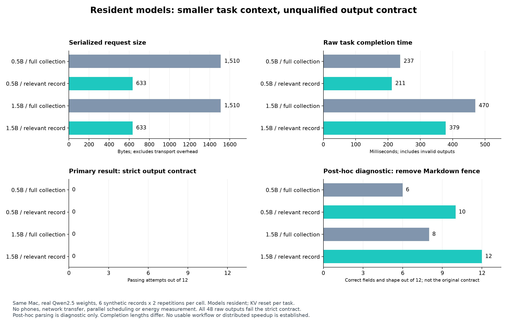
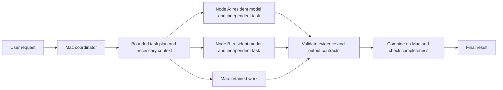

# Resident models and independent task segments

2 November 2026. **Local feasibility probe completed; remote task execution is not implemented or qualified.**

Fabrizio Degni proposed keeping models on the nodes and passing only instruction segments. The useful distinction is the work unit: a whole independent task can require one request and one result, instead of a network dependency every speculative block. NodeLift already keeps the phone's draft model loaded; it does not retransmit the model weights each round.

## What was actually tested

On the existing Mac, two resident Qwen2.5 Instruct Q4_K_M models (0.5B and 1.5B) executed extraction tasks on six fictional maintenance records. Each task received either all six records or just its relevant record. Model files, library hash, runtime identity, parameters, ordering, raw output and timing are retained in [the raw results](local-pilot/results.json). The [plan](PLAN.md) was written before execution. There were four excluded warmups and **48/48 completed attempts**. There was no phone, network or parallel execution.

The primary output contract required exactly one JSON object with four specified fields. **0/48 attempts satisfied it.** All models added Markdown code fences, despite being instructed not to. Some also selected wrong values or returned an array instead of an object. Fast invalid output is not a successful workflow.



| Resident model / input | Median request bytes | Median raw completion | Strictly correct | After removing one Markdown fence, diagnostic only |
| --- | ---: | ---: | ---: | ---: |
| 0.5B / all records | 1,510 | 237 ms | 0/12 | 6/12 |
| 0.5B / relevant record | 633 | 211 ms | 0/12 | 10/12 |
| 1.5B / all records | 1,510 | 470 ms | 0/12 | 8/12 |
| 1.5B / relevant record | 633 | 379 ms | 0/12 | 12/12 |

The median paired reduction in serialized request size was **58.1%**. These bytes are the probe's actual compact JSON messages, not measured HTTP/TLS or Wi-Fi traffic. Raw completion was shorter with the segment in this pilot, but outputs differ in length and all violate the original format contract. We therefore do **not** report a usable-workflow speedup. These are only six unique cases, each repeated twice, not 12 independent quality samples per cell.

Removing a single enclosing Markdown fence was a post-hoc diagnostic, not a change to the predeclared pass rule. It shows a meaningful failure mode: with all records present, the small model supplied R104's due date for R103, which has no due date. With the relevant record alone, that contamination disappeared. The small model still returned the literal string `not assigned` where `null` was required. The 1.5B model's relevant-record cell matched the fixture values after fence removal, but this is not held-out quality evidence.

The probe preserves both resident handles and resets KV on every task, so it measures context selection separately from prefix-cache reuse. Load costs are recorded outside task timings. `first_token_ready_ms` is an internal native boundary, not client-visible TTFT. Full task time includes tokenization, reset, generation, detokenization and fixture scoring. It excludes planning, transport, final synthesis, cold load and production validation. Energy and sustained thermals were not measured.

## Architecture worth implementing



This diagram is the proposed next path, not shipped functionality. The first experiment should use deterministic task boundaries, rather than add an LLM planner whose cost and decomposition errors obscure the comparison.

Suitable starting work includes per-document extraction with source spans, independent retrieval/reranking, and separately testable transformations. A cross-document question, long argument, sequential code dependency, or one autoregressive answer cannot be divided arbitrarily without changing its meaning. Every task must carry all its necessary context; a reference to another record must expand the segment or keep that task on the host. Combining independently generated summaries can lose facts, so final synthesis requires its own evaluation and timing.

The next protocol needs:

- An explicit `task_v1` capability, separate from `draft`. Current Android and iOS workers are limited to matching draft token proposals, not complete task results.
- Model/runtime identity and measured resident readiness, declared context/output limits, one bounded in-flight task per worker initially, task/attempt ID, epoch, input digest and host-owned deadline.
- Existing authenticated pinned TLS and outbound dispatch, typed results with source evidence, duplicate/stale-result rejection, cancellation and bounded fallback. No arbitrary code execution or cloud route is implied.
- Structured decoding or a validated parser with an explicit repair policy. A JSON schema only constrains shape; it cannot prove the extracted owner/date is correct. The pilot answer key is for offline scoring, not a production oracle.
- Source-grounded validation, completeness checks and quality qualification by task family. Unlike draft verification, a small model's answer is not token-equivalent to the main model. Strong-model rechecking can erase the gain and must be charged.
- Report model residency separately from KV or source-context cache state. A model is resident only while the OS keeps its process/model alive. Reconnect, suspension, model changes and memory pressure invalidate prior readiness.

For a bounded batch assigned across nodes, an initial cost screen is:

`T_workflow = T_plan + max(node queue + assigned tasks + communication) + T_validate + T_combine + T_recovery`

This simplified expression assumes independent branches. A workflow with dependencies needs its full critical path. Actual end-to-end wall time is the acceptance metric; do not sum overlapping timers. The remote worker should be admitted only when measured cost plus uncertainty remains below the best applicable host schedule at the required quality. A losing or unqualified route stays disabled. Per-task processing speed alone is insufficient.

Scope evidence to model hash, backend/build, task family, context length, connection, session and device state. Report useful tasks, retained failures, fallback/discarded work, user-visible TTFT, total workflow time, actual bytes, memory and measured energy where available. A successful path can accelerate an entire independent workflow or increase throughput; it does not make phone RAM into host RAM or a larger target model.

## Relationship to Apple, DistAI and upstream work

- [Apple's MLX distributed inference](https://machinelearning.apple.com/research/mlx-distributed-inference) partitions a single model by layers or tensors and exchanges numerical intermediate state over fast links. It is a different path from sending text tasks to complete resident models. Keeping weights local does not eliminate the activation/synchronization traffic required for model parallelism.
- [DistAI](https://github.com/alex8819/DistAi), with our [source-based lessons](../distai/LESSONS_LEARNED.md), is directly relevant both for layer partitioning and its separate queued-task experiment. Its published task throughput must be compared with the batched PC baseline. We have not reproduced its physical measurements and do not claim this task-level idea is new.
- [llama.cpp server](https://github.com/ggml-org/llama.cpp/blob/master/tools/server/README.md) already supports concurrent requests and continuous batching. Its optimized single-host behavior belongs in the control group, not only sequential Python calls.
- [exo](https://github.com/exo-explore/exo) provides model-placement and distributed execution work to study for the separate capacity lane. Its results are not measurements of our heterogeneous phones.

We thank these authors and maintainers. No code from those projects was copied into this experiment. Existing NodeLift native dependencies retain their notices.

## Reproduce and next decision

```sh
python3 research/resident-tasks-2026-11-02/probe.py --output /tmp/nodelift-resident-pilot-new
python3 research/resident-tasks-2026-11-02/analyze.py
# analyze.py and render.py intentionally use the retained local-pilot artifact.
# matplotlib is only required to regenerate the chart.
python3 research/resident-tasks-2026-11-02/render.py
```

Thirty fixture/oracle checks passed before inference, including rejection of duplicate keys, wrong fields, incorrect types and wrong values. The unchanged raw run is the source for [analysis.json](analysis.json) and the chart. No production behavior, mobile package, or benchmark dashboard was changed. The phones were observed offline at preflight, so no distributed claim is made. This new experiment has not yet received a GLM or Gemini assessment.

Proceed with a strictly bounded complete-task protocol and physical comparison after implementing structured results and validation. Preserve the existing draft path and the separate large-model capacity workstream. The local pilot justifies that next experiment; it does not justify enabling autonomous task distribution by default.
