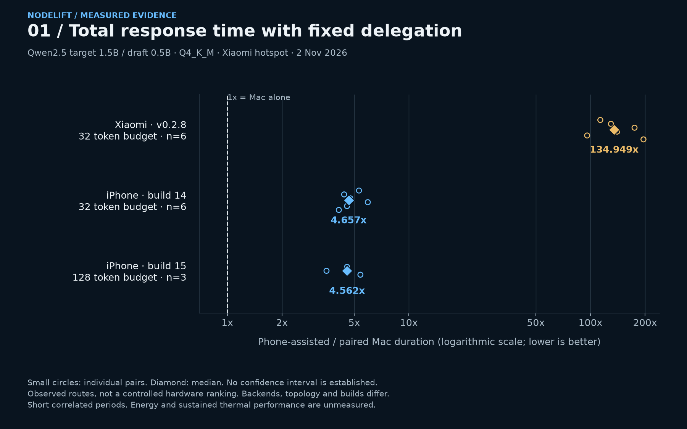
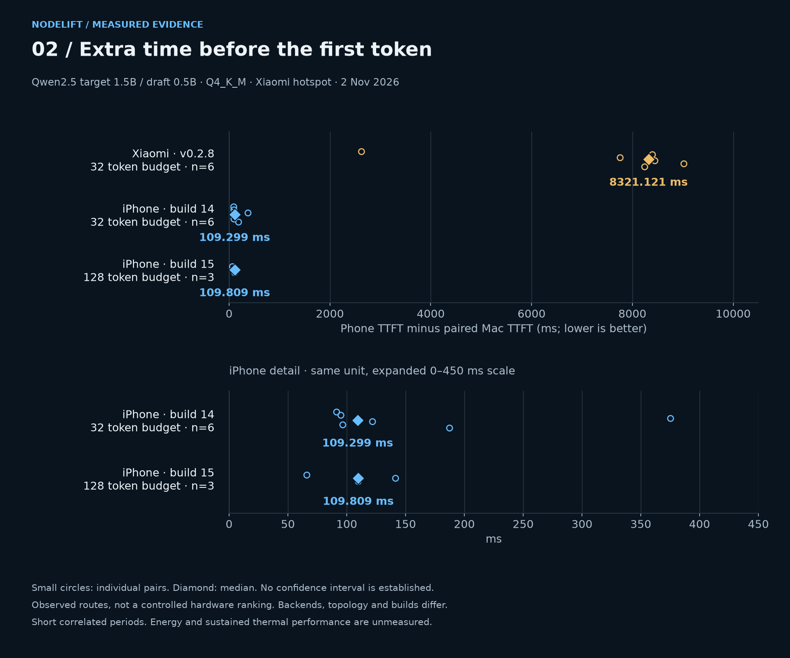
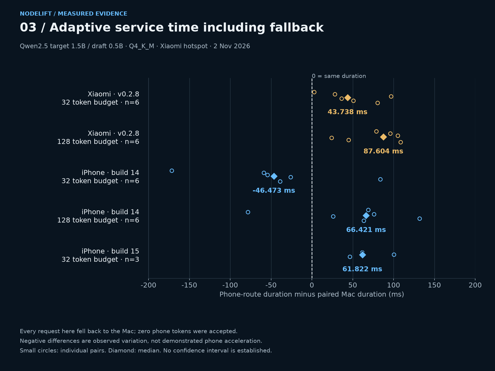
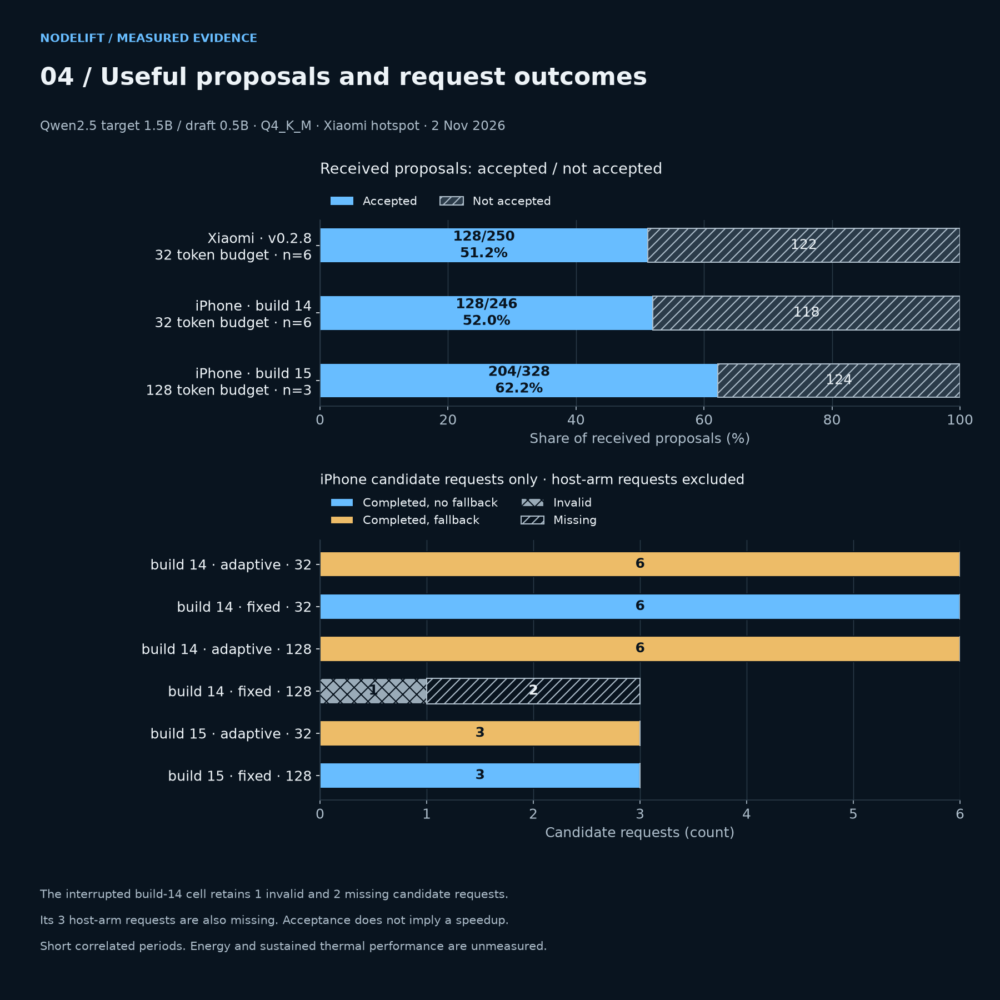

# Visual benchmarks: physical phone trade-offs

Measured 2 November 2026. These figures use retained public raw attempts, including the interrupted iPhone cell. They do not add new benchmarks or infer energy, shared memory or general hardware superiority.

[Open the localized gallery](https://www.fabriziodegni.com/NodeLift/#benchmark-charts). The site offers English by default, Simplified Chinese and Italian, plus full-size image links. Figures below are the canonical English versions.

## Total response time

Fixed delegation only. Each small circle is one output-equivalent pair; diamonds are medians of per-pair ratios. **1x is the paired Mac-only baseline; larger is slower.** The x-axis is logarithmic, not a zero-based bar scale. The 32- and 128-token budgets, builds and sample sizes stay separate. No confidence interval is established.



## First-token latency

Candidate TTFT minus its paired host TTFT. Positive values mean additional waiting. The lower panel repeats the iPhone data with an explicitly expanded 0–450 ms scale; it is not a separate sample.



## Adaptive fallback

Every candidate request shown here fell back to the host with zero phone tokens accepted. Negative service-time differences are observed variation; they cannot demonstrate acceleration by the phone. Expired work may still have consumed phone resources even when the host received no usable proposal.



## Contributions and incomplete evidence

Accepted and unaccepted received proposals sum to the displayed denominator; acceptance is not response speed. Request coverage uses **candidate requests only**, with different planned counts labelled on the axis. The interrupted build-14 fixed-128 cell retains one invalid candidate plus two missing candidates. Its three missing host-arm attempts also remain in the raw evidence. That cell has no valid paired duration and is not represented as zero latency.



## Scope, sources and reproduction

- [Xiaomi raw-study report](../phone-tradeoffs-2026-11-02/REPORT.md).
- [iPhone original and post-fix study](../iphone-tradeoffs-2026-11-02/REPORT.md).
- [Exact plotted rows and input SHA-256](chart-data.json), [image manifest](figures.json), [renderer](render.py).

The host target is Qwen2.5 1.5B Instruct Q4_K_M and the phone draft is Qwen2.5 0.5B Instruct Q4_K_M. Requested backends, companion builds, hotspot roles and host load differ between phone studies. The plots compare observed routes, not isolated SoC performance. These are short correlated periods; no independent confidence intervals, sustained thermal results or measured energy are available.

```sh
python3 -m venv /tmp/nodelift-figures
/tmp/nodelift-figures/bin/pip install -r research/visual-benchmarks-2026-11-02/requirements.txt
/tmp/nodelift-figures/bin/python research/visual-benchmarks-2026-11-02/render.py
```

On macOS the renderer uses the installed Heiti font for Chinese. Elsewhere, set `NODELIFT_CJK_FONT` to an installed Chinese-capable font such as Noto Sans CJK. The font is not distributed in this repository. Re-rendered pixels may vary with fonts or platform; numerical rows must remain unchanged.
